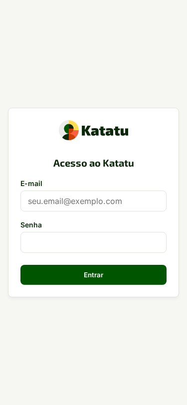

# 1. Avaliado ou Colaborador — Entrar por convite, Coleta e Carteira Pessoal

## Por que isto importa

No Katatu, você não perde tempo criando login e senha antes de participar de um mapeamento ou processo seletivo: o link do convite abre sua sessão imediatamente. Mais importante: **os certificados e cursos da sua Carteira Pessoal pertencem a você**. Quando você participa de processos em duas organizações diferentes (por exemplo, Organização A e Organização B), nenhuma delas enxerga o que você enviou para a outra até que você autorize explicitamente item por item.

## Passo a passo

1. Abra o link recebido no formato `/c/<token>` no celular ou computador. A sessão inicia automaticamente sem exigir cadastro prévio de senha.
2. Na etapa **Camada 0 (Qualificação e Currículo)**, envie seu currículo (`PDF`, `DOCX` ou imagem) ou informe o link público do seu perfil.
   - Tudo o que o assistente extrair do seu arquivo aparece destacado com o selo **A confirmar**. Revise cada linha antes de tocar em **Confirmar dados**.
3. Na etapa de **Conversa Situacional e Entrevista (Camadas 1 e 2)**, responda digitando ou usando o botão **Gravar resposta por voz**.
   - Ao usar voz, o áudio é transcrito na hora em memória temporária e **descartado imediatamente**: você sempre revisa e edita o texto transcrito na tela antes de tocar em **Salvar resposta**.
4. Ao concluir a coleta, acesse **Meu Retrato de Atuação** para consultar e exportar em `PDF` sua devolutiva construtiva (pontos de força observados e recomendações práticas de desenvolvimento, sem rótulos de "aprovado/reprovado" nem comparação com terceiros).
5. Para guardar sua conta para usos futuros, acesse **Carteira Pessoal > Promover conta**, defina seu e-mail/senha ou vincule sua conta Google.

## Exemplo concreto

**Marina Alves** recebe o convite para a posição de *Coordenadora Pedagógica* na **Rede Educacional Horizonte**. Ela abre o link no celular (`375px`), envia seu certificado de pós-graduação em Gestão Escolar (`PDF`) e grava por voz o relato de como conduziu uma mediação com famílias num conselho de classe crítico. O texto transcrito aparece na caixa de revisão; ela corrige a sigla de um projeto e toca em **Salvar resposta**. Mais tarde, convidada pela **Consultoria Prisma**, seu certificado aparece em **Quarentena de compartilhamento**: ela decide com 1 clique se deseja ou não compartilhá-lo com a segunda organização.

## Dicas e armadilhas

- **O que funciona bem:** revisar sempre os itens marcados como **A confirmar** logo após o upload do currículo — isso garante que datas no formato brasileiro (`dd/mm/aaaa`) e cargas horárias entrem exatas no abatimento do seu plano de 90 dias.
- **O que evitar (e a consequência):** não cole link de perfil fechado (como página do LinkedIn que exige login) esperando importação automática. O Katatu não usa robôs furtivos nem credenciais alheias; quando o link é fechado, o sistema exibe o aviso amigável para que você envie o PDF exportado do perfil ou preencha os campos manualmente.
- **Proteção contra convite indevido:** recebeu um e-mail de convite que não reconhece? Toque em **Não reconheço este convite**. A organização remetente fica bloqueada por **30 dias** de enviar novos convites para o seu endereço.

## Quando dá errado

| Mensagem na tela | O que significa | O que fazer |
| :--- | :--- | :--- |
| `link_fechado_requer_arquivo` | O endereço informado exige login ou bloqueia leitura pública. | Exporte o perfil em PDF (no LinkedIn: *Mais > Salvar como PDF*) e envie o arquivo, ou preencha manualmente. |
| `Serviço de transcrição temporariamente indisponível (503)` | A franquia ou provedor externo de IA não respondeu no tempo limite. | O campo de texto permanece aberto: digite sua resposta diretamente sem perder o rascunho. |
| `Convite expirado ou já utilizado` | O token do link atingiu a data de validade ou foi revogado pelo gestor. | Solicite um novo link de convite ao recrutador ou gestor da unidade. |

## Limites do papel

O avaliado/colaborador enxerga exclusivamente seus próprios dados, sua Carteira Pessoal, seu *Retrato de Atuação* e seu próprio plano *Katatu Gap*. Ele nunca vê outros candidatos, notas de corte internas nem o painel comparativo *Katatu Fit*.
