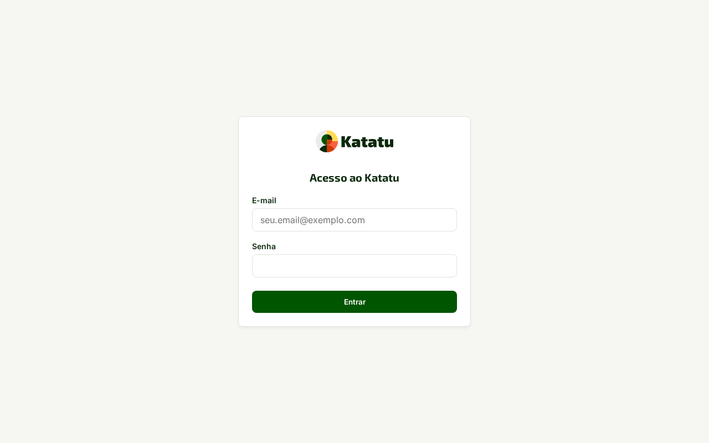
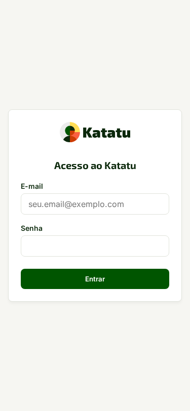

# 1. Avaliado ou Colaborador — Entrar por convite, Questionário de perfil e Meus dados e formação

**Primeiro acesso?** Comece por [Recebi um convite: primeiros passos](/primeiros-passos/), com as telas de cada etapa, do botão **Criar a minha conta** do e-mail até a conclusão do questionário.

## Por que isto importa

No Katatu, você não precisa cadastro antes de participar de um mapeamento ou processo seletivo: o link do convite leva você a criar a sua conta com nome e senha, em uma tela só, e já abre a sua sessão. Mais importante: **os certificados e cursos que você guarda no seu perfil pertencem a você**. Quando você participa de processos em duas organizações diferentes (por exemplo, Organização A e Organização B), nenhuma delas enxerga o que você enviou para a outra até que você autorize explicitamente item por item.

## Como você entra

Você entra no Katatu só com o seu e-mail e a sua senha. Não há código por e-mail a cada entrada.

O segundo passo, com código por e-mail ou com aplicativo autenticador, vale só para contas administrativas, como a de quem administra a organização. Se a tela pedir um código e você não administra nada, procure a administração da sua organização.

## Passo a passo

1. Abra o convite recebido por e-mail, no celular ou no computador. Se o e-mail trouxer o botão **Criar a minha conta**, crie a sua conta com nome e senha, como descrito em [Recebi um convite: primeiros passos](/primeiros-passos/#2-criar-a-sua-conta-pelo-link-do-convite). Se ele não trouxer o botão, entre pelo código por e-mail.
2. Na etapa **Sua trajetória**, escreva, fale ou envie o seu currículo (PDF com texto, Word `.docx`, `.txt` ou `.md`, até 10 MB). Se você já tem trajetória em **Meu Perfil › Trajetória**, ela aparece em **No seu perfil**, e você ajusta ali mesmo. **Continuar para as perguntas** já guarda o que estiver escrito.
   - Tudo o que o assistente extrair do seu arquivo aparece destacado com o selo **A confirmar**. Revise cada linha antes de tocar em **Confirmar dados**.
3. Na etapa de **Conversa Situacional e Entrevista (Camadas 1 e 2)**, responda digitando ou usando o botão **Gravar resposta por voz**.
   - Ao usar voz, o áudio é transcrito na hora em memória temporária e **descartado imediatamente**: você sempre revisa e edita o texto transcrito na tela antes de tocar em **Salvar resposta**.
   - Se a organização não tiver transcrição configurada, o botão de voz aparece desabilitado com o motivo; você digita a resposta normalmente.
   - Se a franquia de IA da organização tiver acabado no mês, o botão de voz também aparece desabilitado, com o aviso de que a IA está pausada até o próximo mês; o trabalho manual segue normalmente e você digita a resposta.
   - Se você tocar em **Confirmar e seguir** com um texto falado ainda não usado, o app pergunta se você quer **usar** ou **descartar** esse texto; nada se perde sem a sua decisão.
4. Ao concluir o questionário, acesse **Meu Retrato de Atuação** para consultar e exportar em `PDF` sua devolutiva construtiva (pontos de força observados e recomendações práticas de desenvolvimento, sem rótulos de "aprovado/reprovado" nem comparação com terceiros).
5. Seus dados civis ficam na aba **Meus dados e formação** do **Meu Perfil**. O currículo, os cursos e certificados e a sua trajetória ficam na aba **Trajetória** (veja as seções abaixo).

### Aceitar os Termos de Uso e a Política de Privacidade

Os Termos de Uso e a Política de Privacidade valem em duas partes: a da plataforma Katatu e a da sua organização. Quando uma delas ganha versão nova, o app mostra a tela de aceite antes de qualquer outra coisa.

- A tela mostra os termos da plataforma e os da organização juntos. Marque **Li e aceito os Termos de Uso** e **Li e aceito a Política de Privacidade**. O botão **Aceitar e continuar** só fica ativo depois que os dois documentos foram marcados.
- Enquanto houver uma versão nova pendente, nenhuma outra tela do app abre.
- Se não concordar, toque em **Não aceito os termos e saio**. A recusa encerra a sua sessão, e você só volta a usar o app depois de aceitar.
- Uma organização pode marcar uma versão como correção, que não muda o conteúdo de fato. Nesse caso você não precisa aceitar de novo.

**Dica:** o aceite fica registrado. Se o texto mudar e você quiser rever antes de aceitar, a tela mostra os documentos com a versão que está valendo.

### Registrar notas de realidade depois da posse

Na aba **Meu desenvolvimento**, a partir da data da sua posse, você pode registrar quantas notas quiser sobre o que está vivendo no cargo: por texto ou por voz, com as horas da semana, se quiser. Uma nota gravada não muda; só pode ser apagada, uma vez, por você. Seu gestor imediato também registra notas, e você as lê com o nome de quem escreveu.

Ao completar 90 dias, o Katatu convida você a deixar um **complemento final**. Responder é voluntário. O balanço de 90 dias é do seu gestor e só fica disponível para leitura depois de concluído.

### O que chega por e-mail

- **Pedido de avaliação:** quando a sua organização dispara uma campanha, você recebe um e-mail para cada avaliação que deve responder. Ele traz o nome de quem é avaliado, o prazo e a garantia de anonimato. Se a organização já tem acesso seu ao Katatu, o botão leva para responder dentro do app; se não tem, o link é pessoal e não pede conta. O e-mail nunca cita os outros respondentes.
- **Lembrete:** se você ainda não respondeu, pode receber um lembrete, no máximo um por dia. Ele reúne todas as avaliações pendentes num e-mail só. Quem já respondeu ou recusou não recebe.
- **Convite para o questionário de perfil de uma vaga:** quando a organização convida você como candidato, o e-mail traz um link pessoal para o questionário. Você não precisa criar conta. Se a vaga é confidencial, o e-mail vem como "Processo seletivo, via Katatu", sem o nome da organização.
- **Comunicado interno:** se você trabalha na organização, pode receber o comunicado de uma vaga da sua unidade, das unidades abaixo dela ou de outras unidades que a organização escolher. Vagas confidenciais nunca enviam comunicado.

**Dica:** se a organização tiver um contato cadastrado, o e-mail convida você a responder a ele. Sem contato, o e-mail diz para não responder.

### Responder campanhas de avaliação e ver suas avaliações

Quando a sua organização abre uma campanha de avaliação 90º, 180º ou 360º, você recebe pedidos para responder, como gestor imediato, mentor, par, liderado ou na sua própria autoavaliação. Eles aparecem em **Campanhas**, na seção **Para você responder**.

- Cada pedido tem até **3 perguntas**, por texto ou por voz revisada, e um prazo para responder. Responder é voluntário, mas a sua resposta entra no resultado da pessoa avaliada.
- Se preferir não responder, toque em **Prefiro não responder** e confirme. Você não precisa dar motivo. Por **30 dias** você não recebe novo pedido sobre a mesma pessoa avaliada. Essa opção não aparece na autoavaliação.
- Se a sua organização ainda não tem acesso seu ao app, o pedido aparece como **aguardando envio por e-mail**, e a campanha segue sem essa resposta.
- Respostas enviadas depois do prazo são recusadas.

Quando você é a pessoa avaliada, a campanha aparece em **Suas avaliações** só depois que o seu gestor imediato ou o seu mentor registra a conversa sobre o resultado. Antes disso, nada aparece para você. Depois, o resultado mostra as respostas agrupadas por grupo (gestor, mentor, autoavaliação, pares e liderados), embaralhadas, sem nome de quem respondeu nem data. Se um grupo tiver menos de 3 respostas, ele não aparece, e o resultado é marcado como **360º parcial**.

### Dizer se está aberto a outras posições

Na aba **Outras posições** do **Meu Perfil** você pode ligar **Aberto a outras posições**. Antes de ligar, o app mostra um aviso explicando o que muda. Ligado, você passa a aparecer como candidata no **Katatu Mapa** das posições de outras unidades, e só para o gestor da unidade da posição.

- Você pode desligar na hora, quando quiser. Desligado, você volta a aparecer apenas no Mapa da sua unidade e das unidades abaixo dela.
- Seu gestor imediato, a linha acima dele e quem gere a sua unidade **não veem** esse sinal, e ele não aparece em exportações nem em totais.
- O app guarda cada vez que você liga ou desliga, com a versão do aviso que você leu. Isso serve como registro do seu consentimento.

**Dica:** ligar o sinal não garante nenhuma vaga. Ele só permite que o gestor da outra unidade veja você como candidata na avaliação de sucessão.

### Vagas internas e "Quero participar"

Algumas vagas são **internas**: aparecem só para quem é da organização. Quando há uma vaga interna aberta para você, aparecem o cartão **Vagas internas abertas** no Início e o item **Vagas internas** no menu. Você não vê essa lista se não houver vaga interna aberta.

- Na lista, você vê as vagas abertas, menos a do cargo que você ocupa hoje.
- Toque em **Quero participar** para pedir. Você não precisa confirmar e-mail nem resolver verificação, porque já está logado. Depois do pedido, a vaga mostra **Pedido enviado em dd/mm**.
- Quem decide a vaga recebe o seu pedido e pode chamar você para o questionário de perfil. Nesse caso, você recebe o convite normal do questionário.
- Se o pedido não for aceito, o app não avisa. Para você, o pedido continua como **enviado**.
- Sua chefia imediata e a linha acima dela não são avisadas do seu pedido, nem veem que você pediu.

**Quero participar pelo mural público (para quem é de fora da organização):** o mural mostra as vagas abertas da organização, no site dela ou numa página pública. Em cada vaga há o botão **Quero participar**. Ao tocar nele, abre-se uma página nova com o título da vaga e o nome da organização.

- **O que você preenche:** seu nome e seu e-mail. Antes do envio, há uma verificação para confirmar que é uma pessoa. Ela roda sozinha, e o botão **Quero participar** só fica ativo depois que ela termina.
- **O código por e-mail:** ao enviar, a tela avisa que, se o e-mail puder receber, um código de 6 dígitos foi enviado. Na mesma página aparece o campo para digitar o código. Digite os 6 dígitos e toque em **Confirmar**. Você não cria senha e não troca de página.
- **Depois da confirmação:** a tela mostra **Pedido confirmado** e informa que quem decide a vaga já vê o seu pedido. Confirmar o e-mail não cria conta, não gera vínculo com a organização e não dá acesso ao Katatu. O app usa seus dados só para esta candidatura.
- **Se o código não chegar:** confira a caixa de spam e espere 15 minutos antes de pedir de novo. Um novo pedido para a mesma vaga, depois desse prazo e sem confirmação, manda um código novo. Antes disso, o código anterior continua valendo e nada novo é enviado. Depois de confirmado, o pedido não gera novo código.
- **Código incorreto ou vencido:** a tela pede que você confira o e-mail mais recente ou peça um código novo mais tarde.
- **Quando o pedido não é aceito:** vagas confidenciais e internas não recebem pedido pelo mural. Se a vaga já não estiver aberta, a página diz que ela não está mais aberta no site da organização. Se a organização já recebeu o limite de pedidos do dia para aquela vaga, a tela responde do mesmo jeito, mas nenhum e-mail sai. Tente outro dia.
- **Depois do pedido:** quem decide a vaga pode liberar você para o questionário de perfil. Nesse caso, você recebe o convite normal do questionário no seu e-mail. Se você não for escolhido, o app não avisa.

**Dica:** use um e-mail que você consulta com frequência, porque é nele que chegam o código e, se for o caso, o convite do questionário. O pedido não garante vaga: ele só permite que quem decide veja o seu interesse e avalie você.

### Banco de talentos

Na candidatura pelo mural e no convite para o questionário de perfil aparece a opção **Quero entrar no banco de talentos desta organização**.

- Com a marca, a organização guarda o seu nome, o seu e-mail e o que você respondeu, para chamar você em outras vagas. Quem decide a vaga vê que você está no banco.
- Sem a marca, esses dados saem 180 dias depois da última movimentação na vaga.
- Você pode sair quando quiser. Se já tem acesso ao app pelo convite do questionário, o cartão **Banco de talentos (opcional)** na página do questionário (menu **Meu questionário de perfil**) mostra a sua situação e permite entrar ou sair.

### Meus dados e formação, e Trajetória

No **Meu Perfil**, a aba **Meus dados e formação** guarda os seus dados pessoais, e a aba **Trajetória** guarda a sua formação. Só você lê e altera.

**Meus dados e formação:**

- **Dados civis:** nome civil, CPF, data de nascimento e telefone com DDD. O app não pede endereço. O CPF é opcional; quando você informa, ele aparece mascarado e não serve para procurar ninguém. Um CPF com dígito errado é recusado.
**Trajetória:**

- **Minha trajetória:** formação, experiência, cursos e certificados, que você acrescenta, corrige e apaga a qualquer momento. O questionário usa o que está aqui; cada questionário concluído guarda uma fotografia do que estava na trajetória naquele dia, e mudar depois não altera o que já foi concluído.
- **Acervo:** cursos, formações e certificados. Em cada certificado você guarda o tipo, o título, a instituição, a carga horária, a data de conclusão e o arquivo, em PDF ou imagem de até 5 MB.
- **Entra sozinho:** o curso que você aponta em **Meu desenvolvimento** aparece no acervo sem precisar digitar de novo.
- **Apagar:** apagar um item também apaga o arquivo do certificado, na hora. Não existe lixeira para isso.
- **Exportar:** você exporta tudo ou só os itens escolhidos, em planilha (XLSX ou CSV).
- **Currículo:** guarde o seu currículo uma vez (PDF com texto, Word .docx, .txt ou .md, até 10 MB) e troque, baixe ou apague quando quiser. O Katatu lê o arquivo inteiro e mostra o que você ainda não tem na trajetória, para confirmar ou descartar; o que já está lá não se repete. É só seu: nenhuma organização vê o arquivo, nem com o vínculo ativo. Arquivos `.doc` (Word antigo) não são lidos: no Word, use **Salvar como** › `.docx` ou PDF. Excluir a conta apaga o currículo, e a exportação dos seus dados o inclui.

### Aceitar, recusar ou não reconhecer um convite

Quando uma organização convida você, o convite aparece com três escolhas:

- **Aceitar o convite de (nome da organização):** antes de confirmar, o app mostra um aviso com exatamente o que aquela organização passa a ver: seus dados pessoais e o acervo, com os arquivos. Depois que você confirma, quem lê as pessoas da organização vê os seus dados e a sua formação, com o CPF mascarado. Sem esse vínculo, a organização não vê nada.
- **Recusar:** apaga o convite. A organização vê só "recusado". Ela pode convidar você de novo depois, sem bloqueio.
- **Não reconheço:** use quando você não sabe quem é a organização. Apaga o convite e a ficha que ela criou para você, na hora e sem lixeira. A organização fica bloqueada por **30 dias** de convidar esse mesmo e-mail. Para ela, o convite aparece só como "recusado".

**Dica:** se você conhece a organização e só não quer entrar, use **Recusar**. Use **Não reconheço** quando não sabe quem ela é.

### Trocar o e-mail de acesso

Para entrar no Katatu com outro e-mail, vá em **Meu Perfil**, aba **Conta**, seção **E-mail de acesso**. Ela mostra o e-mail que você usa hoje. A troca só vale quando você prova, ao mesmo tempo, que tem acesso ao e-mail de hoje e ao e-mail novo. Por isso são dois passos:

1. **Peça a troca.** Digite o e-mail novo e toque em **Enviar link ao e-mail atual**. O app pede a confirmação do segundo passo (o código do aplicativo autenticador, a passkey ou o código por e-mail). Um e-mail com um link chega ao seu e-mail **de hoje**, nunca ao novo. Enquanto você não abre o link, nada muda e a seção mostra o pedido pendente. Você pode cancelá-lo ou pedir de novo com outro e-mail; um pedido novo substitui o anterior.
2. **Abra o link e digite o código.** Na página que o link abre, o app mostra o e-mail novo. Toque em **Enviar código ao novo e-mail**; um código de 6 dígitos chega lá. Digite o código e toque em **Confirmar a troca**. O código vale 15 minutos e pode ser pedido de novo. Cinco códigos errados cancelam o pedido, e você precisa pedir a troca outra vez.

**Quando vale:** a partir da confirmação, você entra pelo e-mail novo, e o antigo deixa de entrar. As suas organizações, os seus papéis e os seus dados e a sua formação ficam como estavam. Os outros aparelhos em que você estava entrando são desconectados (aquele em que você confirmou continua). O e-mail novo recebe um aviso de que passou a ser o de acesso. Passkeys e aplicativo autenticador continuam valendo.

**Se não foi você quem pediu:** ignore o e-mail com o link (na página do link, você também pode tocar em **Não fui eu**). O pedido vence sozinho em 48 horas e nada muda.

**Se você perdeu o acesso ao e-mail antigo:** sem ele, não há como abrir o link. Peça à administração da sua organização para trocar o seu e-mail de acesso (veja [Trocar o e-mail de acesso de quem perdeu o antigo](/5-admin-organizacao/#trocar-o-e-mail-de-acesso-de-quem-perdeu-o-antigo)). Se você participa de mais de uma organização, a administração orienta a procurar o suporte da plataforma.

### Pedir a exclusão dos seus dados em uma organização

Na aba **Excluir meus dados** do **Meu Perfil** aparece, para cada organização em que você tem dados, o botão **Pedir a exclusão dos meus dados em (nome da organização)**.

- O pedido é atendido na hora. Você perde o acesso àquela organização, e os seus dados nela são apagados, menos o que a lei manda guardar.
- Sua conta e as suas outras organizações não mudam.
- Antes de confirmar, o app pede a confirmação. Sem a verificação em duas etapas ativa, ele pede para ativá-la antes.
- Se você é o único administrador da organização inteira, o app recusa o pedido e pede que você passe a função para outra pessoa antes.
- O que a lei manda guardar fica fora das telas e não entra em cálculos. Depois do pedido, o app mostra a lista do que ficou, com o motivo e até quando. Por exemplo: aceites e registros de auditoria ficam por 5 anos; o registro da posse e do acordo de desenvolvimento de quem foi contratado fica enquanto durar o vínculo, mais 2 anos; as certidões exigidas pelo ECA ficam até vencerem.

Isto não se desfaz. Para voltar a essa organização, você precisa receber um novo convite.

### Excluir a sua conta

Na aba **Conta** do **Meu Perfil**, no fim da página, está o botão **Excluir minha conta**. O app pede confirmação e, depois dela, apaga na hora:

- os seus dados e a sua formação, o acervo e os arquivos;
- o seu acesso e os seus vínculos com todas as organizações.

Não há como desfazer. Para entrar de novo, você precisa receber um novo convite.

O que você registrou para as organizações, como notas, balanços, campanhas e marcações, continua com elas, mas sem o seu nome. As certidões exigidas pelo ECA ficam com a organização até vencerem. Se você é o único administrador de uma organização inteira, passe a função para outra pessoa antes de excluir a conta.

## Exemplo concreto

**Marina Alves** recebe o convite para a posição de *Coordenadora Pedagógica* na **Rede Educacional Horizonte**. Ela abre o link no celular (`375px`), envia seu certificado de pós-graduação em Gestão Escolar (`PDF`) e grava por voz o relato de como conduziu uma mediação com famílias num conselho de classe crítico. O texto transcrito aparece na caixa de revisão; ela corrige a sigla de um projeto e toca em **Salvar resposta**. Mais tarde, convidada pela **Consultoria Prisma**, seu certificado aparece em **Quarentena de compartilhamento**: ela decide com 1 clique se deseja ou não compartilhá-lo com a segunda organização.

## Dicas e armadilhas

- **O que funciona bem:** revisar sempre os itens marcados como **A confirmar** logo após o upload do currículo — isso garante que datas no formato brasileiro (`dd/mm/aaaa`) e cargas horárias entrem exatas no abatimento do seu plano de 90 dias.
- **Currículo Lattes ou LinkedIn:** o questionário não lê páginas da internet. Abra o seu currículo no navegador, use **Imprimir › Salvar como PDF** e envie o PDF (ou guarde-o em **Meu Perfil › Trajetória**). PDF escaneado, que é só imagem, não tem texto para ler e é recusado.
- **Proteção contra convite indevido:** recebeu um convite de uma organização que não reconhece? Toque em **Não reconheço**. A organização fica bloqueada por **30 dias** de enviar novos convites para o seu endereço (veja a seção Aceitar, recusar ou não reconhecer um convite).

## Quando dá errado

| Mensagem na tela | O que significa | O que fazer |
| :--- | :--- | :--- |
| "Não consegui ler texto nesse arquivo" | O PDF é uma imagem escaneada, sem texto. | Gere o PDF pelo navegador (**Imprimir › Salvar como PDF**) ou envie Word, .txt ou .md. |
| `Serviço de transcrição temporariamente indisponível (503)` | A franquia ou provedor externo de IA não respondeu no tempo limite. | O campo de texto permanece aberto: digite sua resposta diretamente sem perder o rascunho. |
| `Convite expirado ou já utilizado` | O token do link atingiu a data de validade ou foi revogado pelo gestor. | Solicite um novo link de convite ao recrutador ou gestor da unidade. |
| "Este link não vale mais" (na página da troca de e-mail) | O link venceu (48 horas), já foi usado, os cinco códigos errados cancelaram o pedido ou você fez um pedido novo depois. | Peça a troca de novo em **Meu Perfil › Conta**. |
| "Código incorreto" (na página da troca de e-mail) | O código de 6 dígitos não confere. A mensagem diz quantas tentativas restam. | Use o código do e-mail **mais recente** que chegou ao e-mail novo, ou toque em **Reenviar o código**. |
| "Nada mudou" (na página da troca de e-mail) | O e-mail novo não pôde ser usado. | Peça a troca de novo, com outro endereço. |

## Limites do papel

O avaliado/colaborador enxerga exclusivamente seus próprios dados (as abas Meus dados e formação e Trajetória), seu *Retrato de Atuação*, seu próprio plano *Katatu Gap* e, depois que a conversa é registrada, o seu resultado de campanha de avaliação. Ele nunca vê outros candidatos, quem respondeu cada avaliação, notas de corte internas nem o painel comparativo *Katatu Fit*.
