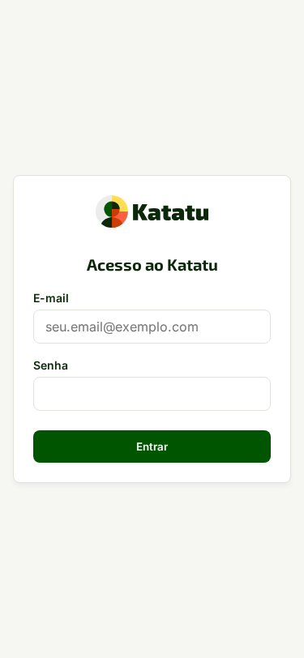
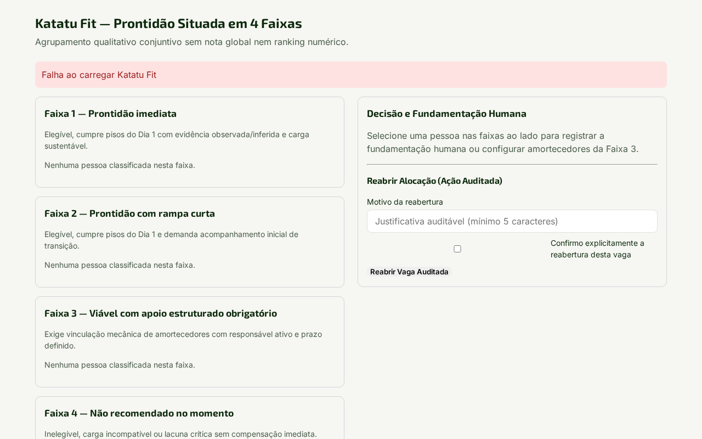
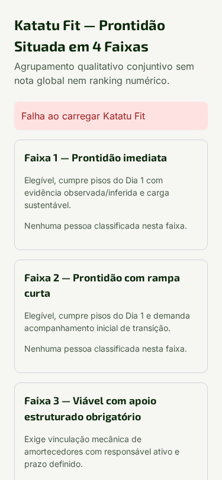

# 2. Gestor ou Recrutador — Matriz Situada, Coleta e Decisão (*Katatu Fit* e *Gap*)

## Por que isto importa

Avaliações tradicionais falham porque usam descrições genéricas de cargo ("boa comunicação", "proatividade") e tiram uma média que esconde lacunas graves. No Katatu, você desenha a **Matriz Situada da Função** nos **4 eixos reais de trabalho** e define dois marcos separados para cada competência (`0` a `3`): o **Piso (Dia 1)** — abaixo do qual a pessoa não consegue operar com segurança no primeiro dia — e o **Pleno (Dia 90)** — o patamar esperado após três meses com suporte. O motor *Katatu Fit* é **100% determinístico**: nenhum desvio abaixo do piso é mascarado por nota alta em outra competência.

## 2.1 Construir a Matriz Situada nos 4 eixos e coletar perspectivas

1. No menu da organização, abra **Matrizes Situadas** e clique em **Nova Matriz Situada**.
2. Escolha o modo de operação:
   - **Modo A (Vaga aberta / Seleção):** para contratação externa ou mobilidade interna.
   - **Modo B (Posição ocupada / Exercício):** para mapear quem já atua na função.
3. Preencha os **4 eixos situados obrigatórios**:
   - **Eixo 1 — Autonomia imediata no Dia 1 vs. o que aguarda até 90 dias;**
   - **Eixo 2 — Incidentes críticos reais da função;**
   - **Eixo 3 — Densidade relacional e ambiguidade do ambiente;**
   - **Eixo 4 — Carga semanal realista, picos sazonais e janelas fixas.**
4. Para calibrar a matriz sem viés de uma única pessoa, clique em **Convidar perspectiva** (`/p/<token>`) e envie o link para pares, ocupantes atuais ou especialistas responderem em até 10 minutos no celular ou desktop.
5. Defina para cada competência o **Piso (`0..3`)**, o **Pleno (`0..3`)**, os critérios de **Elegibilidade** (`atendido`, `compensavel` ou `impedido`) e os **Amortecedores disponíveis** na equipe (dupla titularidade nos primeiros 30 dias, mentoria semanal, alçada assistida).

## 2.2 Analisar o *Katatu Fit* (4 Faixas Conjuntivas)

Abra **Decisão > Katatu Fit** na vaga desejada. O motor classifica cada pessoa de forma determinística em uma das quatro faixas:

- **Faixa 1 — Prontidão Plena:** zero competências abaixo do Piso (`delta_piso < 0`), maioria das competências já no nível Pleno (`delta_pleno >= 0`), estilo convergente e viabilidade de carga sustentável.
- **Faixa 2 — Prontidão de Piso com Trilha de 90 Dias:** zero competências abaixo do Piso (`delta_piso < 0`), mas com competências ainda entre o Piso e o Pleno (`delta_pleno < 0`), que viram itens de desenvolvimento no *Katatu Gap*.
- **Faixa 3 — Alocação Condicionada a Amortecedores:** possui desvio abaixo do Piso (`delta_piso < 0`) ou carga limítrofe, **exigindo amortecedor formal, responsável nominal e prazo** para cada lacuna antes da posse.
- **Faixa 4 — Impedimento Objetivo no Momento:** requisito inegociável de elegibilidade no estado `impedido` ou carga `incompativel`.

## 2.3 Aprovar posse na Faixa 3 e gerar o *Katatu Gap*

1. Na mesa de decisão do *Katatu Fit*, selecione o avaliado e clique em **Converter em Posse e Gerar Katatu Gap**.
2. **Trava mecânica da Faixa 3:** se o avaliado estiver na **Faixa 3**, o botão exige que, para **cada** competência com `delta_piso < 0`, você vincule:
   - O **amortecedor organizacional** (ex.: *Revisão em par das entregas críticas nas primeiras 4 semanas*);
   - O **responsável nominal** pelo acompanhamento;
   - O **prazo de verificação** dentro da janela de 90 dias.
3. Caso o avaliado possua cursos na **Carteira Pessoal** que cubram itens da trilha sugerida, marque ou aceite as equivalências individualmente ou em lote pela `ListaComAcoes`.
4. Confirmada a posse, o registro transita imediatamente do **Modo A (Seleção)** para o **Modo B (Acompanhamento de 90 Dias)** e habilita o registro de notas semanais de evolução (`declarado -> observado`) e o **Balanço de 90 Dias**.

## Quando dá errado

| Mensagem na tela | O que significa | O que fazer |
| :--- | :--- | :--- |
| `422 amortecedor_obrigatorio_pendente` | Tentativa de dar posse a uma pessoa na Faixa 3 sem preencher amortecedor, responsável e prazo para cada item abaixo do Piso. | Preencha os três campos obrigatórios em todas as lacunas listadas antes de confirmar a posse. |
| `402 licenca_expirada_novos_ciclos_bloqueados` | A licença da instalação venceu após os 14 dias de carência. | Vagas abertas, *Katatu Gap*, *Mapa* e exportações continuam funcionando; peça ao `admin_servico` para renovar a chave `V3RLicense`. |
