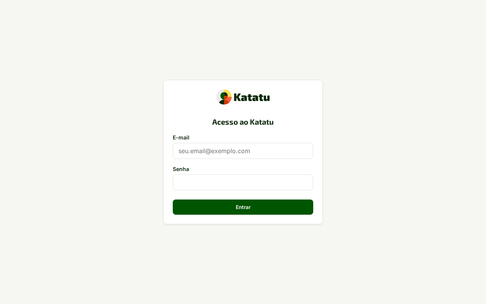
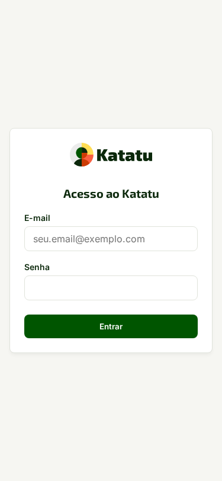
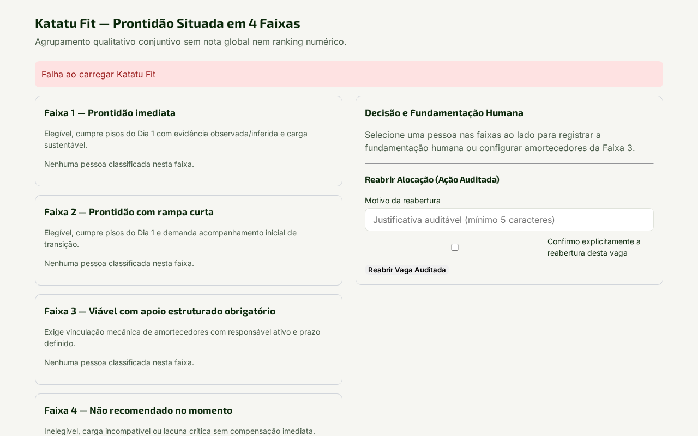
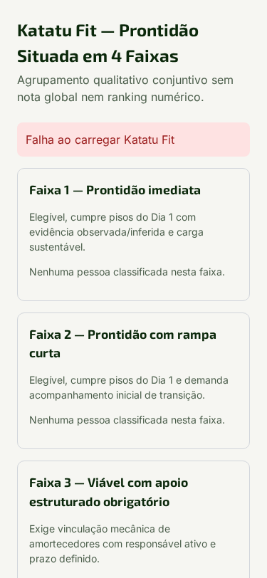

# 2. Gestor ou Recrutador — Matriz Situada, Coleta e Decisão (*Katatu Fit* e *Gap*)

## Por que isto importa

Avaliações tradicionais falham porque usam descrições genéricas de cargo ("boa comunicação", "proatividade") e tiram uma média que esconde lacunas graves. No Katatu, você desenha a **Matriz Situada da Função** nos **4 eixos reais de trabalho** e define dois marcos separados para cada competência (`0` a `3`): o **Piso (Dia 1)** — abaixo do qual a pessoa não consegue operar com segurança no primeiro dia — e o **Pleno (Dia 90)** — o patamar esperado após três meses com suporte. O motor *Katatu Fit* é **100% determinístico**: nenhum desvio abaixo do piso é mascarado por nota alta em outra competência.

## 2.1 Construir a Matriz Situada nos 4 eixos e coletar perspectivas

1. No menu da organização, abra **Matrizes Situadas** e clique em **Nova Matriz Situada**.
2. Escolha o modo de operação:
   - **Modo A (Vaga aberta / Seleção):** para contratação externa ou mobilidade interna.
   - **Modo B (Posição ocupada / Exercício):** para mapear quem já atua na função.
3. Preencha os **4 eixos situados obrigatórios**:
   - **Eixo 1 — Autonomia imediata no Dia 1 vs. o que aguarda até 90 dias;**
   - **Eixo 2 — Incidentes críticos reais da função;**
   - **Eixo 3 — Densidade relacional e ambiguidade do ambiente;**
   - **Eixo 4 — Carga semanal realista, picos sazonais e janelas fixas.**
4. Para calibrar a matriz sem viés de uma única pessoa, clique em **Convidar perspectiva** (`/p/<token>`) e envie o link para pares, ocupantes atuais ou especialistas responderem em até 10 minutos no celular ou desktop.
5. Defina para cada competência o **Piso (`0..3`)**, o **Pleno (`0..3`)**, os critérios de **Elegibilidade** (`atendido`, `compensavel` ou `impedido`) e os **Amortecedores disponíveis** na equipe (dupla titularidade nos primeiros 30 dias, mentoria semanal, alçada assistida).

## 2.2 Analisar o *Katatu Fit* (4 Faixas Conjuntivas)

Abra **Decisão > Katatu Fit** na vaga desejada. O motor classifica cada pessoa de forma determinística em uma das quatro faixas:

- **Faixa 1 — Prontidão Plena:** zero competências abaixo do Piso (`delta_piso < 0`), maioria das competências já no nível Pleno (`delta_pleno >= 0`), estilo convergente e viabilidade de carga sustentável.
- **Faixa 2 — Prontidão de Piso com Trilha de 90 Dias:** zero competências abaixo do Piso (`delta_piso < 0`), mas com competências ainda entre o Piso e o Pleno (`delta_pleno < 0`), que viram itens de desenvolvimento no *Katatu Gap*.
- **Faixa 3 — Alocação Condicionada a Amortecedores:** possui desvio abaixo do Piso (`delta_piso < 0`) ou carga limítrofe, **exigindo amortecedor formal, responsável nominal e prazo** para cada lacuna antes da posse.
- **Faixa 4 — Impedimento Objetivo no Momento:** requisito inegociável de elegibilidade no estado `impedido` ou carga `incompativel`.

## 2.3 Aprovar posse na Faixa 3 e gerar o *Katatu Gap*

1. Na mesa de decisão do *Katatu Fit*, selecione o avaliado e clique em **Converter em Posse e Gerar Katatu Gap**.
2. **Trava mecânica da Faixa 3:** se o avaliado estiver na **Faixa 3**, o botão exige que, para **cada** competência com `delta_piso < 0`, você vincule:
   - O **amortecedor organizacional** (ex.: *Revisão em par das entregas críticas nas primeiras 4 semanas*);
   - O **responsável nominal** pelo acompanhamento;
   - O **prazo de verificação** dentro da janela de 90 dias.
3. Caso o avaliado possua cursos na **Carteira Pessoal** que cubram itens da trilha sugerida, marque ou aceite as equivalências individualmente ou em lote pela `ListaComAcoes`.
4. Confirmada a posse, o registro transita imediatamente do **Modo A (Seleção)** para o **Modo B (Acompanhamento de 90 Dias)** e habilita o registro de notas semanais de evolução (`declarado -> observado`) e o **Balanço de 90 Dias**.

## 2.4 Acompanhar a pessoa depois da posse

Depois da posse, o acompanhamento fica em **Campanhas › Acompanhamentos**. Quem vê a lista são o **gestor imediato** (o responsável do cargo logo acima) e o **mentor**, quando a pessoa tem um na linha pontilhada do organograma. Você só aparece nos acompanhamentos em que é um desses dois papéis, e não pode confirmar nem fazer o balanço da própria posição, mesmo que também ocupe o cargo de cima.

A tela tem três abas:

1. **Plano:** as etapas e entregas que a pessoa apontou como *declaradas*. Você confirma cada uma, uma a uma ou em lote, e ela passa a *observada*, com quem confirmou e quando. Confirmar é o que faz a etapa contar como concluída.
2. **Notas de realidade:** o que a pessoa e você registraram sobre o trabalho real, por texto ou por voz, com as horas da semana quando forem informadas. Todas ficam visíveis para quem acompanha. Uma nota gravada não muda; só pode ser apagada, uma vez, por quem a escreveu.
3. **Balanço:** o balanço de 90 dias, que só você (gestor imediato) conclui, e só a partir do 90º dia após a posse, no fuso da organização. Ele compara as horas dedicadas com as horas típicas previstas para o cargo, avalia se cada compensação combinada na posse funcionou e registra uma síntese.

**Como ler o resultado:**

- **Sem dados:** não houve notas. Isso não é média zero, é falta de registro; peça notas antes de concluir.
- **Acima do previsto:** só aparece com as horas das notas. Uma nota sozinha não basta para afirmar que houve excesso.
- **Concluído:** o balanço fica só para leitura, com o nome de quem escreveu cada nota. Ele não muda depois de concluído.

**Balanço de fim de ciclo:** abre na data em que termina o mandato do cargo, numa aba própria. Se o cargo não tem data de fim, ele não tem esse balanço.

**Dica:** confirme as etapas logo depois que a pessoa aponta, e não espere o dia 90. Assim o balanço já encontra o plano atualizado.

## 2.5 Criar, disparar, encerrar e conversar sobre campanhas de avaliação

Uma campanha de avaliação acontece dentro de uma **janela do calendário institucional** (90º, 180º ou 360º), cadastrada pela administração da organização, e vale para uma unidade. Em **Campanhas**, você vê os pedidos para responder, as conversas que precisa mediar e, se cuida das campanhas, a lista das campanhas da unidade.

1. **Criar:** em **Nova campanha**, escolha a janela do calendário e a unidade, e escreva até **3 perguntas**. A campanha cria uma avaliação para cada ocupante de posição de cargo da unidade e das unidades abaixo dela. Quem ocupa dois cargos é avaliado uma vez em cada um. Nada é enviado ainda.
2. **Quem responde** vem do organograma. Em todas as campanhas, o gestor imediato e o mentor (na linha pontilhada) respondem. No 180º entram também a autoavaliação. No 360º entram ainda os **pares** (cargos com o mesmo chefe imediato, mais as outras posições do mesmo cargo) e os **liderados** (cargos logo abaixo).
3. **Disparar:** abre os pedidos para quem responde no app. Só é possível dentro da janela vigente e com a licença da organização em dia. Disparar uma campanha que já foi disparada não cria uma segunda rodada. Você pode disparar uma pessoa ou um lote, sempre com confirmação. Se o cargo não tem gestor imediato ocupado no organograma, a pessoa não pode ser disparada: indique quem ocupa o cargo de cima.
4. **Acompanhar:** cada pessoa avaliada mostra quantos pedidos foram respondidos, recusados ou ainda aguardam. Quem não tem acesso ao app fica com o pedido **aguardando envio por e-mail**, e a campanha segue sem essa resposta.
5. **Recusas:** quem prefere não responder não precisa dar motivo. Essa pessoa não recebe novo pedido sobre a mesma avaliada por 30 dias, e a recusa conta como resposta que falta.
6. **Encerrar:** você encerra uma pessoa ou um lote. O que ainda estiver aberto fecha sozinho no fim da janela; a verificação acontece quando alguém da organização abre a área de Campanhas ou consulta o *Mapa*, que nunca mostra uma campanha vencida como aberta. Depois de encerrada, a avaliação não reabre e o resultado não muda. Respostas atrasadas são recusadas.
7. **Resultado e conversa:** o resultado junta as respostas por grupo (gestor, mentor, autoavaliação, pares e liderados), embaralhadas, sem nome nem data. Pares e liderados só aparecem com pelo menos 3 respostas; abaixo disso, esse grupo some e o resultado aparece como **360º parcial**.
8. **Antes de a pessoa ver:** a pessoa avaliada só vê o resultado depois que você (gestor imediato) ou o mentor conversa com ela e registra a conversa em **Registrar a conversa**. Essa confirmação não se desfaz. Depois dela, o resultado aparece em "Suas avaliações" da pessoa.

**Dica:** leia o resultado antes da conversa. As respostas de pares e liderados aparecem só agrupadas; não tente descobrir quem escreveu cada uma.

## 2.6 Ler o *Katatu Mapa* e a sucessão de cada cargo

O **Katatu Mapa** (em **Mapa**, no menu) mostra, para cada cargo da sua unidade, quem pode assumir. Ele é calculado na hora, a partir das avaliações e dos processos da própria unidade, por isso sempre reflete o estado atual.

A lista de cargos mostra quatro colunas:

- **Cobertura:** sucessão imediata (um candidato na Faixa 1 ou 2), programada (candidato com estilo compatível cuja trilha cabe no prazo até o fim do ciclo) ou ninguém, ou sem dados.
- **Sucessores:** quem aparece como candidato a cada cargo.
- **Sobrecarga:** aparece quando, em dois processos seletivos seguidos, um candidato capaz foi recusado por causa da carga, ou o balanço de 90 dias ficou acima do previsto.
- **Última avaliação:** a data e o tipo da última campanha encerrada do ocupante.

Use o filtro por unidade para ver uma parte da organização. No detalhe de cada cargo aparecem os candidatos de baixo no organograma, com a faixa, os meses de preparo e o que falta a cada um.

- **Sem dados:** a faixa só aparece para quem concluiu a coleta na Matriz daquele cargo. Quem não concluiu aparece como "sem dados: falta coleta para esta cadeira", com a ação **Convidar para a coleta**. Não é zero: é falta de registro.
- **Não selecionado:** quem levou "não" na escolha do Fit para um cargo fica fora do Mapa desse cargo até abrir um novo processo seletivo.
- **Pessoas que sinalizaram "Aberto a outras posições":** aparecem como candidatas, mas você só as vê no Mapa de cargos da sua unidade.

Para levar a lista a uma reunião, selecione os cargos e exporte em **PDF**, **XLSX** ou **CSV**. A exportação traz os nomes, porque você é o gestor da unidade.

**Dica:** o Mapa não é uma nota. Ele mostra quem está pronto e o que falta; a decisão de sucessão continua sendo sua.

## 2.7 Vagas no site da organização e no WordPress

Em **Vagas**, o botão **Vagas no site** leva à página onde você publica as vagas no site da organização. Só vagas que estão prontas aparecem para publicar: a vaga precisa estar oficializada, aberta e com o anúncio aprovado no canal **página da vaga**. Sem esse anúncio, a vaga não vai ao site.

- **Mural:** cada organização tem uma página pública com as vagas prontas. A página **Vagas no site** traz o trecho para colar no site da organização; você pode filtrar o trecho por unidade.
- **WordPress:** publique a vaga no WordPress da organização. Cada vaga vira um post que já sai publicado. Quando você edita a vaga ou aprova um anúncio novo, o post é atualizado. Ao encerrar, suspender, apagar ou marcar a vaga como confidencial ou interna, o post sai do ar.
- **Em lote:** você pode publicar, atualizar ou retirar várias vagas de uma vez. Cada vaga é tratada sozinha: se uma falhar, as outras seguem, e o resultado mostra quais deram certo e quais falharam.
- **Vaga confidencial:** por enquanto, ela não aparece no mural nem vai ao WordPress. Ao tentar publicar, o app explica o motivo.
- **Vaga interna:** também não vai ao mural nem ao WordPress. Ela só aparece para as pessoas da organização (veja o capítulo 1).

**Dica:** antes de publicar, confira no mural se o texto da vaga está como você quer. Depois de publicado, qualquer edição na vaga é refletida no site.

## 2.8 Lixeira: apagar e restaurar

Apagar no Katatu não é para sempre. O que você apaga sai na hora de todas as listas, telas e cálculos, inclusive do *Katatu Mapa*, e vai para a **Lixeira**. Lá ele fica 30 dias e pode voltar com um clique, igual a como estava.

**O que vai para a lixeira:** vagas, rascunhos de anúncio, coletas, campanhas de avaliação (com as avaliações delas), avaliações de campanha e notas de realidade do acompanhamento.

**O que vai junto com a vaga:** os anúncios, os interessados, o post do site e os convites da vaga. As coletas e as decisões do *Katatu Fit* **não** vão junto, porque são da Matriz Situada e podem servir a outra vaga da mesma Matriz e ao *Mapa*. Para tirar uma coleta, apague a coleta.

**Vaga com posse registrada:** não vai para a lixeira. A pessoa já está no cargo, e o acompanhamento dela nasce da posse. Para tirar a vaga da lista, **encerre** a vaga.

**Para restaurar:**

1. Abra **Lixeira** no menu.
2. Encontre o item. A lista mostra o que é, quem apagou, quando e a data a partir da qual ele pode ser excluído de vez.
3. Clique em **Restaurar** na linha, ou marque vários itens e restaure em lote. O resultado separa o que voltou, o que foi recusado (com o motivo) e o que falhou.

**Quem restaura:** quem apagou, se ainda tiver o direito de apagar aquele item na unidade dele, e a Administração da organização. Se você mudou de função e perdeu esse direito, peça à Administração.

**O que volta e o que não volta:**

- O item volta igual, com os vínculos e o histórico.
- A vaga restaurada volta sozinha ao mural do site da organização. No WordPress, publique de novo em **Vagas no site**.
- Os convites não são reenviados: se a pessoa precisa voltar a responder, convide de novo.
- A campanha volta com as avaliações que estavam valendo quando ela foi apagada. Uma avaliação apagada antes da campanha continua na lixeira e volta sozinha, depois da campanha.
- Uma avaliação só volta com a campanha dela fora da lixeira, e um rascunho de anúncio só volta com a vaga dele fora da lixeira.

**Exclusão de vez:** não existe botão para excluir de vez. Depois dos 30 dias, quem exclui é a rotina de retenção dos dados da organização; até ela rodar, o item continua na lixeira com o aviso "exclusão pendente". Um item com retenção legal mostra o motivo e não é excluído.

**Seus próprios dados:** o que você apaga no **Meu Perfil** sobre você mesmo sai na hora e não passa pela lixeira.

**Dica:** antes de apagar uma vaga que já preencheu, prefira **encerrar**. A vaga encerrada continua no histórico, sem aparecer nas listas de vagas abertas.

## Quando dá errado

| Mensagem na tela | O que significa | O que fazer |
| :--- | :--- | :--- |
| `422 amortecedor_obrigatorio_pendente` | Tentativa de dar posse a uma pessoa na Faixa 3 sem preencher amortecedor, responsável e prazo para cada item abaixo do Piso. | Preencha os três campos obrigatórios em todas as lacunas listadas antes de confirmar a posse. |
| `402 licenca_expirada_novos_ciclos_bloqueados` | A licença da instalação venceu após os 14 dias de carência. | Vagas abertas, *Katatu Gap*, *Mapa* e exportações continuam funcionando; peça ao `admin_servico` para renovar a chave `V3RLicense`. |
| "Esta vaga já tem posse registrada: encerre a vaga em vez de apagá-la." | A vaga já tem uma pessoa empossada; apagar faria sumir o acompanhamento dela. | Use **Encerrar** na vaga. |
| "Só quem apagou, ainda com o direito de apagar este item, ou a Administração restaura." | Você não apagou o item, ou não tem mais o direito de apagá-lo na unidade dele. | Peça à Administração da organização para restaurar. |
| "Esta pessoa já tem outra coleta ativa nesta Matriz." | A coleta apagada não volta por cima de outra coleta valendo da mesma pessoa. | Use a coleta que está valendo, ou cancele-a antes de restaurar a antiga. |
| "A campanha desta avaliação está na lixeira: restaure a campanha antes." | A avaliação só volta com a campanha dela fora da lixeira. | Restaure a campanha primeiro. |
