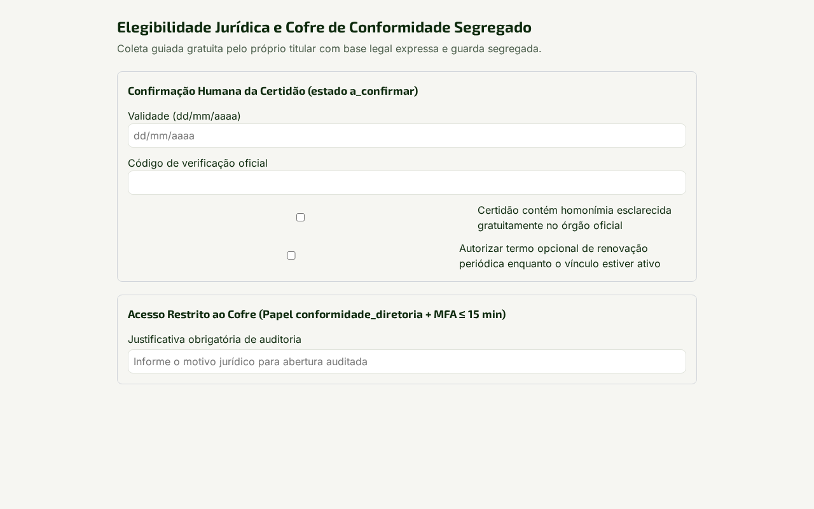
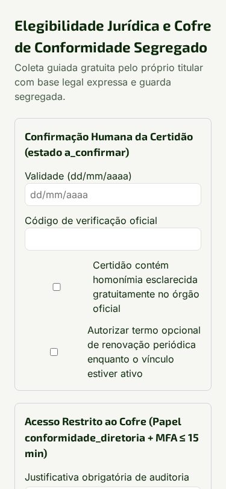

# 3. Conformidade e Diretoria — Cofre de Conformidade Segregado

## Por que isto importa

Certidões de antecedentes ou certidões judiciais nunca podem ser pedidas de forma indiscriminada nem misturadas ao perfil comportamental do candidato. No Katatu, o **Cofre de Conformidade** vive num schema físico segregado (`cofre_conformidade`), acessível exclusivamente por conexão própria do banco e restrito ao papel `conformidade_diretoria` com **MFA TOTP obrigatório**. Toda leitura exige justificativa e grava rastro imutável em `auditoria.acessos_cofre`.

## Passo a passo

1. Antes de habilitar a exigência na vaga, selecione a **Base Legal Prévia** aplicável:
   - `ECA_ART_59A` — funções com contato habitual com crianças e adolescentes (Estatuto da Criança e do Adolescente, Art. 59-A);
   - `TST_JURISPRUDENCIA_ATIVIDADE_SENSIVEL` — funções com fidúcia especial ou guarda de valores/armas amparadas pela jurisprudência do TST.
2. Defina o regime de guarda:
   - **Apenas verificação (`apenas_verificacao`):** registra somente o status de conferência, validade e hash, descartando o PDF imediatamente após a validação;
   - **Guarda de PDF (`exige_guarda_pdf`):** retém o documento cifrado no Cofre durante a vigência legal.
3. Na etapa de pré-posse ou renovação periódica, o candidato segue o guia passo a passo de emissão (Polícia Federal e Justiças Estaduais). A leitura assistida extrai validade e código de autenticação sempre como **A confirmar** e dispara **Alerta de Homonímia** quando o nome exige conferência de filiação/CPF antes de qualquer conclusão.
4. No desligamento do colaborador, o termo opcional de lembrete de renovação é revogado imediatamente e certidões vencidas são eliminadas pela rotina diária.

## Limites do papel

Recrutadores, gestores de unidade e `apoiadores_delegados` recebem **`403 Acesso negado`** se tentarem ler qualquer rota do Cofre de Conformidade: eles visualizam apenas o indicador binário de prontidão documental para posse, sem jamais ver o teor da certidão.
