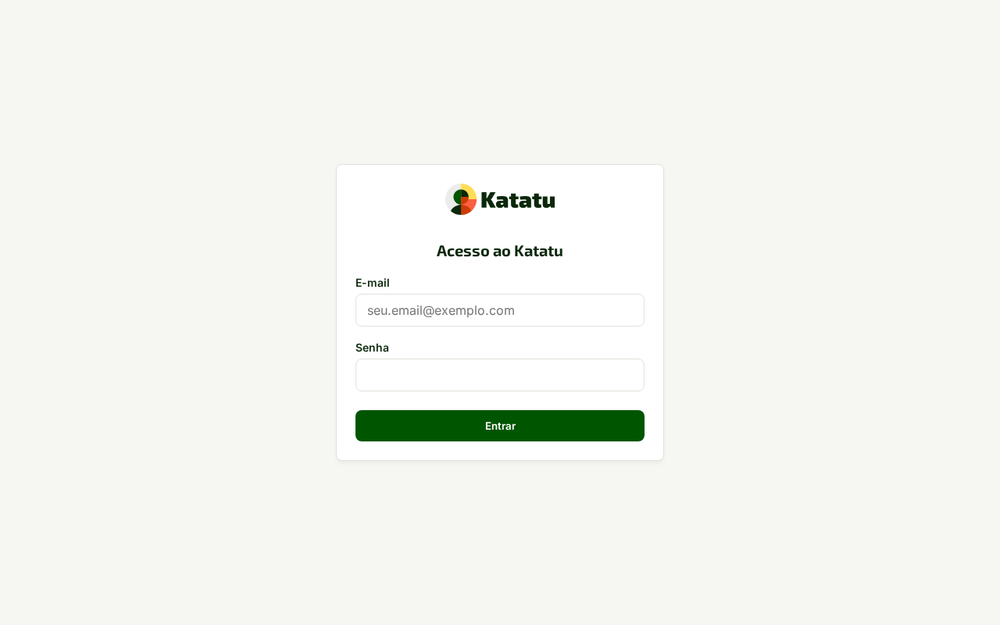

# 5. Administrador da Organização — Estrutura, IA e Governança LGPD

## Por que isto importa

Cada organização tem sua própria topologia (diretorias, regionais, filiais, escolas ou unidades operacionais), sua política de uso de inteligência artificial, os dados do controlador dos dados pessoais e os termos que as pessoas aceitam. Os prazos de retenção são definidos pela plataforma (capítulo 6). O Katatu permite desenhar níveis livres sem limite de profundidade, proteger equipes pequenas contra identificação indireta e operar 100% funcional mesmo sem IA ativada.

## Configurar a organização

O assistente **Configurar a organização** é o caminho guiado para deixar a organização pronta para uso. Ele tem oito passos, em ordem:

1. **Identidade visual:** nome, logo e cores que aparecem nas telas e nos e-mails.
2. **Unidades da estrutura:** diretorias, escolas ou setores. Você digita uma a uma, lê a estrutura de um documento com a IA ou importa uma planilha.
3. **Cargos e posições:** cada cargo do organograma fica numa unidade e tem as posições que alguém ocupa.
4. **Catálogo:** competências, modelos de cargo e trilhas, e como cada um se liga aos cargos.
5. **Pessoas:** cadastrar pessoas sem acesso, por planilha, ou convidá-las.
6. **Papéis:** quem administra e quem gere cada unidade.
7. **IA (opcional):** chave própria ou franquia da plataforma. Pode ficar para depois.
8. **Calendário de ciclos:** a programação das campanhas de avaliação. Também pode ficar para depois.

Cada passo mostra para que serve, o que você vai precisar e o caminho mais curto até onde se resolve. Um passo se libera quando os passos de que depende estão feitos. Por exemplo, o Catálogo espera os Cargos, e os Papéis esperam as Pessoas e as Unidades. A IA e o Calendário podem ser feitos a qualquer momento.

- **Como um passo fica feito:** sozinho, quando o mínimo está cadastrado. Por exemplo, o passo de Unidades fica feito com a primeira unidade. Também dá para marcar um passo como feito à mão, desde que os passos de que ele depende estejam feitos.
- **Como pular:** qualquer passo pode ser pulado. Pular um passo não libera os passos que dependem dele. Marcar e pular podem ser desfeitos.
- **Quem vê:** só a Administração da organização vê o assistente.
- **Onde fica:** ao entrar pela primeira vez como Administração de uma organização nova, o assistente abre sozinho uma vez. Depois, a lista **Primeiros passos** aparece no Início, com o que falta e um link para cada passo; ela pode ser recolhida. O assistente também tem entrada fixa em **Configurações da Organização**.

**Dica:** o "?" ao lado de termos como cadeira, cargo, posição, referencial, modelo de cargo e trilha explica o significado do termo nas telas de Cargos, Catálogo e Mapa.

## Catálogo: competências, modelos de cargo e trilhas

O catálogo é onde a organização descreve o que se espera de cada função. Ele alimenta o restante do Katatu: sem ele, cada Matriz precisa ser montada competência por competência, a trilha não tem o que sugerir e o plano dos primeiros 90 dias fica sem passos. Cadastre uma vez e reaproveite em todos os cargos que precisam da mesma competência. Os termos estão explicados no [Glossário](../7-glossario/).

### Para que serve cada um e como se ligam

- **Referencial:** uma competência, com nome e a descrição do comportamento que prova cada grau, de 0 a 3. A descrição de cada grau é a **âncora**. Exemplo: *Comunicação com famílias*.
- **Modelo de cargo:** o conjunto de competências de um tipo de cargo. Para cada competência, traz o piso do dia 1 e o pleno esperado. Escolhe competências entre os referenciais.
- **Trilha:** a sequência de etapas de formação que leva a pessoa a um grau. Cada etapa tem uma competência, um código, um grau alvo e um prazo em dias. Também escolhe competências entre os referenciais.

Esses itens chegam ao restante do Katatu desta forma:

1. Ao criar a **Matriz** de um cargo, ela copia as competências, o piso e o pleno do modelo escolhido. O modelo vem marcado quando o cargo tem um. Se o cargo não tem modelo e você não escolhe outro, a Matriz começa sem competências.
2. Na Matriz em rascunho, o botão **Sugerir do catálogo**, na seção **Trilha de aprendizagem**, propõe as etapas das trilhas que servem às competências dela.
3. Depois de **oficializada**, a Matriz é a base do **Katatu Fit**, que avalia as pessoas; do **Katatu Mapa**, que mostra a cobertura de cada cargo e as lacunas por competência; e do **Katatu Gap**, o plano dos primeiros 90 dias de quem toma posse, montado com a trilha da Matriz.

O cargo do organograma pode ter um modelo ligado por padrão. Hoje essa ligação chega pela **importação da planilha da Estrutura**: a importação cria, para cada cargo da planilha, um modelo com o mesmo nome e sem competências, e liga o cargo a ele. Pela tela de Catálogo não há como ligar um cargo a um modelo. Ao criar a Matriz, você mantém o modelo marcado ou escolhe outro.

### Ordem certa

1. **Cargos antes.** O Catálogo só libera depois do passo de Cargos no assistente de configuração.
2. **Referenciais primeiro.** Modelos de cargo e trilhas só escolhem competências que já existem. Se o formulário avisa "Ainda não há nenhuma competência para escolher", falta cadastrar o referencial: o botão **Cadastrar um referencial** leva até lá e, ao salvar, volta ao formulário com o que você já tinha digitado.
3. **Modelos de cargo e trilhas**, em qualquer ordem.
4. **Matrizes**, por último, porque copiam o que já está no catálogo.

**Dica:** a lista de competências mostra os referenciais da unidade escolhida na coluna **Nível** e os das unidades acima dela. Os referenciais de uma unidade não aparecem nas unidades irmãs. Se você está em **Organização inteira**, só aparecem os referenciais da organização.

### Referencial: como cadastrar, com exemplo completo

Passo a passo:

1. Abra **Estrutura e rede**, na aba **Catálogo**, e escolha **Referenciais**.
2. Na coluna **Nível**, escolha **Organização inteira** para uma competência que todas as unidades usam, ou a unidade que vai usá-la.
3. Clique em **Novo referencial**.
4. Preencha o **Nome do referencial**, a descrição (opcional) e a âncora de cada grau, de 0 a 3.
5. Clique em **Salvar**.

**Por que isto importa:** sem régua, o grau vira opinião. Dois avaliadores dão notas diferentes para a mesma pessoa, e a Matriz e o plano dos 90 dias saem com números que ninguém consegue explicar. A âncora diz o que se vê na prática em cada grau, e quem avalia confere um comportamento, não uma impressão.

**Exemplo, em uma escola: a competência *Comunicação com famílias***

- **Nome do referencial:** Comunicação com famílias
- **Descrição:** a forma como a função conversa com as famílias sobre a aprendizagem e os problemas da turma.
- **Grau 0:** não tem registro de contato com as famílias. Quando surge um problema, a família só fica sabendo pelo aluno ou por terceiros.
- **Grau 1:** responde às famílias quando é procurado e informa corretamente, mas sempre com a condução de outra pessoa. Não registra o contato.
- **Grau 2:** conduz sozinho o contato com as famílias da turma. Envia o comunicado no prazo, registra cada conversa no diário e retorna em até dois dias úteis quando há pendência.
- **Grau 3:** faz o que o grau 2 pede e antecipa problemas. Convoca a família antes da crise, ajustou o modelo de comunicado com a coordenação e treinou outro professor para fazer o mesmo.

### Modelo de cargo: como cadastrar, com exemplo completo

Passo a passo:

1. Na aba **Catálogo**, escolha **Modelos de cargo** e clique em **Novo modelo de cargo**.
2. Preencha o título e, se quiser, a descrição.
3. Em cada linha, escolha a **competência** na lista e informe o **piso do dia 1** e o **pleno esperado**, inteiros de 0 a 3.
4. Use **Adicionar competência** para acrescentar linhas e clique em **Salvar**.

**Por que isto importa:** o modelo é o que a Matriz copia. Um modelo bem feito faz cada Matriz nova começar pronta, com a mesma exigência para todos os cargos do mesmo tipo. Um modelo mal feito obriga a corrigir cada Matriz, uma a uma.

**Exemplo, em uma escola: o modelo *Coordenador pedagógico***

| Competência | Piso do dia 1 | Pleno esperado |
|---|---|---|
| Comunicação com famílias | 2 | 3 |
| Acompanhamento de professores | 2 | 3 |
| Planejamento pedagógico | 1 | 2 |

Um coordenador novo precisa conduzir sozinho o contato com as famílias já no primeiro dia (piso 2) e, ao fim de 90 dias, deve chegar ao grau 3. Em planejamento pedagógico, basta o grau 1 no dia 1: ele entende a lógica e executa com apoio. Ao fim de 90 dias, deve conduzir sozinho (grau 2). As outras duas competências precisam existir como referenciais antes, cadastrados como no exemplo anterior.

### Trilha: como cadastrar, com exemplo completo

Passo a passo:

1. Na aba **Catálogo**, escolha **Trilhas** e clique em **Nova trilha**.
2. Preencha o título e, se quiser, a descrição.
3. Em cada etapa, informe o código, o título da etapa, a competência, o grau alvo (de 0 a 3) e o prazo em dias.
4. Use **Adicionar etapa** para acrescentar etapas e clique em **Salvar**.

**Por que isto importa:** a trilha transforma a lacuna em passos. Sem ela, a pessoa sabe que precisa melhorar numa competência, mas não sabe por onde começar nem em quanto tempo.

**Exemplo, em uma escola: a trilha *Integração de professor***

| Código | Etapa | Competência | Grau alvo | Prazo (dias) |
|---|---|---|---|---|
| INT-01 | Acompanhar duas reuniões de pais conduzidas pela coordenação | Comunicação com famílias | 2 | 30 |
| INT-02 | Planejar e aplicar duas semanas de aulas, com revisão da coordenação | Planejamento de aulas | 2 | 45 |
| INT-03 | Assumir a turma sozinho por uma semana, com a coordenação de sobreaviso | Gestão de sala de aula | 2 | 60 |

O grau alvo é o nível que a etapa leva a pessoa a atingir. O prazo é o tempo sugerido para concluir a etapa, em dias.

Veja como o grau alvo muda o resultado. Num modelo de professor em que *Comunicação com famílias* tem piso 1 e pleno 2, a INT-01 entra na sugestão, porque o grau 2 está acima do piso e até o pleno. Se o piso dessa competência fosse 2, a INT-01 não entraria: o grau 2 já seria o mínimo do dia 1, e a etapa não levaria a pessoa a nenhum grau novo.

### O que significa cada grau

Cada competência é avaliada numa escala de quatro pontos, de 0 a 3. O Katatu não dá nome aos graus na tela: a régua é o texto que você escreve em cada âncora. Os nomes abaixo vêm da metodologia do Katatu e ajudam a escrever as âncoras:

- **Grau 0, não evidenciado:** a pessoa ainda não viveu situação equivalente nem mostrou os passos básicos. A âncora do grau 0 descreve essa ausência. Ela não pode ficar em branco, mesmo quando parece óbvia: o formulário exige as quatro.
- **Grau 1, preliminar ou elementar:** já participou da atividade ou entende a lógica, mas sempre com a condução de outra pessoa.
- **Grau 2, intermediário ou autônomo:** conduziu episódios reais com autonomia própria, em complexidade compatível com a rotina do cargo.
- **Grau 3, avançado ou propositivo:** conduziu com autonomia em cenários difíceis, deixou melhorias que duram ou formou outras pessoas.

**Dica:** escreva cada âncora como um fato que se pode observar ou relatar. "Comunica bem" não diz o que a pessoa faz, e duas pessoas leem a mesma frase de jeitos diferentes. "Responde à família em até dois dias úteis e registra no diário" diz. Pelo mesmo motivo, o método não aceita nota solta nem adjetivo ao registrar uma avaliação.

### Piso do dia 1 e pleno esperado

- **Piso do dia 1:** o grau mínimo para começar a atuar com segurança no primeiro dia. Abaixo dele, a pessoa não consegue começar sem comprometer entregas, expor pessoas a risco ou depender de terceiros para a rotina básica.
- **Pleno esperado:** o grau que se espera ao fim dos primeiros 90 dias, depois do amadurecimento normal do cargo.
- O piso não pode ser maior que o pleno. Os dois podem ser iguais, quando o mínimo já é o nível esperado.

**Atenção:** a lacuna abaixo do piso pesa mais do que a lacuna entre piso e pleno. Se a pessoa está abaixo do piso em alguma competência, o Katatu a coloca na Faixa 3 do Fit, e a posse fica travada até a organização cadastrar um amortecedor para aquela competência: alguém que a cubra, com prazo. Uma lacuna entre piso e pleno não trava nada. Ela vira item de desenvolvimento no plano dos 90 dias.

### O que vem de níveis acima

Cada unidade recebe os itens criados na organização inteira e nas unidades acima dela. Eles aparecem na lista **Herdados de níveis acima**. Você pode consultar e ver as versões, mas não editar. Para mudar um deles, é preciso estar no nível que o mantém.

O que uma unidade cria fica nela e nas unidades abaixo. Não aparece nas irmãs.

**Dica:** competência que vale para todas as unidades deve ser cadastrada na **Organização inteira**. Assim, todas a usam sem precisar recadastrar.

### Ao editar, arquivar e apagar

- **Editar** cria uma versão nova, com número. Vale para qualquer mudança no item: nome, descrição, âncoras, competências ou etapas. Salvar sem mudar nada não cria versão.
- **Vaga ou ciclo já aberto** continua na versão em que começou. A **Matriz oficializada** também não muda. A **Matriz em rascunho** não recebe a mudança sozinha, porque copiou as competências quando nasceu.
- **Arquivar** tira o item das ofertas. Ele deixa de aparecer para escolha em novos modelos, trilhas e Matrizes, mas continua guardado e nas vagas que já o usam. **Desarquivar** volta a oferecê-lo.
- **Apagar** só funciona se nenhuma vaga, ciclo ou outro item usa o item. Apagar é definitivo: o item não vai para a lixeira e não volta. Na dúvida, arquive.

### Dicas e armadilhas

- **Lista de competências vazia.** O formulário de modelo e de trilha só mostra os referenciais que valem para a unidade escolhida. Antes de procurar outro erro, confira a coluna **Nível** e se há referencial cadastrado nesse nível ou acima. A pergunta sobre a lista vazia está nas Perguntas Frequentes.
- **Etapa fora da sugestão.** A Matriz só recebe a etapa se o grau alvo estiver acima do piso e até o pleno da competência naquela Matriz. Grau igual ao piso, ou acima do pleno, fica de fora. A sugestão não explica por que cada etapa ficou de fora, então confira os graus antes.
- **Código repetido.** Se duas trilhas visíveis para a mesma Matriz usam o mesmo código de etapa, a sugestão fica só com a primeira, e a outra some sem aviso. Use códigos diferentes entre trilhas: por exemplo, INT para a integração e LID para a liderança.
- **Valores que já vêm preenchidos.** Uma nova linha de competência começa com piso 1 e pleno 2. Uma nova etapa começa com grau alvo 2 e prazo de 30 dias. Eles aparecem na tela, mas são padrão, não resposta. Confira cada linha antes de salvar.
- **Competência não escolhida.** Uma linha que fica em "Escolha…" é recusada com a mensagem de identificador inválido. Escolha a competência de cada linha.
- **Nomes repetidos.** O sistema não impede dois referenciais com o mesmo nome, e na lista de escolha eles aparecem repetidos. Procure antes de cadastrar.
- **Modelo vindo da planilha.** O modelo criado pela importação da Estrutura nasce sem competências. Complete-o antes de criar a Matriz. Se a planilha for importada de novo, confira as competências dos modelos depois, porque a importação grava de novo os modelos que criou.
- **Endereço de site.** Não cole endereço de site nos textos. O sistema recusa.

### Quando dá errado

| O que aparece | O que significa | O que fazer |
|---|---|---|
| Informe o nome. / Informe o título. | O campo principal está vazio. | Preencha o campo indicado. |
| Âncora do grau N: descreva o comportamento observável. | Falta a âncora de um dos graus. | Escreva a âncora. As quatro são obrigatórias. |
| Linha N: Piso (X) acima do pleno (Y). | Na competência da linha, o piso passou do pleno. | Ajuste os dois valores. O piso não pode ser maior que o pleno. |
| Linha N: "1,5" não é inteiro; use 0, 1, 2 ou 3. | Piso, pleno ou grau alvo com vírgula ou decimal. | Use só 0, 1, 2 ou 3. O sistema não arredonda. |
| Linha N: o valor está fora da escala de 0 a 3. | Piso, pleno ou grau alvo maior que 3 ou menor que 0. | Use só 0, 1, 2 ou 3. |
| Linha N: Identificador de competência inválido. | A linha está sem competência escolhida. | Escolha a competência na lista. |
| Esta competência já está na lista. | A mesma competência aparece em duas linhas do modelo. | Remova uma das linhas. |
| Esta competência não está disponível para a unidade (nasceu numa unidade irmã ou abaixo). | A competência foi criada em outra unidade. | Escolha um referencial visível para esta unidade, ou cadastre-o no nível de cima. |
| Esta competência está arquivada. | O referencial foi arquivado. | Desarquive-o ou escolha outro. |
| Código repetido na trilha: já existe outra etapa com o mesmo código. | Duas etapas da trilha têm o mesmo código. | Dê um código diferente a cada etapa. |
| Prazo sugerido: inteiro de 1 a 3650 dias. | Prazo vazio, zero, com decimal ou acima de 3650. | Informe um número inteiro de dias. |
| O item está em uso por vagas, ciclos ou outros itens e não pode ser apagado. | Tentativa de apagar um item que outro item usa. | Arquive o item. A mensagem mostra o que o usa. |
| O modelo de cargo não existe, está arquivado ou não vale para esta unidade. | Ao criar a Matriz, o modelo escolhido não está disponível. | Escolha outro modelo, ou desarquive o existente. |
| Não foi possível carregar os referenciais para escolha. | A lista de competências não carregou. | Atualize a tela. Se continuar, tente mais tarde. |
| Não foi possível salvar agora. Tente de novo. | Falha de conexão ou erro inesperado. | Tente de novo. Os dados digitados continuam na tela. |

### Limites do papel

- **Gestor da unidade** cria referenciais, modelos e trilhas no próprio nível e nos de baixo. Não vê as ações de editar, arquivar e apagar nos itens que já existem. Quem altera é quem mantém o nível.
- **Sessão de suporte** só consulta o catálogo.
- **Organização inteira:** só quem tem permissão nesse nível cria ou altera itens ali.

## Passo a passo

1. **Desenhar unidades e organograma (`Estrutura`):**
   - Crie unidades em qualquer profundidade (`unidades_fecho`) ou importe planilhas `CSV/XLSX` e imagens/PDFs de organograma pela **Ingestão Assistida** (tudo entra como **A confirmar**).
   - Configure o **Piso mínimo de agregação** (padrão: `3` ocupantes, mínimo irredutível: `2`): abaixo desse número, painéis agregados e campanhas 90º/180º/360º ocultam quebras nominais, incidentes críticos, amortecedores e nomes em Faixa 3.
2. **Configurar Assistência de IA e chaves próprias (`Assistência > Configuração e Consumo`):**
   - Escolha entre a franquia da assinatura V3RTECH, chaves próprias cifradas (**BYOK**: Google Gemini, OpenAI ou Anthropic Claude) ou modo **100% manual sem IA**.
   - Acompanhe o painel transparente de consumo filtrado por unidade, empresa-cliente, usuário e operação.
3. **Publicar vagas e integrar canais** (em *Vagas*, pelo botão **Vagas no site**):
   - Gere versões do *Perfil da Vaga* adaptadas aos 5 estilos e 5 canais (sempre sobre a projeção pública fechada que nunca vaza campos internos da Matriz Situada).
   - Ative o mural incorporável ou publique direto no **WordPress** via REST API nativa (`wp/v2`) com *Application Password*, sem instalar plugin no site. Veja a conexão abaixo.

### Conectar o WordPress da organização

Quem administra a organização conecta o WordPress em **Vagas no site**, na seção **WordPress**.

1. Informe o endereço do site (precisa ser HTTPS) e o usuário que vai publicar as vagas.
2. Crie uma senha de aplicativo no WordPress, em **Usuários > Perfil > Senhas de aplicativo**, e cole-a no campo de senha do Katatu.
3. Escolha o tipo de post (o padrão é `posts`) e, se quiser, a categoria, pelo número dela no WordPress.
4. Ao salvar, o Katatu confere a conexão no site antes de gravar. A senha fica guardada de forma protegida: depois de salva, ninguém consegue vê-la de novo na tela.

**Trocar o site, trocar o usuário ou desligar e conectar outro site** é uma troca de destino e exige cuidado:

- O app pede a senha de aplicativo nova e a confirmação em duas etapas, feita agora.
- Ele registra o evento de segurança e avisa por e-mail todas as pessoas da Administração da organização.
- Os posts que já estão no site antigo continuam lá. A senha nova nunca vai para o site antigo.

**Dica:** se a conexão não for conferida, a vaga não é publicada e o app mostra o motivo. Não há um post "fantasma" no site.
4. **Acompanhar o Katatu Mapa (`/mapa`):**
   - Veja cada cargo com a cobertura de sucessão, a sobrecarga e a última avaliação, somados **por unidade**. Você vê números consolidados, sem nomes. Unidades com menos de 3 pessoas entram na soma da unidade de cima. A exportação em PDF, XLSX ou CSV segue o mesmo nível, sem nomes.
5. **Governança LGPD (`/governanca`, em Configurações da Organização):**
   - **Controlador dos dados pessoais:** informe o endereço completo e o canal de atendimento ao titular, que são obrigatórios. O encarregado de dados (DPO), com nome, e-mail e telefone, é opcional. Os dados passam a valer para as pessoas da organização ao salvar, e cada mudança fica registrada na auditoria.
   - **Termos e Política da organização:** publique a versão de cada documento. Quando uma versão nova muda o conteúdo, as pessoas da organização aceitam de novo no acesso seguinte. Uma versão pode ser marcada como correção, que não pede novo aceite. Quem publica vê quem ainda não aceitou.
   - **Prazos de retenção:** a organização não configura prazos. Eles são iguais para todas as organizações da plataforma e definidos pela Administração do Serviço.

