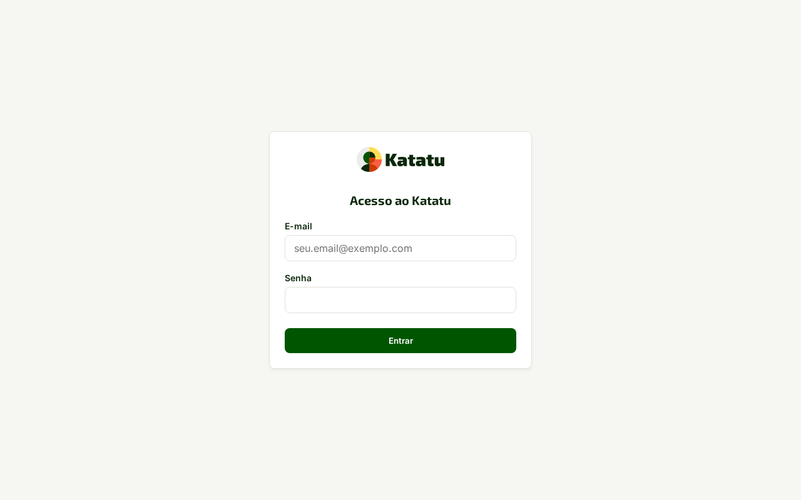
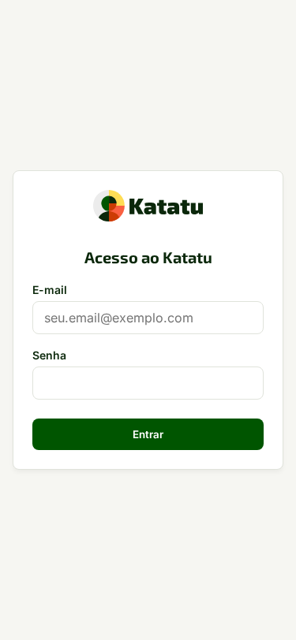

# 6. Administrador do Serviço — Licenças, Cópias Cifradas e Manutenção

## Por que isto importa

Toda a operação crítica da plataforma — ativação do primeiro administrador, gestão de licenças `V3RLicense`, rotação do chaveiro criptográfico, envio de cópias de segurança cifradas para nuvem externa e ensaio de restauração — acontece **pela interface web**, sem nunca exigir SSH ou comandos de terminal no servidor.

## Passo a passo

1. **Inicialização única (`/entrar` → `/inauguracao`):** no primeiro acesso, entre com a credencial provisória. A aplicação encaminha para `/inauguracao`; informe os dados do primeiro administrador, troque a credencial provisória, pareie o MFA TOTP com o código do aplicativo autenticador e guarde os códigos de recuperação exibidos.

2. **Licenciamento (`Sistema > Licença V3RLicense`):** insira a chave assinada (`ed25519`). Em caso de falha de rede com o servidor de licenças, a instalação opera por 14 dias em carência; após o vencimento, apenas a criação de novas vagas e campanhas é bloqueada (`402`), mantendo leitura e exportações 100% liberadas.
3. **Cópias de segurança cifradas e Kit de Recuperação (`Sistema > Manutenção`):**
   - Antes de habilitar um destino externo (S3/R2, WebDAV, SFTP ou Google Drive), clique em **Baixar Kit de Recuperação Independente**, informe seu código MFA atual (*step-up*) e digite a frase de confirmação. O kit inclui o script autônomo de decifragem `AES-256-GCM + HMAC-SHA256`.
   - Para testar a integridade de uma cópia sem afetar os dados em produção, clique em **Executar Ensaio de Restauração**: o sistema valida a assinatura HMAC, decifra o snapshot em transação isolada de teste e exibe o certificado de integridade.
4. **Renomear uma organização (`Sistema > Organizações do serviço`):** o botão **Renomear**, na linha de cada organização, troca só o nome do cadastro. O endereço curto continua o mesmo, porque ele identifica a organização em links, e a troca do endereço não está disponível nesta tela. O nome que a própria organização define em Identidade visual também não muda. A troca fica registrada na trilha de segurança.
5. **Envios de feedback que ainda não saíram (`Início do serviço`):** a tela mostra quantos envios ficaram retidos. Toque em **Reenviar agora** para tentar na hora; o servidor também tenta sozinho. A tela não mostra o texto dos relatos: eles chegam por e-mail a suporte@v3rtech.com.br, com o assunto "[Feedback - Katatu: categoria] início do relato".

6. **Retenção de dados (`/sistema/retencao`):** a rotina diária só faz o **ensaio**, que conta o que sairia sem apagar nada. Para eliminar de verdade, primeiro emita o aviso, com **Emitir aviso**. A eliminação, em **Executar eliminação**, só fica disponível de 30 a 90 dias depois do aviso, e pede a palavra de confirmação ou a marcação de confirmação. O botão **Fazer ensaio agora** repete a contagem a qualquer momento.
   - Os prazos valem para toda a plataforma: a lixeira guarda o item por 30 dias depois de apagado; o candidato de fora não alocado, por 180 dias depois da última movimentação na vaga, salvo quem está no banco de talentos; a pessoa desligada, por 2 anos depois da retirada do acesso, e depois fica só um resumo anônimo por cargo; os registros de acesso têm o piso legal de 6 meses civis.
   - Em **Alterar prazo**, o app recusa um prazo abaixo do mínimo legal. Mudar um prazo cancela o aviso já emitido, e é preciso emitir outro e esperar os 30 dias.
   - Se uma tabela falhar, as outras seguem, e a rodada fica registrada como falha parcial, nunca como sucesso.
7. **Termos de Uso e Política de Privacidade (`/sistema/termos`):** publique cada versão nova dos documentos da plataforma. Cada versão nova pede o aceite de todas as pessoas no acesso seguinte. Enquanto a versão em vigor for o texto provisório, um aviso fica no topo da página. A versão final só deve ser publicada depois da revisão jurídica, e antes de liberar o Katatu a clientes.

**Aviso persistente de segurança (`Sistema`):** o Katatu compara as proteções do banco com uma referência aprovada para verificar que as regras de acesso continuam íntegras. Só o superadmin vê a conferência. Exemplo fictício: com duas pendências, o título **Alerta de segurança** acompanha a mensagem “A conferência das proteções encontrou 2 alertas pendentes. Solicite a verificação técnica antes de continuar a operação. O aviso permanece até a correção ser registrada.”

Se o painel não conseguir carregar os alertas, aparece: “Não foi possível conferir os alertas de segurança. Recarregue a página para tentar novamente.” Recarregue; se o erro continuar, solicite verificação técnica.

