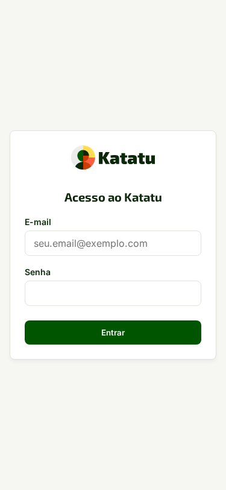

# 6. Administrador do Serviço — Licenças, Cópias Cifradas e Manutenção

## Por que isto importa

Toda a operação crítica da plataforma — ativação do primeiro administrador, gestão de licenças `V3RLicense`, rotação do chaveiro criptográfico, envio de cópias de segurança cifradas para nuvem externa e ensaio de restauração — acontece **pela interface web**, sem nunca exigir SSH ou comandos de terminal no servidor.

## Passo a passo

1. **Inicialização única (`/entrar` → `/inauguracao`):** no primeiro acesso, entre com a credencial provisória. A aplicação encaminha para `/inauguracao`; informe os dados do primeiro administrador, troque a credencial provisória, pareie o MFA TOTP com o código do aplicativo autenticador e guarde os códigos de recuperação exibidos.

2. **Licenciamento (`Sistema > Licença V3RLicense`):** insira a chave assinada (`ed25519`). Em caso de falha de rede com o servidor de licenças, a instalação opera por 14 dias em carência; após o vencimento, apenas a criação de novas vagas e campanhas é bloqueada (`402`), mantendo leitura e exportações 100% liberadas.
3. **Cópias de segurança cifradas e Kit de Recuperação (`Sistema > Manutenção`):**
   - Antes de habilitar um destino externo (S3/R2, WebDAV, SFTP ou Google Drive), clique em **Baixar Kit de Recuperação Independente**, informe seu código MFA atual (*step-up*) e digite a frase de confirmação. O kit inclui o script autônomo de decifragem `AES-256-GCM + HMAC-SHA256`.
   - Para testar a integridade de uma cópia sem afetar os dados em produção, clique em **Executar Ensaio de Restauração**: o sistema valida a assinatura HMAC, decifra o snapshot em transação isolada de teste e exibe o certificado de integridade.
4. **Envios de feedback que não chegaram ao GitHub (`Início do serviço`):** a tela mostra quantos envios ficaram retidos. Toque em **Reenviar agora** para tentar na hora; o servidor também tenta sozinho. A tela não mostra o texto dos relatos: quem os lê é a issue no GitHub.

**Aviso persistente de segurança (`Sistema`):** o Katatu compara as proteções do banco com uma referência aprovada para verificar que as regras de acesso continuam íntegras. Só o superadmin vê a conferência. Exemplo fictício: com duas pendências, o título **Alerta de segurança** acompanha a mensagem “A conferência das proteções encontrou 2 alertas pendentes. Solicite a verificação técnica antes de continuar a operação. O aviso permanece até a correção ser registrada.”

Se o painel não conseguir carregar os alertas, aparece: “Não foi possível conferir os alertas de segurança. Recarregue a página para tentar novamente.” Recarregue; se o erro continuar, solicite verificação técnica.

