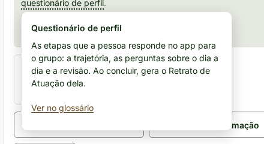
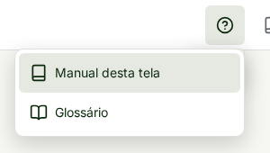
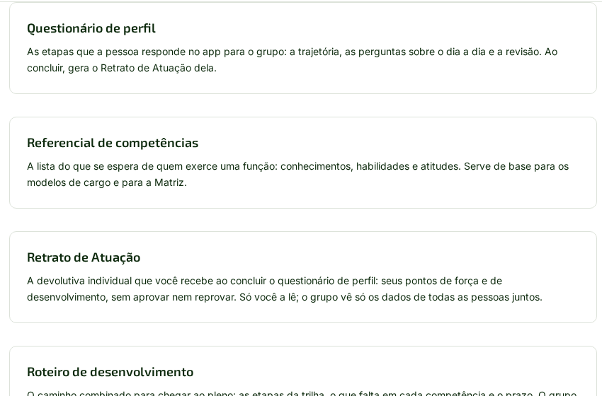

# Glossário do Katatu

Há dois jeitos de chegar a um termo.

**Pela própria tela.** Os termos com linha pontilhada têm definição ali mesmo. Toque no termo (no computador, também dá para usar **Tab** até ele e apertar **Enter**): abre um balão com a definição e o link **Ver no glossário**, que traz você para esta página, no termo. Aperte **Esc** para fechar o balão; o foco volta ao termo.

**Pelo menu de ajuda.** Toque no ícone **?** no topo da tela. **Glossário** abre esta lista; **Manual desta tela** abre o capítulo da tela em que você está.

- **Questionário de perfil:** o conjunto de etapas que a pessoa responde no app para a organização: a Trajetória, as Perguntas e as Situações do dia a dia. Ao concluir, gera o **Retrato de Atuação** dela. Quem administra chama a pessoa para o questionário na Matriz do cargo; a pessoa o vê em **Meu questionário de perfil** no menu. Nas versões anteriores à 1.4.1, este mesmo item se chamava *coleta*; veja a seção de mudanças de nome, no fim desta página.
- **Meus dados e formação:** a aba do **Meu Perfil** onde a pessoa guarda os próprios dados pessoais (nome civil, CPF, data de nascimento e telefone). Só ela lê e altera; a organização só vê depois de aceitar o aviso do vínculo. A formação, os cursos e os certificados ficam na aba **Trajetória**, ao lado dela. Nas versões anteriores à 1.4.1, esta aba se chamava *carteira pessoal*.
- **Matriz Situada da Função:** especificação viva de uma vaga (Modo A) ou posição ocupada (Modo B) estruturada em 4 eixos de realidade operacional, substituindo descrições genéricas de cargo.
- **Piso (Dia 1) e Pleno:** os dois níveis separados de exigência (`0` a `3`) de cada competência. O Piso é o mínimo para operar com segurança no primeiro dia; o Pleno é o nível esperado da pessoa já madura na função. O caminho do piso ao pleno segue a trilha, no prazo de cada etapa.
- **Amortecedor Organizacional:** suporte concreto disponibilizado pela equipe (mentoria, dupla titularidade, revisão em par, alçada assistida) para compensar uma lacuna abaixo do Piso na Faixa 3.
- **Katatu Fit:** motor determinístico e auditável que avalia elegibilidade, desvios frente ao Piso e ao Pleno, sintonia de estilo e viabilidade de carga, classificando nas Faixas 1 a 4 sem média compensatória.
- **Katatu Gap:** plano vivo dos primeiros 90 dias gerado na posse, combinando amortecedores obrigatórios, trilha formativa e abatimento de cursos equivalentes que a pessoa guarda em Meus dados e formação.
- **Katatu Mapa:** visão organizacional contínua de cobertura de competências, prontidão de sucessão imediata, sucessão programada e alertas de sobrecarga estrutural.
- **Retrato de Atuação:** devolutiva individual privativa entregue a toda pessoa avaliada, focada em pontos de força e desenvolvimento, sem rótulos de aprovação/reprovação.
- **Lixeira:** lugar onde fica, por 30 dias, o que foi apagado no Katatu. Dali o item volta igual com um clique; depois dos 30 dias, a rotina de retenção da organização exclui de vez. Vale também para referenciais, modelos de cargo e trilhas. Para deixar de oferecer um item que já foi usado, arquive-o.
- **Referencial:** uma competência com a régua de graus de 0 a 3: nome e, para cada grau, a âncora. É a peça com que se montam os modelos de cargo e as trilhas.
- **Âncora:** o texto que descreve, em um grau de 0 a 3, o comportamento observável que comprova aquele nível. Sem âncora, dois avaliadores podem dar graus diferentes para a mesma pessoa.
- **Modelo de cargo:** conjunto de competências de um tipo de cargo, com o piso do dia 1 e o pleno esperado de cada uma. A Matriz copia o modelo quando nasce.
- **Trilha:** sequência de etapas de formação, cada uma com competência, código, grau alvo e prazo em dias. A Matriz recebe a sugestão da trilha, e o plano dos primeiros 90 dias é montado com ela.
- **Grau alvo:** o grau, de 0 a 3, que uma etapa da trilha leva a pessoa a atingir.
- **Herdado de nível acima:** item do catálogo criado na organização inteira ou numa unidade de cima. Aparece nas unidades de baixo só para leitura.
- **Versão (do catálogo):** cada mudança no item gera a versão seguinte, com número. Vagas e ciclos guardam a versão em que começaram; a Matriz guarda as versões usadas quando é oficializada.

## Mudanças de nome (para quem já usava o Katatu)

- **Coleta virou questionário de perfil.** "Minha coleta" no menu agora é **Meu questionário de perfil** (para quem responde) e "Coletas" é **Questionários de perfil** (para quem administra). No Início, o cartão "Coletas para responder" virou **Questionários de perfil para responder**. O que você já sabia sobre a coleta vale para o questionário: é a mesma coisa, com outro nome.
- **Carteira pessoal virou Meus dados e formação.** A aba **Meus dados** do **Meu Perfil** passou a se chamar **Meus dados e formação**. A aba **Trajetória** continua separada, ao lado dela. Nenhum dado mudou de lugar com a troca de nome.
- **Os endereços antigos continuam funcionando.** Quem tinha um link guardado para a coleta ou para a carteira não precisa trocá-lo.
- **O que não mudou:** *Retrato de Atuação*, *Matriz Situada* e *contrato* continuam com o mesmo nome.

## Vocabulário da sua organização

Cada organização pode trocar alguns nomes do Katatu pelos termos que usa no dia a dia. A administração escolhe esses nomes em **Configurações da Organização › Identidade**. Por exemplo, "unidade" pode se chamar **área** e "organização" pode se chamar **grupo**. Os textos das telas da sua organização passam a usar os nomes escolhidos, e o menu acompanha.

Este manual usa os nomes padrão do Katatu. Se a sua organização trocou um nome, leia a palavra equivalente: onde o manual disser *unidade*, a sua tela pode mostrar *área*. A importação por planilha, os e-mails e as telas públicas seguem com os nomes padrão, mesmo quando a organização trocou os nomes.
