# Responder uma avaliação sem conta

Este guia é para quem recebeu um pedido de avaliação por e-mail: alguém da organização quer a sua resposta sobre uma pessoa da equipe, como par, liderado ou na própria autoavaliação. Você responde pelo celular ou pelo computador, sem criar conta e sem senha.

## Por que isto importa

Uma avaliação só mostra o que a equipe viu de verdade se as pessoas que convivem com quem está sendo avaliado responderem. A sua resposta entra junto com as de outras pessoas, e o resultado só aparece quando há respostas suficientes para proteger quem respondeu. Você não precisa de conta no Katatu para contribuir, e a sua resposta não leva o seu nome nem a data: quem conduz a conversa lê o que foi escrito, nunca quem escreveu.

## Antes de começar

O e-mail traz o nome da pessoa avaliada, o prazo e a garantia de anonimato. O botão **Responder** leva ao pedido. O link vale até o fim do prazo da avaliação, no máximo 30 dias, e é só seu: não o encaminhe.

**Dica:** se a organização mandou um lembrete, use o e-mail mais recente. Um lembrete traz um link novo, e o anterior deixa de valer, junto com as páginas que ele tiver aberto.

## Passo a passo

1. No e-mail, toque em **Responder**. O link abre a página **Responda a uma avaliação**, com o nome da organização e o aviso de que não é preciso código, conta nem senha.
2. Nessa página, toque em **Responder** de novo. Ela abre o formulário, com o nome da pessoa avaliada, o seu papel na avaliação e a data limite.
3. Leia o aviso no alto do formulário: conte o que você viu acontecer, como entregas, situações e comportamentos da rotina. Não há nota.
4. Responda cada pergunta, digitando o texto. Se a organização tiver a transcrição por voz configurada, você também pode falar e revisar o texto antes de enviar.
5. Toque em **Enviar resposta**. A página **Resposta enviada** confirma que chegou.

**Exemplo.** Você é par de uma chefe de seção, a Helena Duarte (nome fictício), na avaliação de 360º. Na pergunta sobre uma entrega que se destacou, escreve: "Na acampada de outubro reorganizou a escala das patrulhas em meia hora." Na pergunta sobre um imprevisto, escreve: "Quando duas famílias avisaram que não viriam, refez a lista e tudo saiu no horário." Toca em **Enviar resposta**. A resposta sai sem o seu nome.

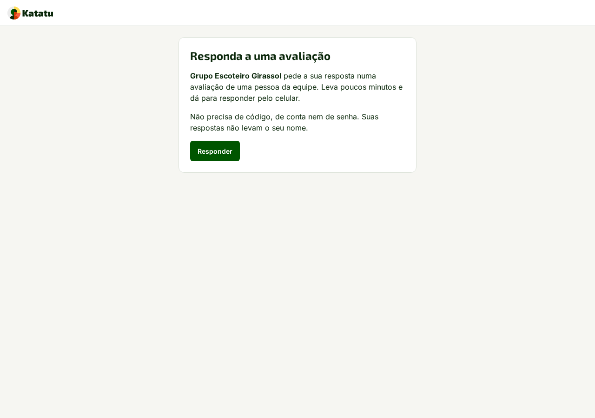
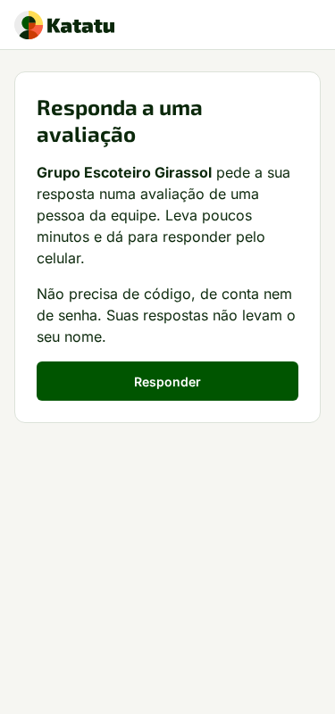

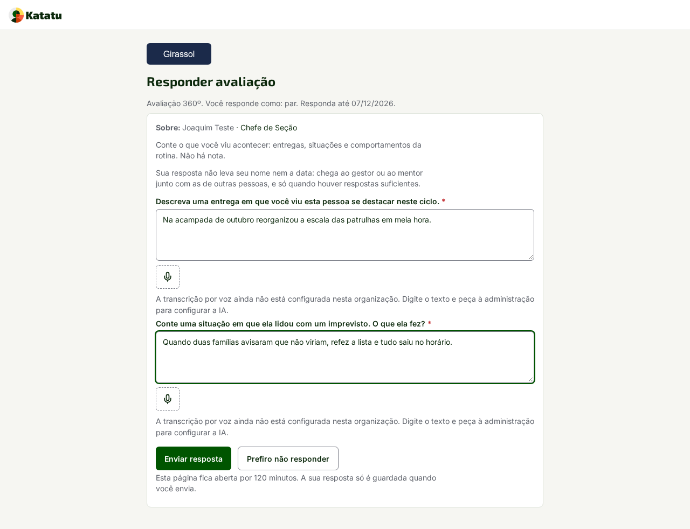
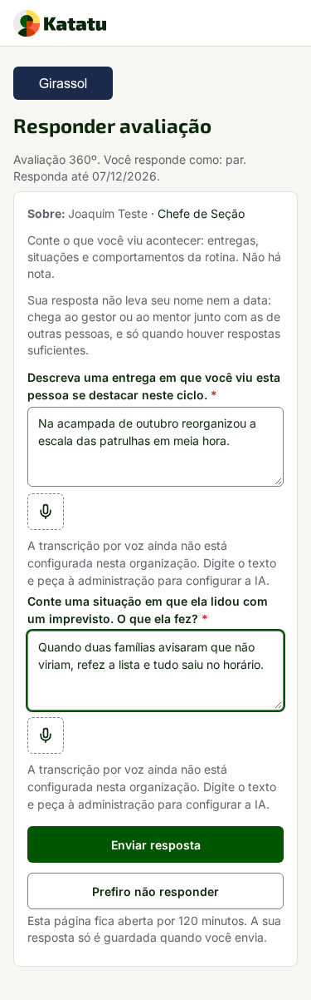

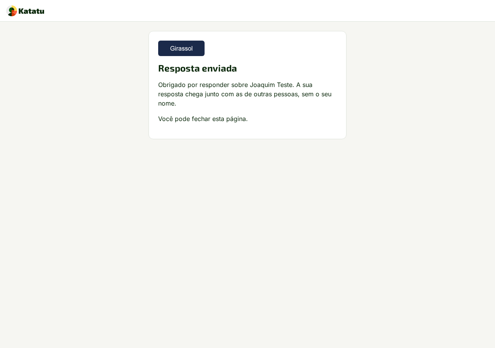
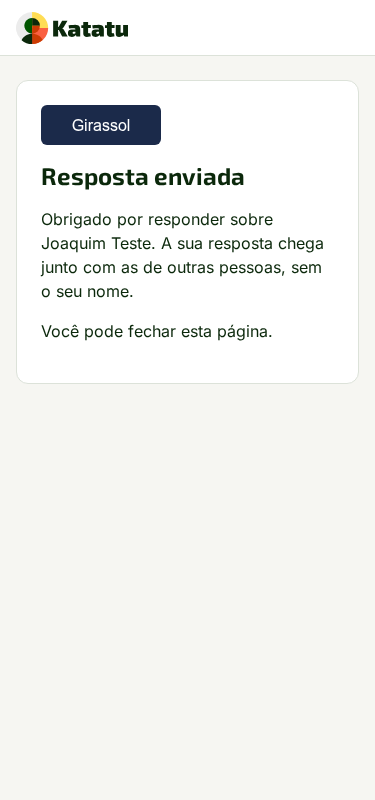

Se você não quer responder, toque em **Prefiro não responder** no formulário. Uma janela pergunta se é isso mesmo e diz o que acontece. Confirme em **Não responder** e a página registra a sua escolha.

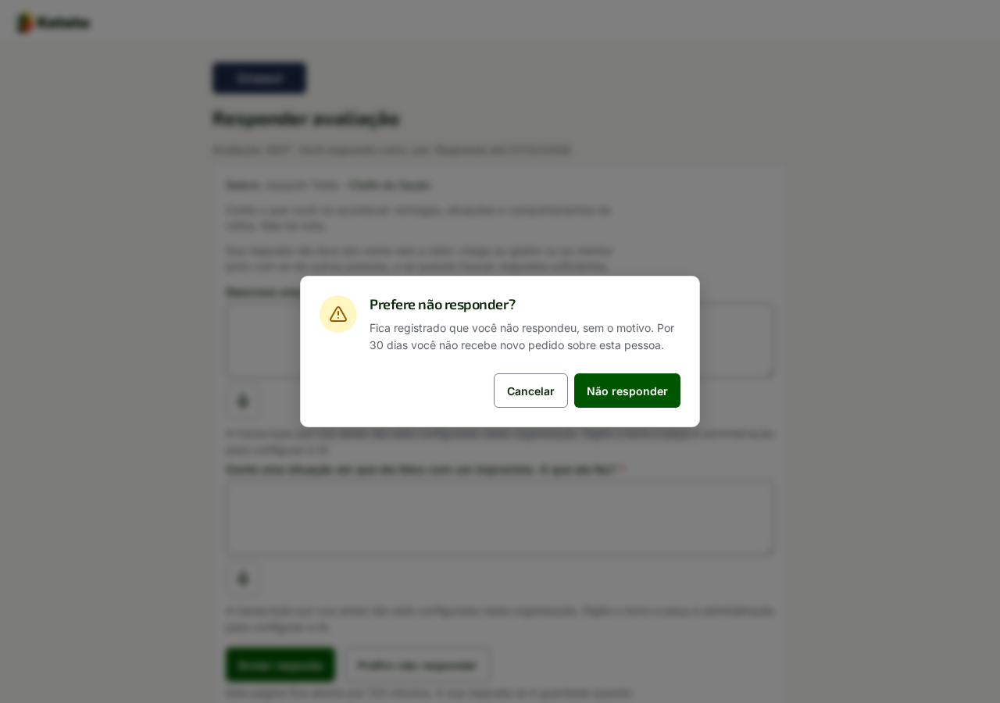
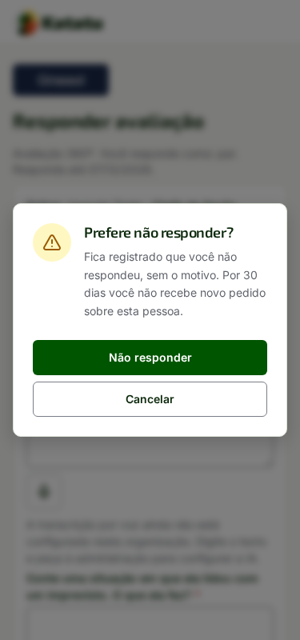

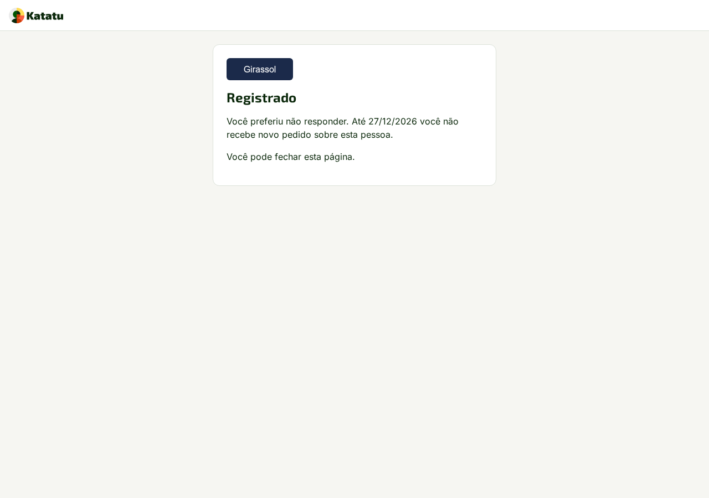
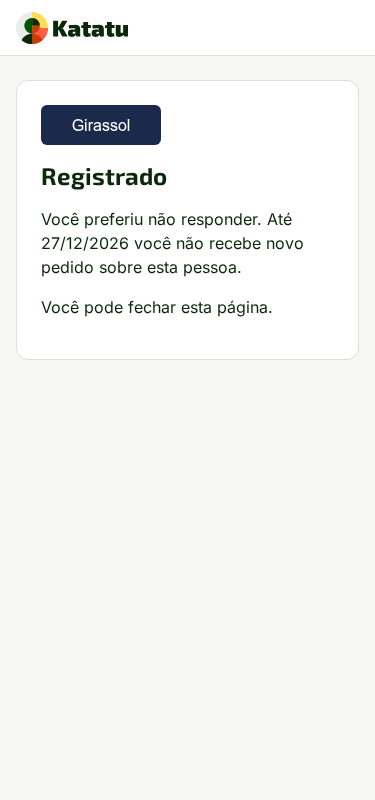

**Dica:** um exemplo concreto, com o que você viu acontecer, ajuda mais do que uma opinião geral sobre a pessoa.

**Armadilha:** a resposta enviada não muda. Se você abrir o link de novo, a página diz que você já respondeu e não há como editar o texto. Releia cada pergunta antes de tocar em **Enviar resposta**; o texto que sai segue para o resultado como foi enviado.

**Armadilha:** em **Prefiro não responder**, a recusa fica registrada como resposta que falta, e você não recebe novo pedido sobre a mesma pessoa por 30 dias. Pelo link, não há como voltar atrás depois de confirmar.

**Gestor imediato e mentor sem conta** não recebem link. Eles entram com um código enviado por e-mail e ganham conta no Katatu ao responder, porque são quem lê o resultado e conduz a conversa com a pessoa avaliada.

## Quando dá errado

- **Este link não vale mais.** A página aparece quando o link venceu, foi substituído por um mais novo ou a avaliação foi encerrada. Peça a quem pediu a sua resposta um link novo, e use o e-mail mais recente.

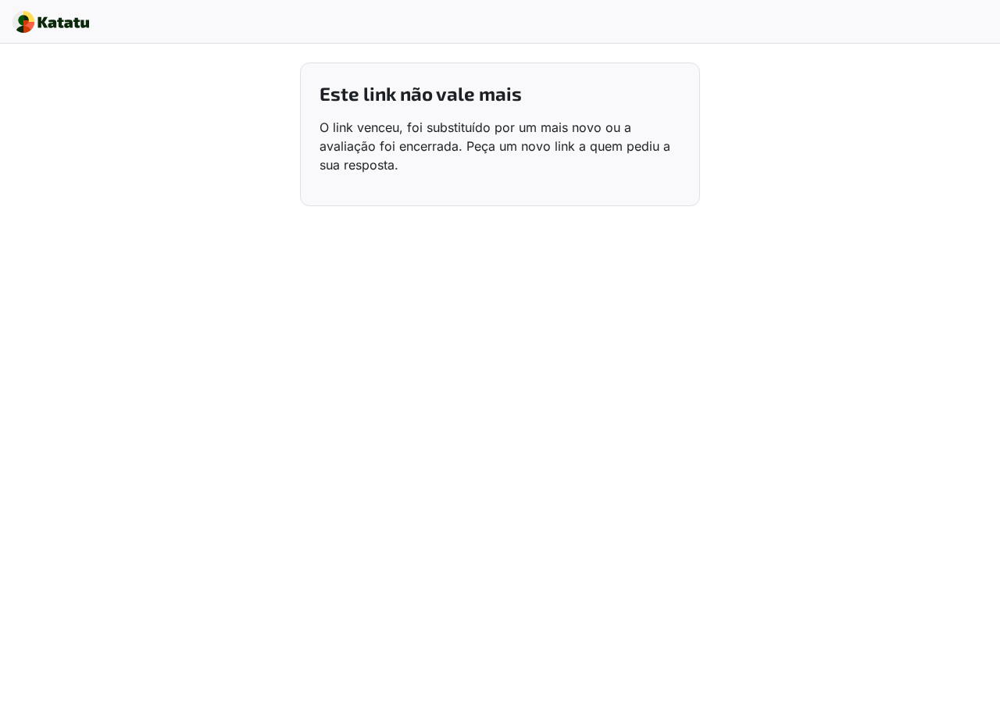

- **Esta sessão terminou.** Cada vez que você abre o link, a página fica aberta por 120 minutos. Depois disso, abra de novo o link do e-mail para continuar. O que você tinha escrito e não enviou precisa ser escrito de novo, porque a resposta só é guardada quando você envia.

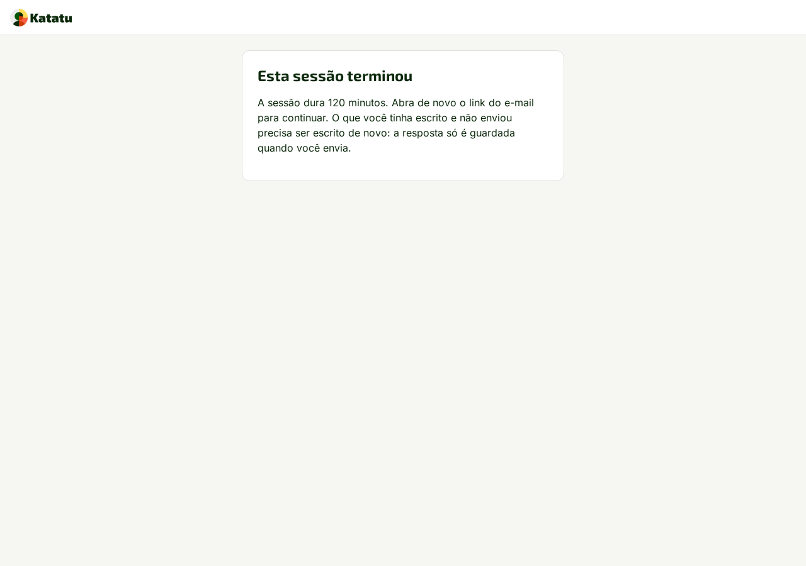
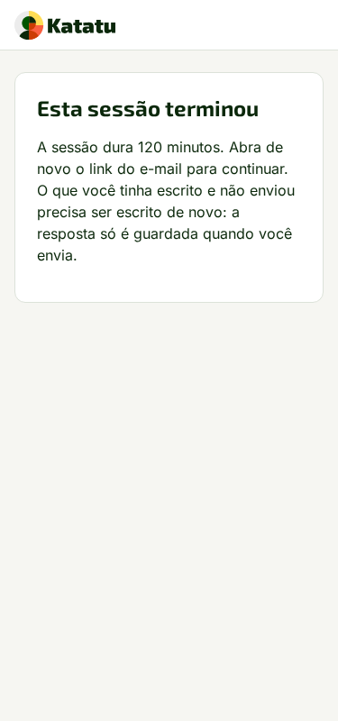

- **Você já respondeu esta avaliação.** Sua resposta chegou e não há nada a fazer. A página aparece sempre que você abre o link depois de enviar.

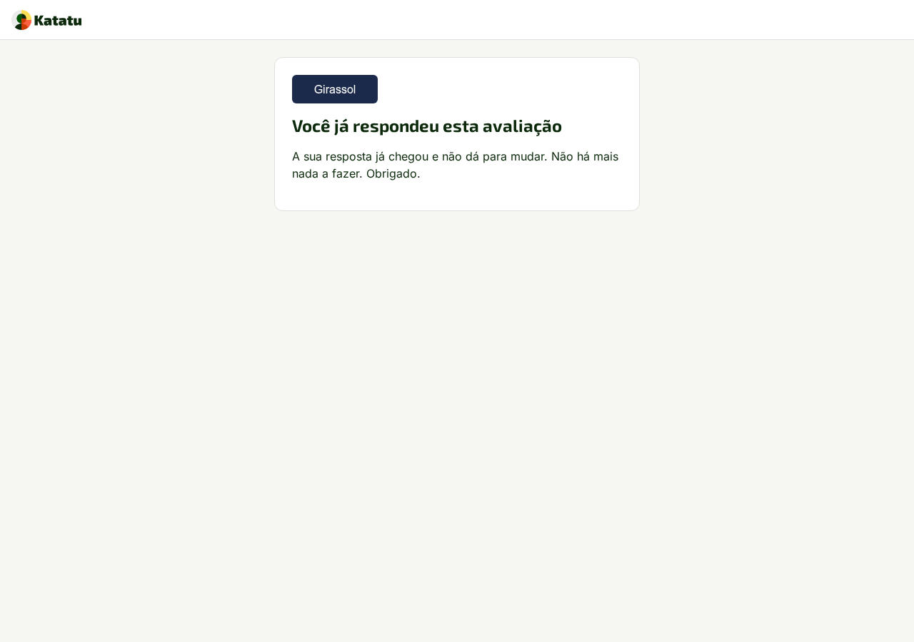
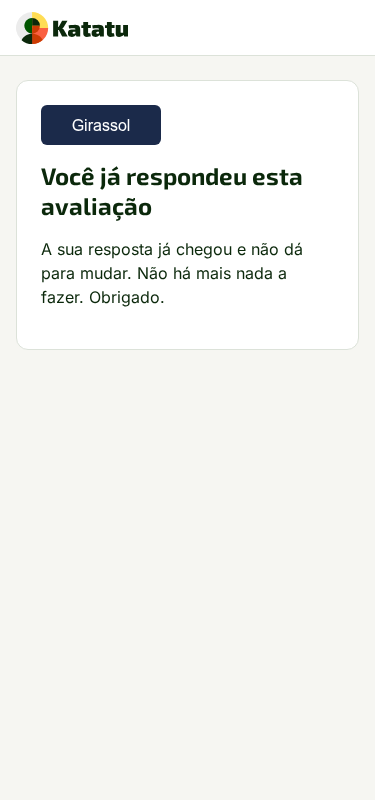

- **Organização em quarentena.** Enquanto a organização estiver em quarentena, ela não aceita respostas, inclusive por link. Fale com quem pediu a sua resposta.

## O que você não vê e o que a organização vê

- **Você responde só ao pedido do seu e-mail.** A página não tem menu nem outras telas do Katatu.
- **Quem gere a campanha vê só contagens:** quantas pessoas responderam, pela conta e pelo link, e quantas recusaram. Nenhum texto aparece com nome.
- **O link é de quem o recebeu.** Quem tiver o link pode responder no seu lugar, por isso não o encaminhe.

Veja também o [Glossário](/7-glossario/) se algum termo da tela não estiver claro.
