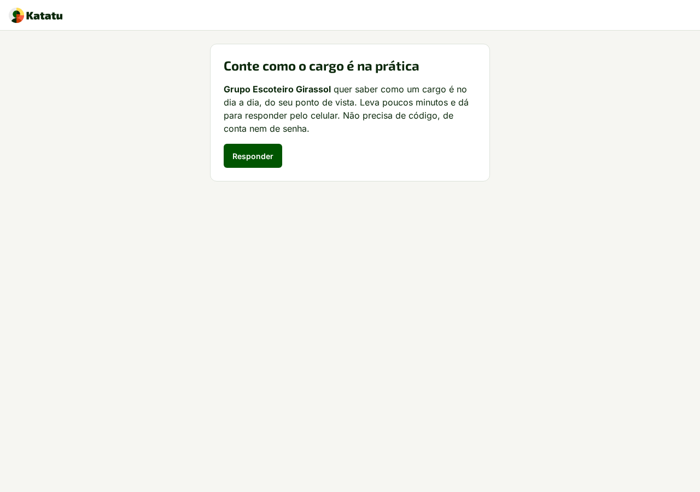
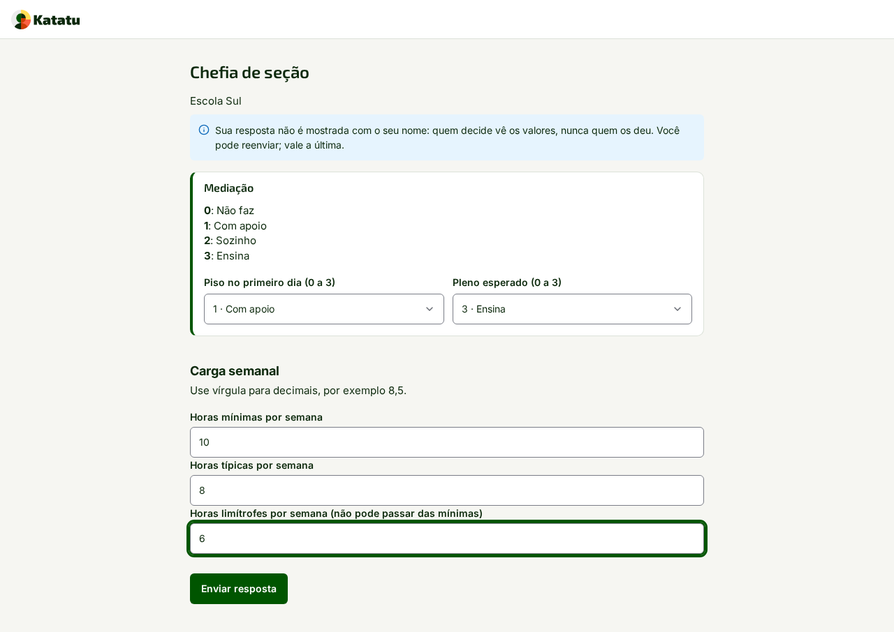
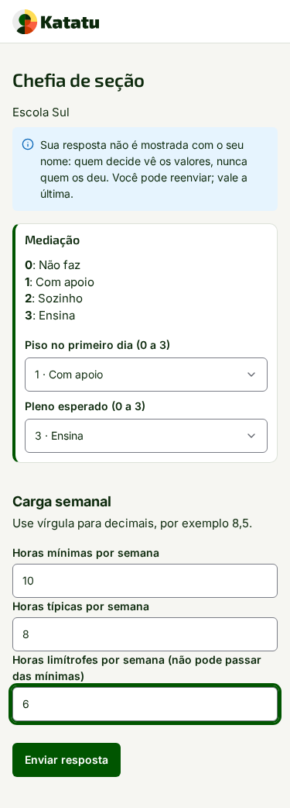
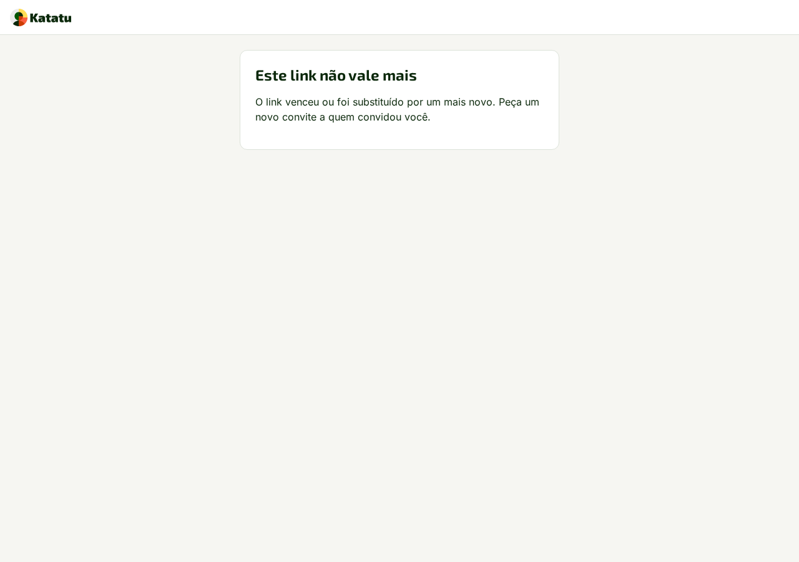
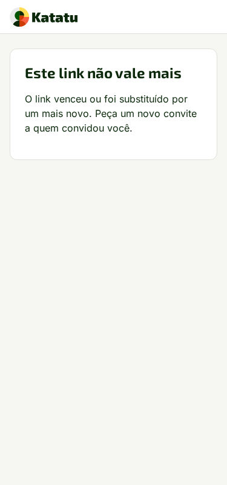

# Dar perspectiva sobre alguém

Este guia é para quem recebeu um pedido de perspectiva por e-mail: alguém da organização quer saber, do seu ponto de vista, como um cargo é no dia a dia. Você responde pelo celular ou pelo computador, sem criar conta e sem senha.

## Por que isto importa

Quem monta o cargo precisa de quem convive com ele. A sua resposta entra junto com as de outras pessoas para calibrar o que a função exige de verdade, e isso só funciona se as respostas forem sinceras. A resposta não sai com o seu nome: quem decide vê os valores, nunca quem os deu.

## Antes de começar

Você recebe um e-mail de quem convidou você. O e-mail traz o botão **Responder**. Ele vale por 30 dias e leva ao mesmo pedido enquanto estiver valendo.

**Dica:** se a organização reenviou o convite, use o e-mail mais recente. Ao reenviar, a organização invalida o link anterior.

## Passo a passo

1. No e-mail, toque em **Responder**. O link abre a página **Conte como o cargo é na prática**, com o nome da organização e um aviso: não é preciso código, conta nem senha.
2. Toque em **Responder** de novo. Esse clique abre o formulário. Só abrir a página, antes do clique, não faz nada com o link.
3. Na tela do formulário, confira o nome do cargo e da unidade no alto. O aviso azul diz que a sua resposta não é mostrada com o seu nome.
4. Para cada competência, escolha o **Piso no primeiro dia** e o **Pleno esperado**, de 0 a 3. A legenda da competência mostra o que cada número quer dizer: 0 não faz, 1 com apoio, 2 sozinho, 3 ensina.
5. Em **Carga semanal**, escreva as horas com vírgula para decimais, por exemplo `8,5`: **Horas mínimas por semana**, **Horas típicas por semana** e **Horas limítrofes por semana**.
6. Toque em **Enviar resposta**.

**Exemplo.** Uma chefe de seção, a Helena Duarte (nome fictício), recebe o pedido sobre o cargo de chefia de seção. Ela considera que a competência Mediação, no primeiro dia, exige apoio, por isso escolhe **1 · Com apoio** no piso, e que o pleno é **3 · Ensina**. Escreve 6 nas horas mínimas, 8 nas típicas e 4 nas limítrofes, e toca em **Enviar resposta**.

**Dica:** responda como o cargo é de fato, não como acha que deveria ser. Uma resposta sincera com um nível mais baixo ajuda mais do que uma resposta idealizada.

**Armadilha:** o campo **Horas limítrofes por semana** não pode passar do valor de **Horas mínimas por semana**. Se passar, confira os dois números antes de enviar.

**Armadilha:** você pode reenviar a resposta, e vale a última. Se mudar de ideia depois de enviar, abra o mesmo link e responda de novo.

## Quando dá errado

- **Este link não vale mais.** A página diz que o link venceu ou foi substituído por um mais novo. Peça à pessoa que convidou você que reenvie o convite. Use o e-mail mais recente.

- **Organização em quarentena.** Enquanto a organização estiver em quarentena, ela não aceita respostas por link. Fale com quem convidou você.

## O que você não vê e o que a organização vê

- **Você responde só ao pedido do seu convite.** A página não tem menu nem outras telas do Katatu.
- **Quem convidou você vê que você respondeu**, pelo e-mail do convite. O que ela vê é a resposta, sem o seu nome.

Veja também o [Glossário](/7-glossario/) se algum termo do formulário não estiver claro.
