# Começando: implantar o Katatu na sua organização

Este guia é para quem recebeu o convite de **administração** de uma organização e vai deixá-la pronta do zero: identidade, estrutura, catálogo, voluntários, Matrizes e os primeiros questionários de perfil. Você não precisa ter feito nada antes no Katatu.

> **Quem está lendo como voluntário?** Vá para [Recebi um convite: guia do colaborador](/primeiros-passos/). Aquele guia mostra o que a pessoa vê ao entrar e responder.

## Antes de você chegar

A equipe da V3RTECH cadastra a organização e a libera para uso. Esse passo é feito pela administração do serviço, não por você, e acontece uma vez só. Quando a organização está liberada, você recebe um e-mail de convite para a administração.

## O que você vai fazer, em ordem

A ordem importa. Cada etapa alimenta a seguinte: sem estrutura não há a quem atribuir a função; sem catálogo, a Matriz nasce vazia.

| Etapa | O que fica pronto | Quanto tempo, num grupo pequeno |
| :--- | :--- | :--- |
| 1. Aceitar o convite e entrar | Sua conta de administração | 10 minutos |
| 2. Configurar a organização (assistente) | O roteiro de 8 passos, com o que já está feito | Acompanha as etapas abaixo |
| 3. Identidade, vocabulário e dados do grupo | Nome, cores, logomarca, termos e controlador dos dados | 30 minutos |
| 4. Estrutura: áreas e funções | A árvore de áreas e as funções de cada uma | 30 a 60 minutos |
| 5. Catálogo | Competências, modelos de função e trilhas | 1 a 3 horas |
| 6. Voluntários | Cada pessoa cadastrada, ocupando uma função | 30 a 60 minutos |
| 7. Matrizes Situadas | Uma Matriz oficializada por função | Uma por tipo de função |
| 8. Quem responde a quem, papéis e calendário | Quem avalia quem, quem administra o quê, as janelas de avaliação | 30 minutos |
| 9. Papel previsto e convites | Convites enviados, com o papel de cada pessoa | Depende da lista |
| 10. Abrir os questionários de perfil | Cada voluntário com o questionário para responder | Minutos, em lote |
| 11. Primeira leitura no Katatu Mapa | A visão inicial de cobertura | Imediato |

**Dica:** você não precisa fazer tudo no mesmo dia. O assistente guarda o que já foi feito, e cada passo mostra o que falta.

## Como o Katatu chama as coisas

Cada organização escolhe os próprios nomes. Na etapa 3 você ajusta o **vocabulário**, e as telas passam a usar esses termos. Por isso, a partir daqui, este guia usa o exemplo do **Grupo Escoteiro Girassol**, um grupo fictício, com os termos dele:

| Termo padrão do Katatu | No Girassol | Por quê |
| :--- | :--- | :--- |
| Organização | Grupo | É como o grupo se refere a si |
| Unidade | Área | "Área" serve às diretorias, equipes e seções |
| Cargo | Função | É a linguagem usada no grupo |
| Pessoa | Voluntário | "Adulto voluntário" é o termo usado no grupo |

**Atenção:** quando você lê "área" ou "função" neste guia, as telas do seu Katatu podem mostrar outra palavra, se você escolheu outra. Os nomes padrão continuam aparecendo na importação de planilha, nos e-mails e nas telas públicas.

## Exemplo do Girassol, reduzido

O Girassol é um grupo pequeno, com duas unidades de ramo e uma diretoria. A estrutura usada neste guia é esta:

```
Diretoria
  Presidência
    Diretora Presidente
  Diretoria Administrativa
    Diretor Administrativo
Ramo Escoteiro
  Tropa Escoteira Estrela-do-Norte
    Chefe de Tropa Escoteira
    Assistente de Tropa Escoteira
  Tropa Escoteira Cruzeiro Azul
    Chefe de Tropa Escoteira
    Assistente de Tropa Escoteira
```

Os nomes de pessoas são todos fictícios: **Ana Ribeiro** administra o Girassol, **Helena Duarte** é Chefe da Tropa Estrela-do-Norte, e assim por diante.

## Etapa 1: aceitar o convite e entrar pela primeira vez

**Por que existe:** o convite prova que o e-mail é de quem vai administrar. Nada de senha para criar antes: você define a senha ao aceitar e confirma o acesso com um código.

**O que ter em mãos:** o e-mail de convite de administração e o e-mail que você cadastrou para receber o convite.

**Passo a passo**

1. Abra o e-mail do convite. Ele diz qual organização convidou você e até quando o convite vale: **7 dias**, e ele serve **uma vez só**.
2. Toque em **Aceitar o convite**.
3. Crie a senha e confirme.
4. Entre no Katatu com o seu e-mail e a senha.
5. Digite o **código de 6 dígitos** que chega ao seu e-mail. Ele vale **10 minutos**.
6. Confirme. A tela avisa: "Convite aceito. Você agora é a pessoa administradora da organização."

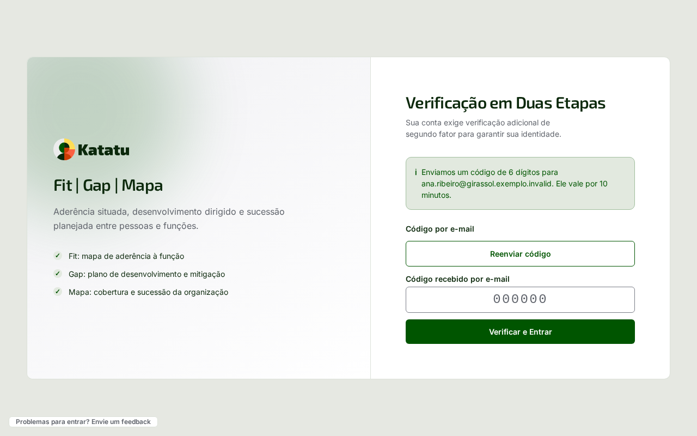
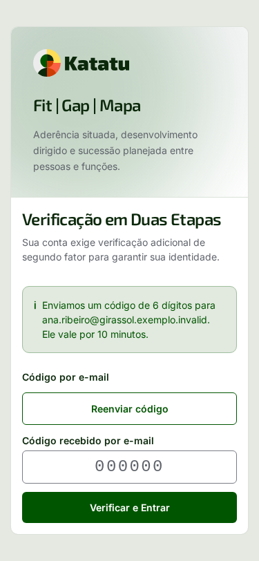

**Dica:** você pode trocar o código por e-mail por um aplicativo autenticador depois. Ele é mais forte e não depende da entrega do e-mail. Essa troca fica em **Meu Perfil**.

**Armadilha:** se o código demorar, espere alguns minutos antes de pedir outro. Pedir muitos códigos seguidos bloqueia a entrada por um tempo.

**Quando dá errado**

- **O convite venceu ou já foi usado.** Peça à equipe da V3RTECH um convite novo.
- **O código não chega.** Veja a pasta de spam e aguarde alguns minutos.

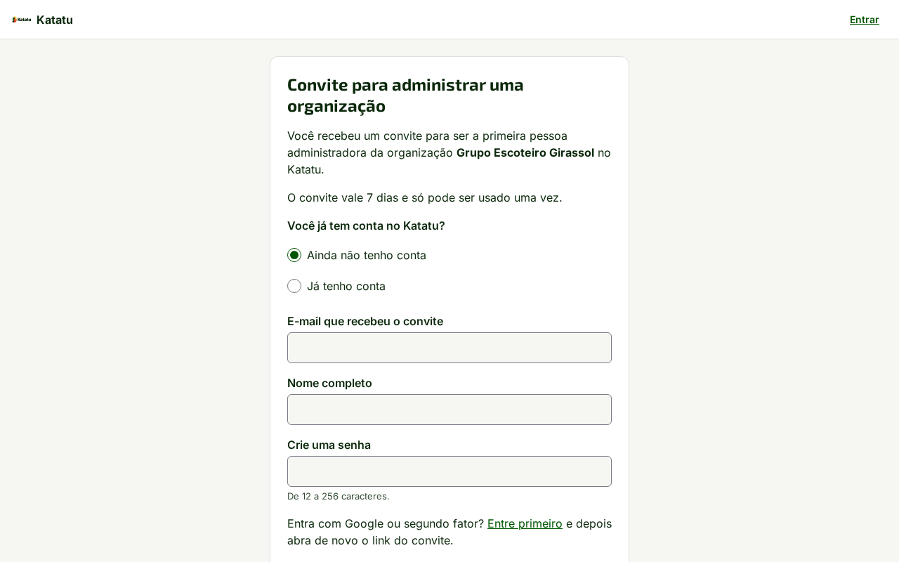
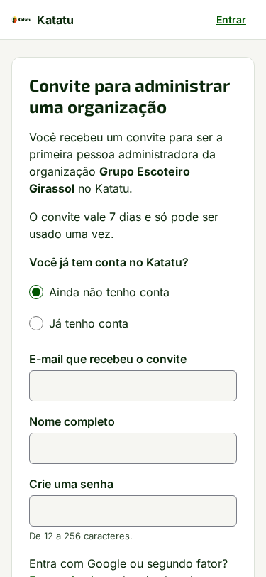

## Etapa 2: o assistente Configurar a organização

**Por que existe:** o assistente é o roteiro da implantação. Ele mostra cada passo, para que serve, o que você precisa ter em mãos e de que outro passo ele depende. Você não precisa lembrar a ordem.

**O que ter em mãos:** nada ainda. Esta tela só mostra o caminho.

Ao entrar pela primeira vez como administração de uma organização nova, o assistente abre sozinho.

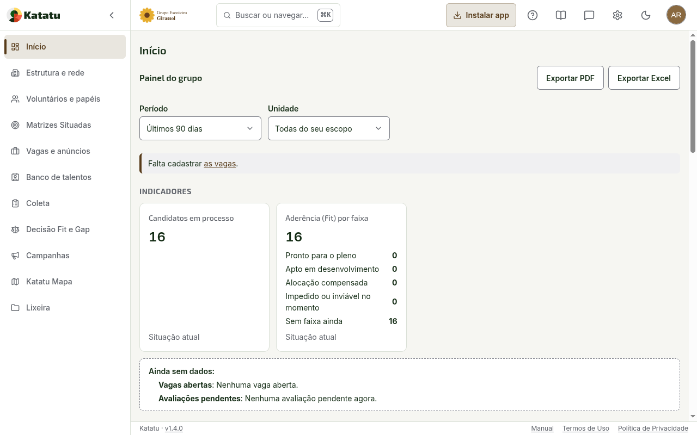
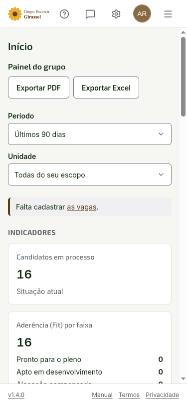 Depois, ele fica na lista **Primeiros passos**, no Início, com um link para cada passo.

| Passo | Para que serve no Girassol | Depende de |
| :--- | :--- | :--- |
| 1. Identidade visual | Nome, logo e cores nas telas e nos e-mails | nada |
| 2. Áreas da estrutura | Diretoria e ramos (áreas) | nada |
| 3. Funções e posições | As funções de cada área e quantas pessoas cabem em cada uma | Áreas da estrutura |
| 4. Catálogo | Competências, modelos de função e trilhas | Cargos |
| 5. Voluntários e convites | Os voluntários do grupo | Áreas da estrutura |
| 6. Papéis e acessos | Quem administra e quem gere cada área | Voluntários e áreas |
| 7. IA do grupo (opcional) | Chave própria ou franquia da plataforma | nada |
| 8. Calendário de ciclos | Quando acontecem as avaliações | nada |

**Como um passo fica feito:** sozinho, quando o mínimo está cadastrado. Por exemplo, o passo de Unidades fica feito com a primeira área. Você também pode marcar um passo como feito à mão, desde que os passos de que ele depende estejam feitos.

**Como pular:** qualquer passo pode ser pulado. Pular um passo não libera os que dependem dele. Marcar e pular podem ser desfeitos.

**Dica:** os passos 7 e 8 podem esperar. Faça a IA quando quiser usar a leitura de documentos, e o calendário antes da primeira campanha de avaliação.

**Armadilha:** pular um passo não o faz sumir da lista. Ele continua pendente, e os passos que dependem dele ficam bloqueados.

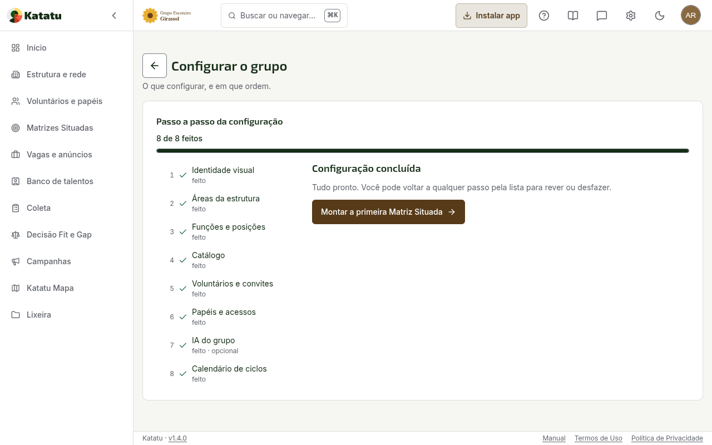
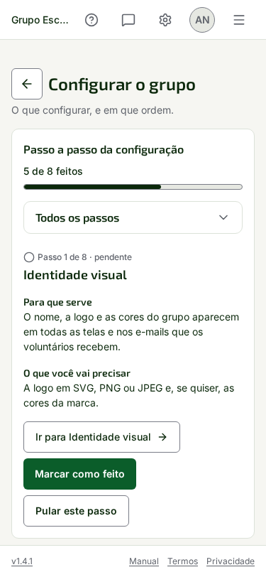

## Etapa 3: identidade, vocabulário e dados do grupo

**Por que existe:** as pessoas reconhecem o Katatu como o espaço do grupo quando as telas têm o nome, as cores e os termos dele. E a lei exige que o grupo saiba quem responde pelos dados dos voluntários.

**O que ter em mãos:** o nome de exibição do grupo, a logomarca em SVG, as cores escolhidas, a razão social e o CNPJ, o endereço de contato, e o endereço completo e o canal de atendimento de quem responde pelos dados.

**Onde fica:** **Configurações da Organização** (ícone de engrenagem no alto). A tela tem abas: **Identidade**, **Dados e contato**, **Privacidade**, **Pessoas e questionário de perfil**, **Plano e IA** e **Suporte**. Trocar de aba não apaga o que você digitou.

### 3.1 Identidade

1. Abra a aba **Identidade**.
2. Preencha o **nome de exibição**: no exemplo, **Grupo Escoteiro Girassol**.
3. Envie a **logomarca** horizontal, em SVG. Confirme quando o Katatu pedir. Ele retira do arquivo o que não pertence à imagem e recusa scripts dentro dele.
4. Escolha as **cores**. A primária é a cor de botões e links. A de destaque precisa ser legível sobre o fundo branco. O Katatu mostra o contraste de cada cor e ajusta sozinho o que fica abaixo de 4,5:1, dizendo o que mudou.
5. Ajuste o **vocabulário**, com a tabela do início deste guia: Grupo, Área, Função e Voluntário.
6. Escolha o **fuso horário**: no exemplo, America/Sao_Paulo. É por ele que a organização conta o dia para prazos e ciclos.
7. Toque em **Salvar**.

**Dica:** salve a identidade antes de começar a estrutura.

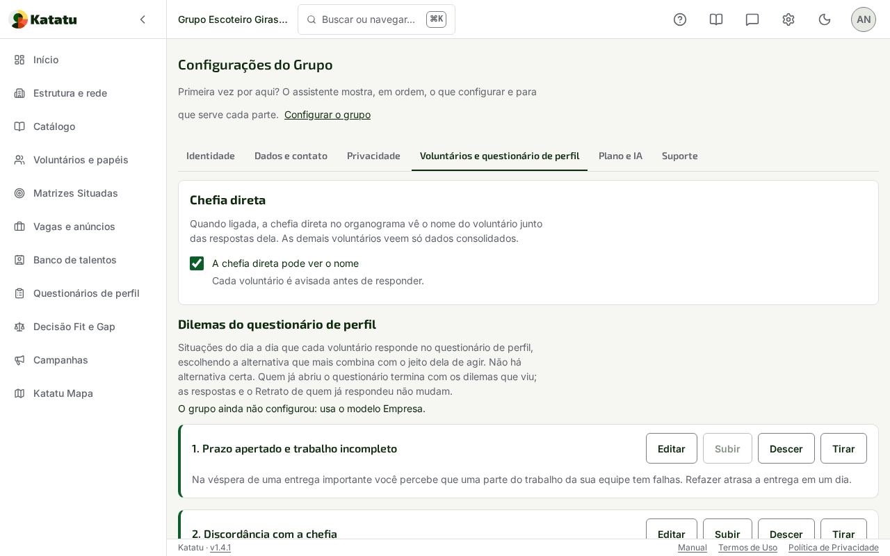
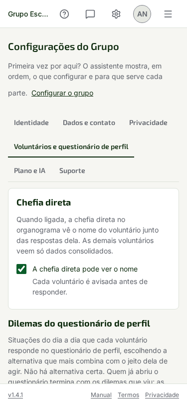 Os nomes escolhidos aqui aparecem em todas as telas seguintes.

**Armadilha:** o vocabulário muda as telas, mas não a planilha de importação, os e-mails nem as páginas públicas. Nessas, continuam valendo os nomes padrão (Unidade e Cargo). Na planilha, use esses nomes nos cabeçalhos.

### 3.2 Dados e contato

1. Abra a aba **Dados e contato**.
2. Informe a **razão social** e o **CNPJ** do grupo.
3. Informe o **e-mail de contato**, que recebe as respostas aos convites e lembretes. No exemplo, **contato@girassol.exemplo**.
4. Confirme o e-mail com o código que chega a ele. Um e-mail sem confirmação não é usado.

**Armadilha:** trocar a razão social ou o CNPJ não vale na hora. A troca passa pela conferência da equipe da plataforma. Até a decisão, os e-mails novos em nome do grupo ficam parados. Informe os dados certos da primeira vez.

### 3.3 Privacidade e controlador dos dados

1. Abra a aba **Privacidade**.
2. Em **Controlador dos dados pessoais**, informe o **endereço completo** e o **canal de atendimento ao titular**. São obrigatórios.
3. Informe o encarregado de dados (DPO), com nome, e-mail e telefone, se o grupo tiver um. É opcional.
4. Salve. Os dados passam a valer para as pessoas da organização e aparecem na política de privacidade.
5. Em **Termos e Política**, publique a versão do documento do grupo, se houver. Quando a versão muda, as pessoas aceitam de novo no acesso seguinte.
6. Em **Domínios confiáveis para links**, liste os sites de onde um requisito ou uma etapa de trilha pode trazer link. Digite o site sem `https://`, por exemplo `ead.escoteiros.org.br`, toque em **Acrescentar domínio** e depois em **Salvar domínios**.

**Por que isto importa:** o controlador é quem responde pelos dados dos voluntários. Quando um voluntário pede para ver ou apagar os próprios dados, a resposta sai com o endereço e o canal que você cadastrou aqui.

**Dica:** se um curso indicado pela trilha tiver link, cadastre o site dele antes. Sem domínio na lista, nenhum link é aceito, e isso não é erro de tela.

**Quando dá errado**

- **Campo obrigatório vazio.** A tela aponta o campo. Preencha e salve de novo.
- **Endereço de site não aceito no texto.** Não cole endereços nos textos comuns. Use o campo de domínio confiável.

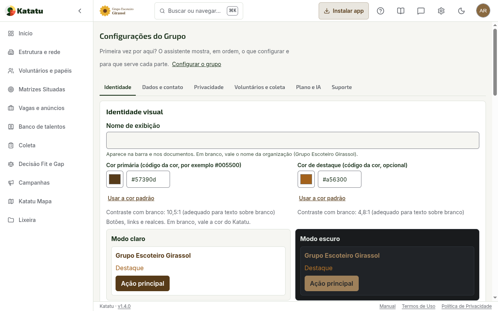
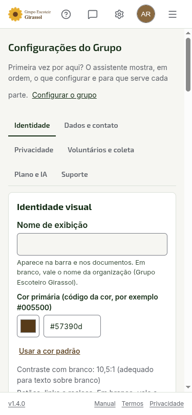

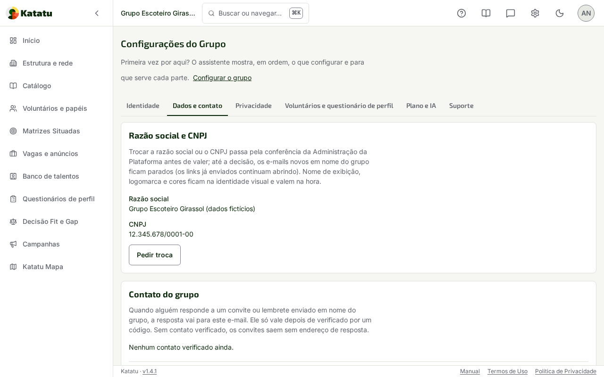
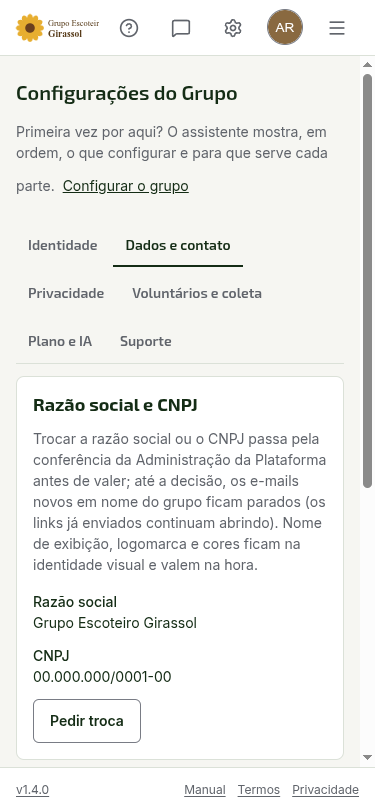

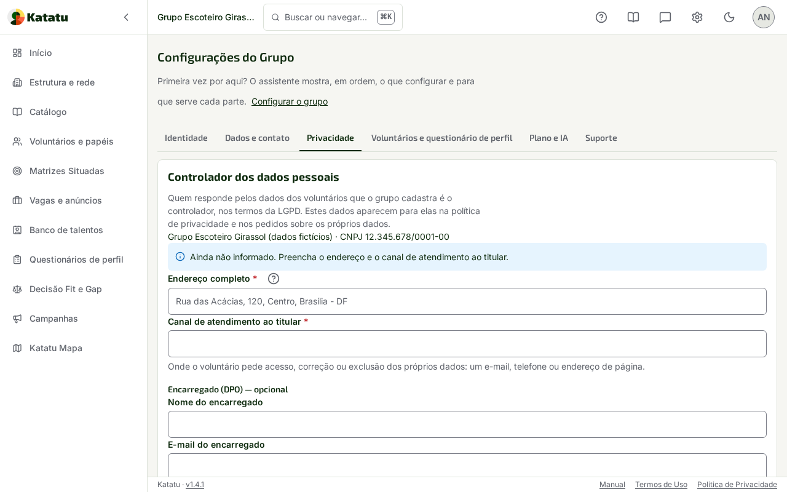
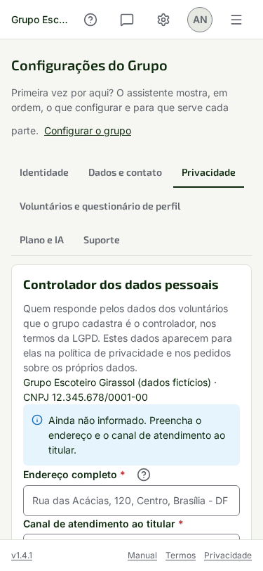

## Etapa 4: estrutura, áreas e funções

**Por que existe:** a estrutura é o mapa do grupo. Cada função nasce dentro de uma área, e as avaliações, os convites e o Katatu Mapa dependem dela para saber quem está onde.

**O que ter em mãos:** o organograma do grupo, em texto, planilha ou documento. O Estatuto e a lista de voluntários ajudam a não esquecer uma área.

**Onde fica:** **Estrutura e rede › Estrutura**.

**Passo a passo**

1. Abra **Estrutura e rede** e escolha **Estrutura**. Se estiver vazia, você verá a tela sem áreas.
2. Escolha uma das formas de entrada:
   - **Digitar:** crie uma área por vez, com o botão de nova área. É o caminho mais simples para um grupo pequeno.
   - **Importar:** envie uma planilha, que o Katatu lê direto, ou um documento, imagem ou texto livre, lido pela IA.
3. Se importar texto, escreva **uma linha por área ou função**, com recuo: a área no nível de cima e as funções recuadas embaixo. Use o exemplo do Girassol acima.
4. Toque em **Ler** (ou no botão equivalente) e espere a leitura.
5. **Confira a proposta.** A IA devolve os itens, cada um com a área em que fica. Nada é gravado antes disso. Desmarque o que não quiser.
6. Toque em **Aplicar**. A árvore de áreas aparece pronta.

**Exemplo:** a leitura do Girassol devolve 12 itens: 6 áreas (Diretoria, Presidência, Diretoria Administrativa, Ramo Escoteiro e as duas tropas) e 6 funções. Como todos estão certos, você aplica sem desmarcar nada.

**Dica:** a árvore segue a **ordem em que as áreas foram criadas ou importadas**. Se quiser a diretoria primeiro, crie ou importe a diretoria primeiro. Não é possível reordenar à mão por enquanto.

**Armadilha:** a IA lê o texto como você o escreveu. Um recuo errado coloca a função na área de cima, e a proposta mostra isso antes de aplicar. Confira a área de cada linha.

**Armadilha:** cada área com a mesma função precisa de cadastro próprio. Duas tropas significam duas funções de Chefe de Tropa, uma em cada tropa.

**Quando dá errado**

- **Queda de conexão na leitura.** A tela tenta de novo sozinha, uma vez. Se falhar, toque em **Ler** de novo.
- **Item descartado.** A prévia diz o motivo. Ajuste o texto e leia de novo.

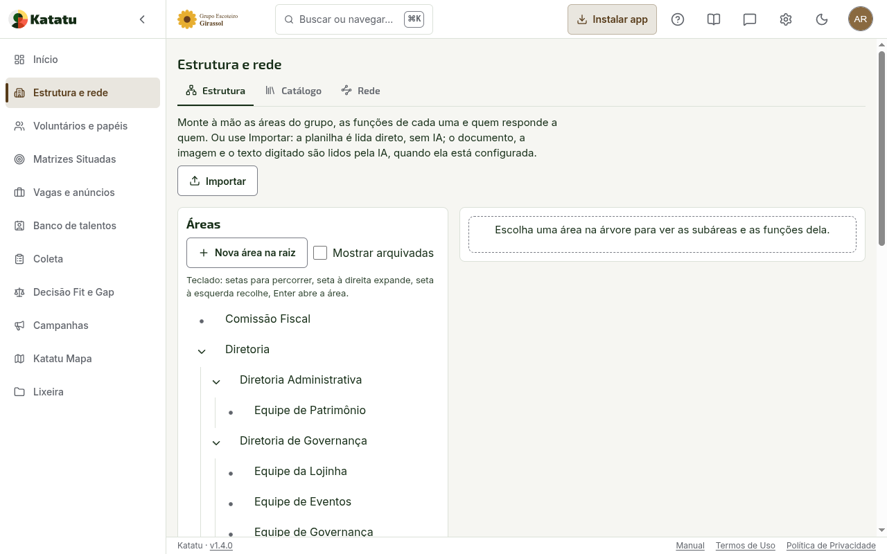
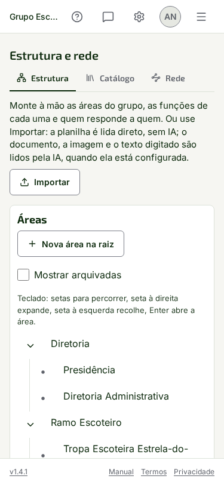

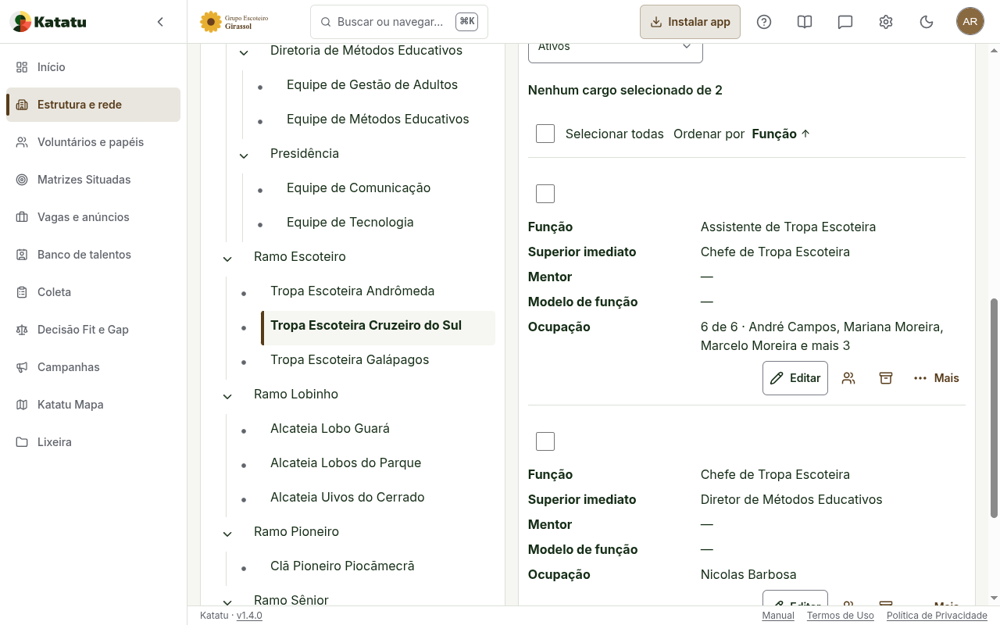
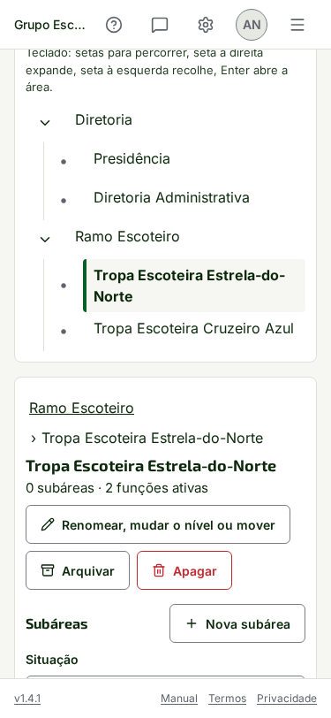

## Etapa 5: catálogo, com competências, modelos de função e trilhas

**Por que existe:** o catálogo descreve o que se espera de cada função. Ele alimenta a Matriz, a trilha de formação e o plano dos primeiros 90 dias. Cadastre uma vez e reaproveite em todas as funções que precisam da mesma competência.

**O que ter em mãos:** a lista de competências do grupo (no caso da UEB, os documentos de referência), e para cada função, o que ela exige e em que grau.

**Onde fica:** **Estrutura e rede › Catálogo**, com as abas **Referenciais**, **Modelos de cargo** e **Trilhas**. Os modelos de cargo mantêm o nome padrão na tela de Catálogo.

### 5.1 Ordem certa

1. **Referenciais primeiro.** Modelos e trilhas só escolhem competências que já existem.
2. **Modelos e trilhas**, em qualquer ordem.
3. **Matrizes**, por último, porque copiam o que já está no catálogo.

### 5.2 Referencial: a régua de uma competência

**Por que isto importa:** sem régua, o grau vira opinião. Dois avaliadores dão notas diferentes para a mesma pessoa. A âncora diz o que se vê na prática em cada grau.

**Passo a passo**

1. Em **Catálogo**, escolha **Referenciais** e toque em **Novo referencial**.
2. Na coluna **Nível**, escolha **Organização inteira** para uma competência que todas as áreas usam, ou a área que vai usá-la.
3. Preencha o **nome**, a descrição (opcional) e a âncora de cada grau, de 0 a 3. As quatro são obrigatórias.
4. Toque em **Salvar**.

**Exemplo do Girassol: a competência *Trabalho em equipe*, na Organização inteira**

- **Grau 0:** não participa das combinações da equipe e não avisa quando não pode ir.
- **Grau 1:** participa das combinações quando alguém lembra, e avisa a falta quando é cobrado.
- **Grau 2:** participa das combinações e avisa a falta com antecedência, sem precisar de cobrança.
- **Grau 3:** organiza a divisão de tarefas da equipe e ajuda outros a entrar no ritmo.

**Dica:** escreva cada âncora como algo que se pode observar. "Colabora bem" não diz o que a pessoa faz. "Avisa a falta com antecedência" diz.

**Armadilha:** o sistema não impede dois referenciais com o mesmo nome. Procure antes de cadastrar, senão a lista de escolha fica com nomes repetidos.

### 5.3 Modelo de função: o que cada função exige

**Por que isto importa:** o modelo é o que a Matriz copia. Um modelo bem feito faz cada Matriz nova começar pronta. Um modelo mal feito obriga a corrigir cada Matriz, uma a uma.

**Piso e pleno:** o **piso do dia 1** é o grau mínimo para começar a atuar com segurança. O **pleno esperado** é o grau que se espera da pessoa já madura na função. O piso nunca é maior que o pleno.

**Passo a passo**

1. Em **Catálogo**, escolha **Modelos de cargo** e toque em **Novo modelo de cargo**.
2. Preencha o título e, se quiser, a descrição.
3. Em cada linha, escolha a **competência** e informe o **piso do dia 1** e o **pleno esperado**, de 0 a 3.
4. Use **Adicionar competência** para acrescentar linhas e toque em **Salvar**.

**Exemplo do Girassol: o modelo *Chefe de Tropa Escoteira***

| Competência | Piso do dia 1 | Pleno esperado |
| :--- | :--- | :--- |
| Trabalho em equipe | 2 | 3 |
| Planejamento de atividades | 2 | 3 |
| Acompanhamento de patrulha | 1 | 3 |

Um chefe novo precisa planejar as atividades sozinho já no primeiro dia. No acompanhamento de patrulha, basta o grau 1 para começar com apoio.

**Armadilha:** a lista de competências do modelo só mostra os referenciais da área escolhida e das áreas acima dela. Se a lista aparece vazia, cadastre o referencial no nível certo.

### 5.4 Trilha: como a lacuna vira passos

**Por que isto importa:** sem trilha, a pessoa sabe que precisa melhorar, mas não sabe por onde começar nem em quanto tempo.

**Passo a passo**

1. Em **Catálogo**, escolha **Trilhas** e toque em **Nova trilha**.
2. Preencha o título.
3. Em cada etapa, informe o código, o título, a competência, o grau alvo (de 0 a 3) e o prazo em dias.
4. Toque em **Salvar**.

**Exemplo do Girassol: a trilha *Chefe de tropa***

| Código | Etapa | Competência | Grau alvo | Prazo (dias) |
| :--- | :--- | :--- | :--- | :--- |
| TRP-01 | Acompanhar duas reuniões de patrulha conduzidas pelo chefe atual | Acompanhamento de patrulha | 2 | 60 |
| TRP-02 | Planejar e conduzir duas atividades com revisão da diretoria | Planejamento de atividades | 2 | 90 |

**Dica:** o código de cada etapa precisa ser único na trilha e nas outras trilhas que a área enxerga. Use prefixos diferentes, como TRP para tropa e INT para integração.

**Armadilha:** o prazo é obrigatório. O "30" que aparece apagado dentro do campo é só um exemplo, e sem prazo a etapa é recusada.

### 5.5 Cadastrar muita coisa de uma vez

Para muitos itens, use o botão **Importar** na tela de Catálogo, no tipo que você quer: referenciais, modelos de cargo ou trilhas. A janela mostra o formato, os campos e o botão **Baixar o exemplo**.

**Dica:** para um documento longo e bem estruturado, como o da UEB, prefira a importação em **JSON**. Ela é previsível e reimportar o mesmo arquivo atualiza sem duplicar. O botão **Ler de um documento**, com IA, serve para textos menores ou para conferir.

**Quando dá errado**

| O que aparece | O que fazer |
| :--- | :--- |
| Âncora do grau N: descreva o comportamento observável. | Escreva a âncora. As quatro são obrigatórias. |
| Linha N: Piso (X) acima do pleno (Y). | Ajuste os dois valores. O piso não pode ser maior que o pleno. |
| Código repetido na trilha. | Dê um código diferente a cada etapa. |
| Prazo sugerido: inteiro de 1 a 3650 dias. | Informe um número inteiro de dias. |

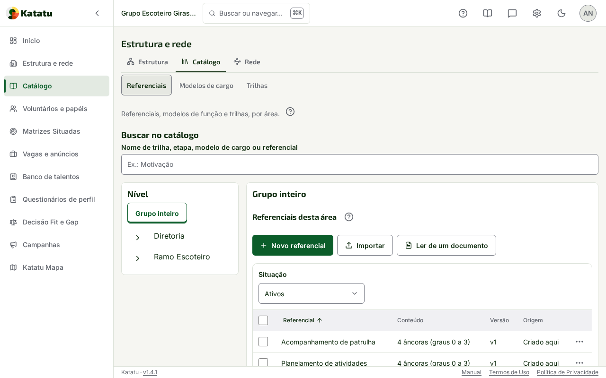
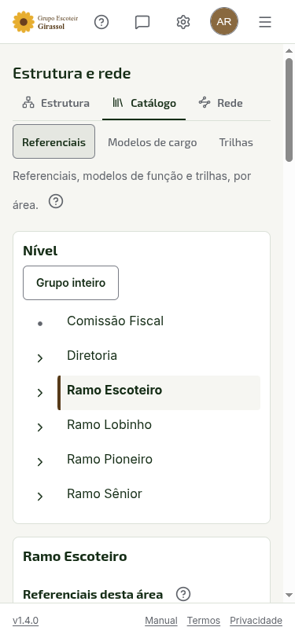

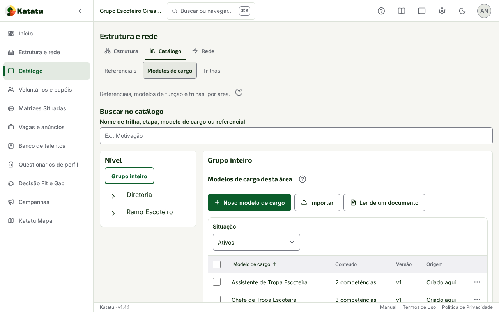
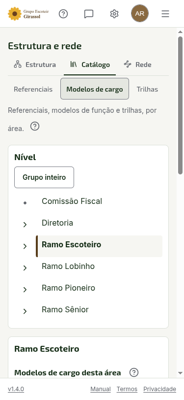

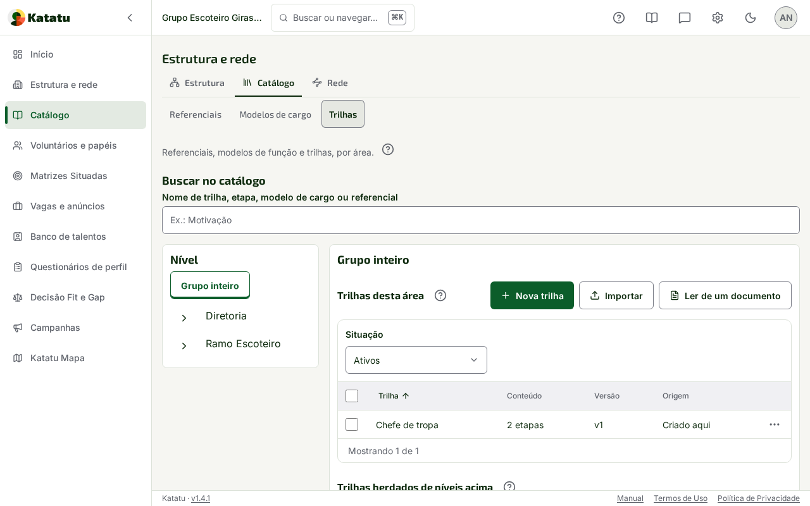
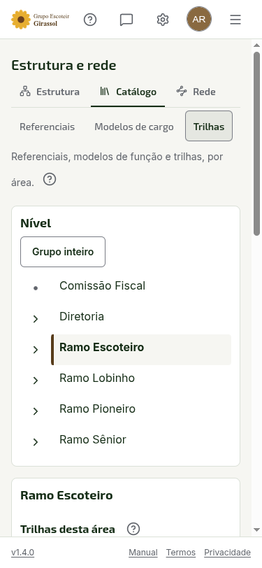

## Etapa 6: voluntários nas suas funções

**Por que existe:** cada voluntário cadastrado ocupa uma função. É isso que faz a Matriz, o questionário de perfil e o Mapa saberem quem é quem.

**O que ter em mãos:** uma planilha com e-mail, nome, área, papel inicial e função de cada pessoa. Os cabeçalhos são **E-mail**, **Nome**, **Unidade** (a área) e **Cargo** (a função). **Papel inicial** é opcional.

**Onde fica:** **Pessoas e papéis**, aba **Pessoas**, botão **Importar planilha**.

### 6.1 Convidar ou cadastrar sem acesso

No primeiro passo da importação, escolha o modo:

- **Convidar:** cada pessoa recebe um e-mail para entrar no Katatu. Use quando a pessoa já deve acessar.
- **Cadastrar sem acesso:** nenhum e-mail sai. A pessoa passa a existir no grupo, ocupando a função. Use quando você quer organizar antes e convidar depois.

**Por que cadastrar sem acesso primeiro:** assim você confere a estrutura e as funções com calma, e só convida quando tudo estiver certo.

### 6.2 Conferir a prévia

1. Depois do arquivo, a tela mostra a **prévia**: cada linha, com a função de cada pessoa.
2. Confira as linhas com erro. Uma linha da própria administração aparece como erro porque ela já existe no grupo. Isso é esperado.
3. Quem tem duas funções entra em **duas linhas**, com o mesmo e-mail e um cargo diferente em cada.
4. Se a função não tem posição livre para todas as pessoas, a prévia avisa quantas faltam. Marque **Abrir N posições que faltam** para o Katatu abrir essas posições.
5. Toque em **Confirmar**. Nada é gravado se alguma linha tiver erro.

**Exemplo:** Helena Duarte, Chefe de Tropa Escoteira na Tropa Estrela-do-Norte, entra com o e-mail dela e o cargo "Chefe de Tropa Escoteira". A função nasce com uma posição, e a tela ocupa essa posição com ela.

### 6.3 Posições e posse

Cada função nasce com uma posição. Quando há mais de um assistente numa tropa, a quantidade de posições precisa ser ajustada. Depois, as pessoas tomam posse, e a área passa a mostrar os ocupantes.

**Dica:** confira a função de cada pessoa antes de confirmar. Corrigir depois é possível, mas uma por uma.

**Armadilha:** a importação não abre posições por conta própria. Quem não tem posição livre entra sem função, a menos que você marque **Abrir N posições que faltam**.

**Armadilha:** a planilha usa os nomes padrão, Unidade e Cargo. Confira os cabeçalhos mesmo que a tela mostre Área e Função.

**Quando dá errado**

- **Nome ou área não encontrados.** A unidade e o cargo são procurados pelo nome exato. Copie o nome como está na tela de Estrutura.
- **E-mail repetido na mesma pessoa, com o mesmo cargo.** A linha repetida é ignorada. Use duas linhas só para cargos diferentes.

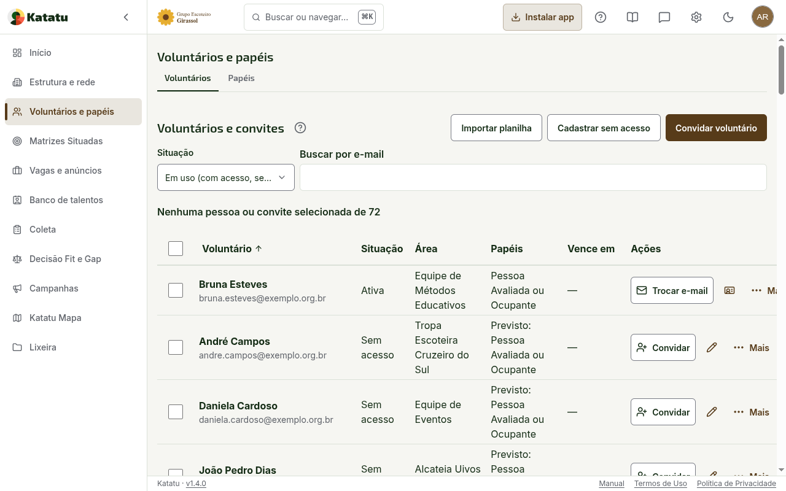
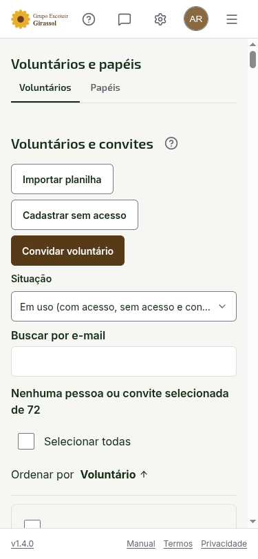

> **Captura pendente:** prévia da importação de planilha de voluntários (antes de confirmar), em desktop e em 375px. Arquivos previstos: manual-11-implantar-voluntarios-previa-desktop.png e manual-11-implantar-voluntarios-previa-375.png.

## Etapa 7: Matrizes Situadas

**Por que existe:** a Matriz descreve a função como ela acontece de verdade no grupo, não só no papel. Ela nasce do modelo de função e acrescenta quatro eixos, respondidos numa conversa guiada por quem conhece a função. É a Matriz que sustenta a seleção, a avaliação e o plano de desenvolvimento de quem ocupa a função.

**O que ter em mãos:** o modelo da função (da etapa 5) e uma pessoa que conheça a função bem, para responder à conversa.

**Onde fica:** **Matrizes Situadas › Nova Matriz**.

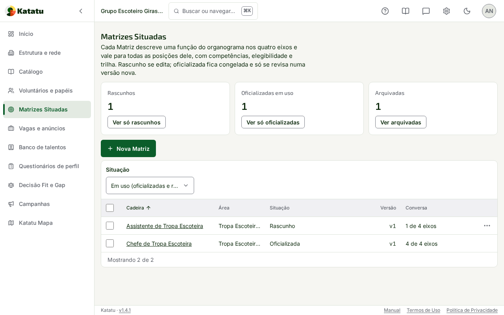
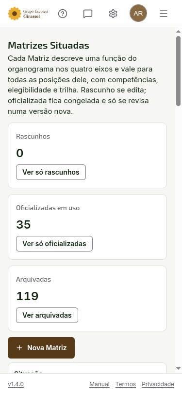

### 7.1 Criar a Matriz

1. Toque em **Nova Matriz** e escolha a função, por exemplo **Assistente de Tropa Escoteira**, na Tropa Estrela-do-Norte.
2. Confirme o modelo marcado. Você pode mantê-lo ou escolher outro.
3. Responda a **conversa guiada**, eixo por eixo.

### 7.2 Os quatro eixos

1. **Autonomia nas primeiras semanas:** o que a pessoa conduz sozinha, o que decide na hora e o que não decide sozinha.
2. **Incidentes críticos:** situações difíceis reais da função, como um jovem machucado longe da sede, e o que se espera de quem está lá.
3. **Relações e ambiguidade:** com quem a função se relaciona e o que muda sem aviso, como número de jovens e adultos disponíveis.
4. **Carga e janelas fixas:** horas por semana, mínimas, típicas e limítrofes, e o horário fixo, se houver.

**Exemplo do Girassol, no eixo 4:** o assistente tem 2 horas mínimas, 4 típicas e 1 limítrofe por semana, com janela fixa aos sábados, das 14h30 às 18h.

### 7.3 Trilha, elegibilidade e oficializar

1. Em **Trilha de aprendizagem**, toque em **Sugerir do catálogo**. A sugestão traz uma etapa por competência e grau, do piso ao pleno. Se houver mais de uma trilha que serve à área, escolha em **Trilha para sugerir**.
2. Em **Elegibilidade**, marque o que a pessoa precisa para a função, por exemplo a idade mínima e o nível de formação. Cada requisito pode ser **atendido**, **compensável** ou **impedido**.
3. Toque em **Oficializar**. A janela mostra o que será congelado. Depois de oficializada, a Matriz não muda.

**Para corrigir uma Matriz oficializada:** abra uma revisão. Ela nasce como rascunho, e a oficializada continua valendo até a revisão ser oficializada.

**Dica:** confira a trilha sugerida antes de oficializar. Com mais de uma trilha na mesma área, a sugestão pode juntar etapas repetidas. Escolha a trilha certa em **Trilha para sugerir**.

**Dica:** cada área pede a sua própria Matriz, mesmo quando a função é igual. As duas tropas precisam, cada uma, da Matriz do seu Chefe e do seu Assistente. Crie uma e use em lote, como no item 7.4.

**Armadilha:** dar **Oficializar** congela a Matriz. Erro de texto ou de nível depois disso exige uma revisão nova, e não uma correção simples.

### 7.4 Várias Matrizes de uma vez

Na lista de Matrizes, marque as que vão mudar e escolha **Acrescentar requisito**, **Tirar requisito** ou **Acrescentar etapa**. A janela mostra quantas e quais vão mudar antes de aplicar. Quem não pode receber a mudança fica de fora, com o motivo.

**Quando dá errado**

- **Matriz já tem o mesmo código.** Ela fica de fora da mudança em lote. Abra a Matriz e ajuste à mão.
- **Matriz arquivada ou com revisão em rascunho.** Ela também fica de fora, com o motivo na lista.

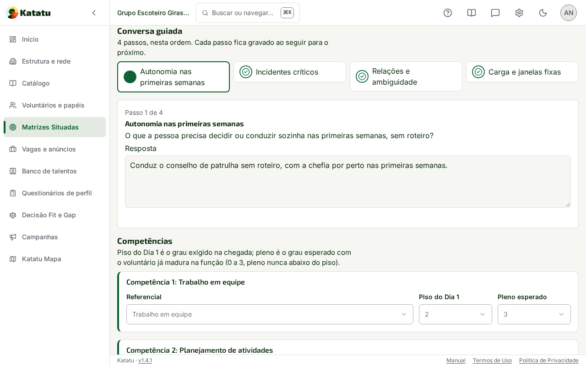
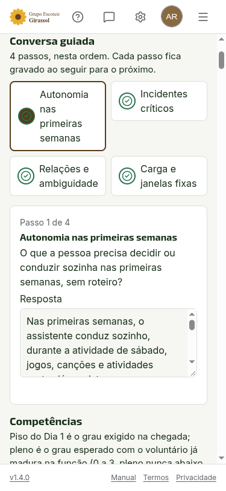

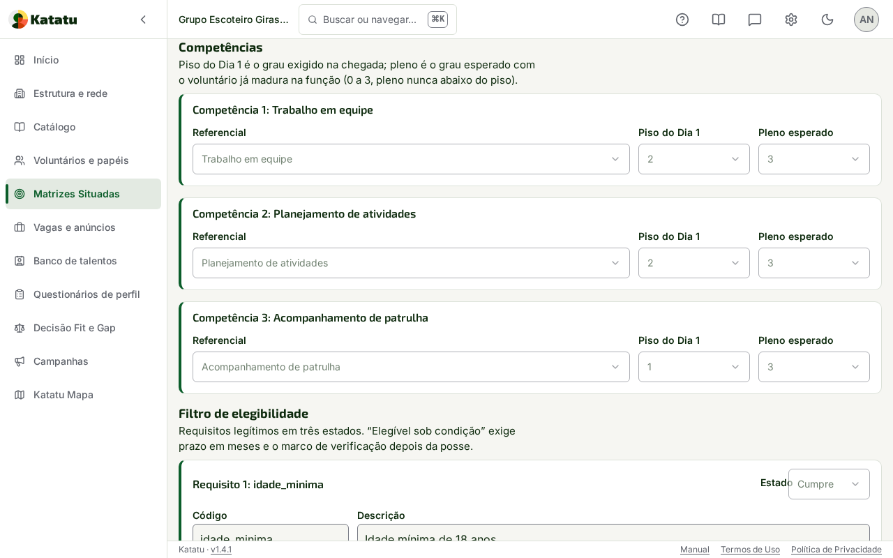
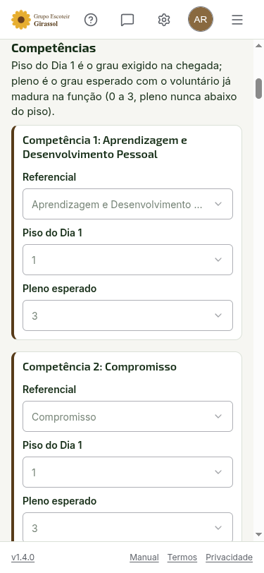

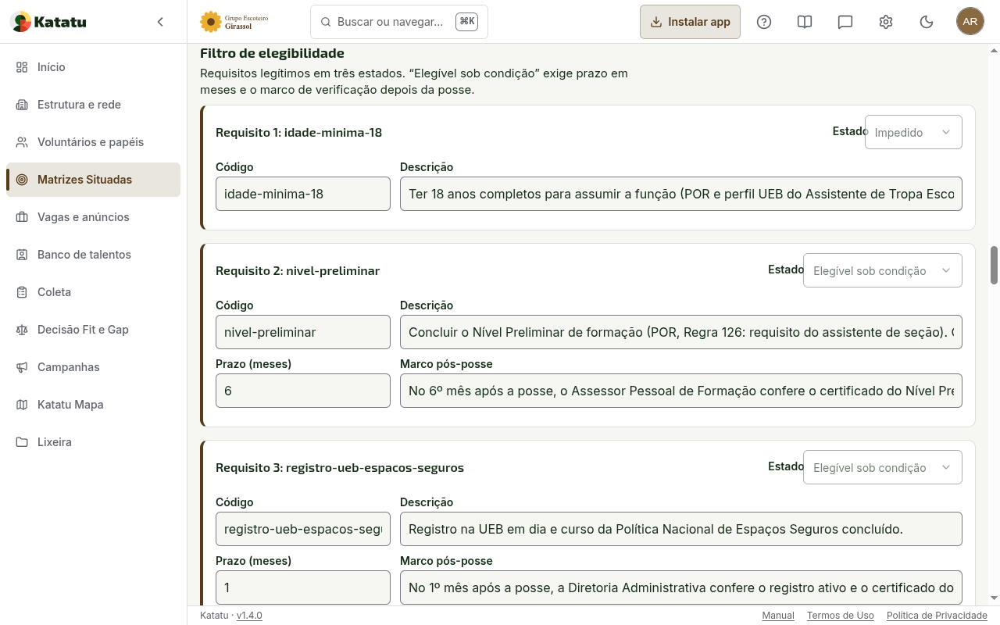
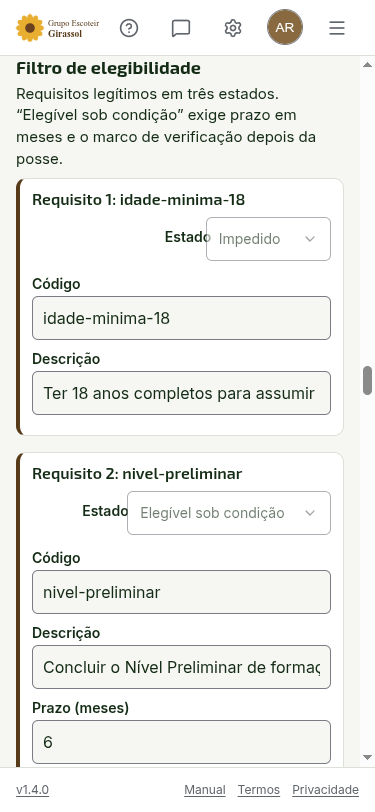

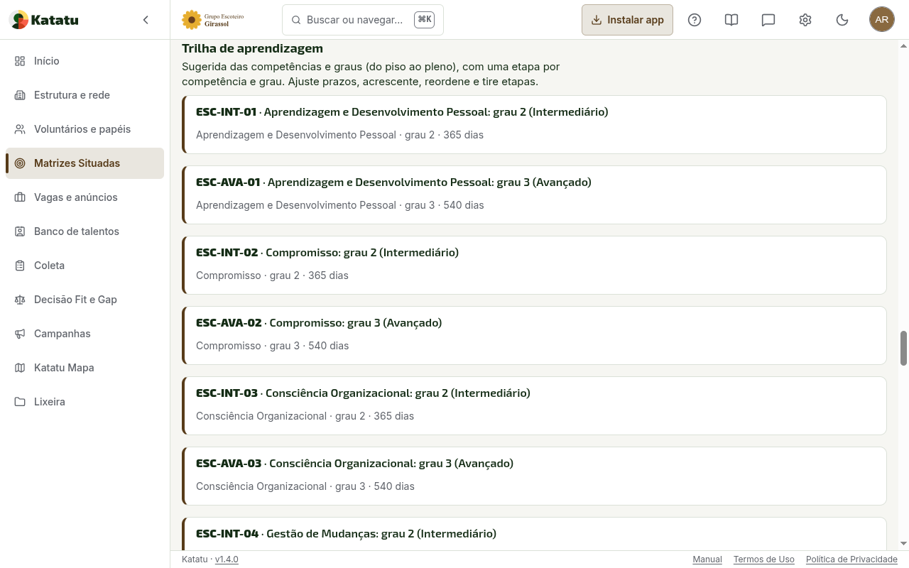
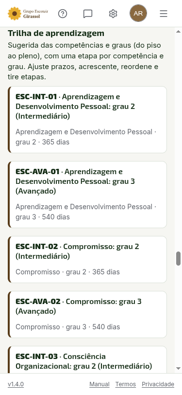

## Etapa 8: quem responde a quem, papéis e calendário

**Por que existe:** as avaliações precisam saber quem avalia quem. O gestor imediato vem da linha direta do organograma. Os papéis definem quem vê e altera o quê. O calendário diz quando as avaliações podem acontecer.

### 8.1 Quem responde a quem

O organograma já mostra a linha de cada função. Confira que ela está certa, por exemplo:

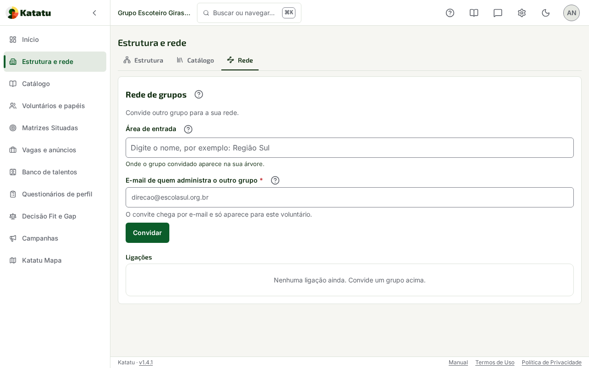
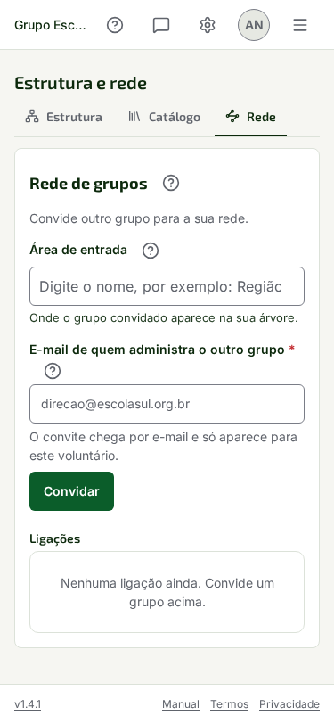

| Função | Responde a |
| :--- | :--- |
| Assistente de Tropa Escoteira | Chefe da sua tropa |
| Chefe de Tropa Escoteira | Diretora Presidente |

**Armadilha:** se a linha estiver errada, o gestor imediato também fica errado, e a pessoa recebe pedido de avaliação de quem não deveria. Confira antes de abrir qualquer campanha.

### 8.2 Papéis

O Katatu traz quatro papéis prontos:

- **Administração da Organização:** vê e altera a configuração do grupo.
- **Gestor da Unidade:** gere a própria área ou diretoria.
- **Responsável por documentos legais:** cuida dos documentos legais do grupo.
- **Pessoa Avaliada:** cada voluntário, para ver o próprio retrato e responder ao questionário de perfil.

No Girassol, a Diretora Presidente ficou com a Administração, e o Diretor Administrativo com os documentos legais.

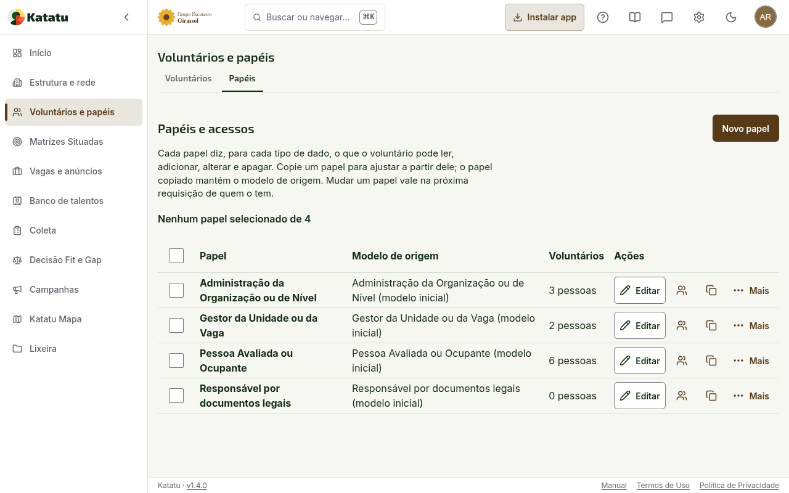
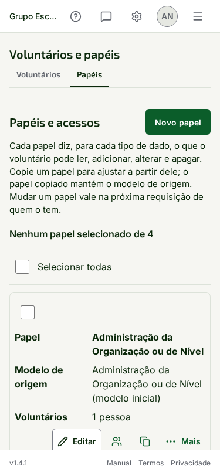

**Dica:** defina os papéis antes do convite. Quando você convida, a pessoa entra já com o papel que você escolheu.

### 8.3 Calendário de ciclos

As campanhas de avaliação só podem ser disparadas dentro de uma janela do calendário. Em **Campanhas › Calendário de ciclos**, cadastre cada janela. No exemplo do Girassol:

- **180º:** de 1º de março a 30 de abril de 2027, junto da renovação dos acordos de voluntariado. Respondem o gestor imediato e a própria pessoa.
- **360º:** de 1º de setembro a 31 de outubro de 2027. Além deles, respondem os pares e os liderados.

**Dica:** para valer para o grupo inteiro, use **Abranger todas**, em vez de marcar uma área por vez.

**Armadilha:** cadastrar a janela não dispara nada. Nenhum e-mail sai, e nenhuma avaliação começa até alguém disparar a campanha dentro da janela.

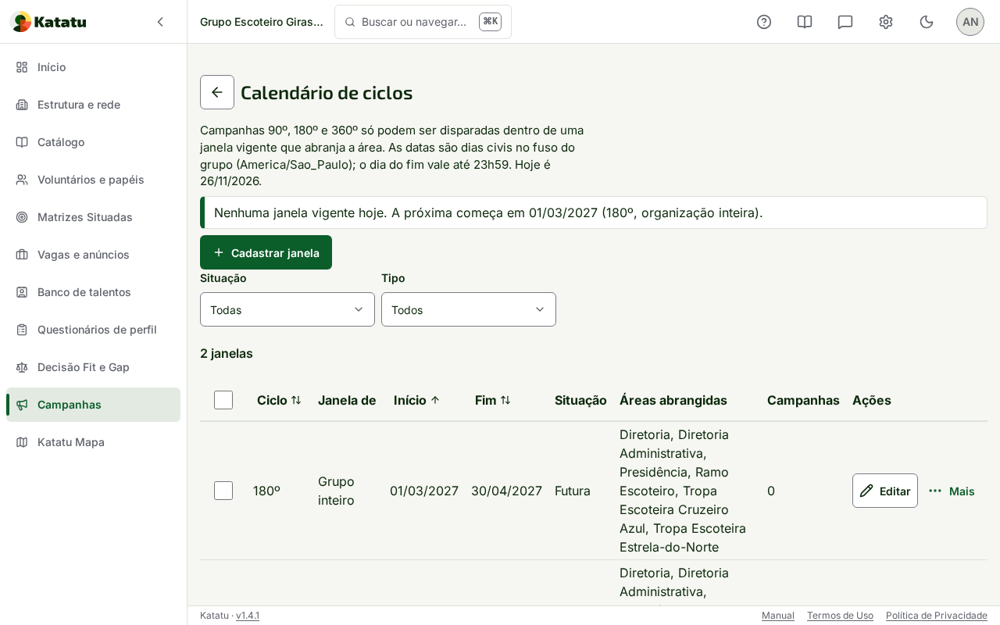
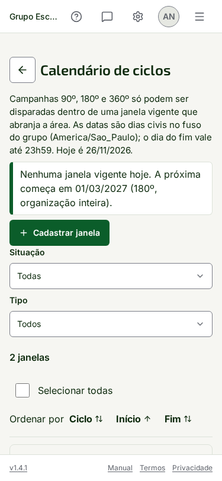

## Etapa 9: papel previsto e convites em lote

**Por que existe:** convidar cem pessoas uma a uma é lento e sujeito a erro. O papel previsto deixa o papel de cada pessoa definido antes, sem mandar nenhum e-mail. Assim, quando você convida, o papel já vem preenchido.

**Passo a passo**

1. Em **Pessoas e papéis › Pessoas**, marque as pessoas que estão cadastradas sem acesso.
2. Escolha **Mais ações em lote › Definir papel previsto** e escolha o papel de cada grupo, por exemplo **Gestor da Unidade** para os chefes de tropa.
3. A lista mostra "Previsto: <papel>" em cada linha. Nenhum e-mail saiu.
4. Quando estiver tudo conferido, marque as pessoas e escolha **Mais ações em lote › Convidar**.
5. Na janela de confirmação, leia o resumo: quantas pessoas recebem cada papel. Confirme.

**Exemplo do Girassol:** os chefes e assistentes de tropa receberam **Gestor da Unidade** na própria tropa. A Diretora Presidente recebeu **Administração da Organização**. Os demais voluntários ficaram com **Pessoa Avaliada**.

**Dica:** avise as pessoas antes do convite, por WhatsApp ou outro canal. Explique o que vem no e-mail e o que fazer: aceitar, informar o código e aceitar os termos.

**Armadilha:** o papel de gestão só vale na área do cadastro. Quem está sem área no cadastro fica de fora do lote, com o motivo, e os demais seguem.

**Armadilha:** o convite tem validade. Ele vence em alguns dias. Reenvie ou renove o convite antes disso, e o papel escolhido é mantido.

**Quando dá errado**

- **Papel de gestão sem área no cadastro.** A pessoa fica de fora do lote. Preencha a área e tente de novo.
- **E-mail de convite não chegou.** Peça para olhar o spam. Se não estiver lá, reenvie o convite.

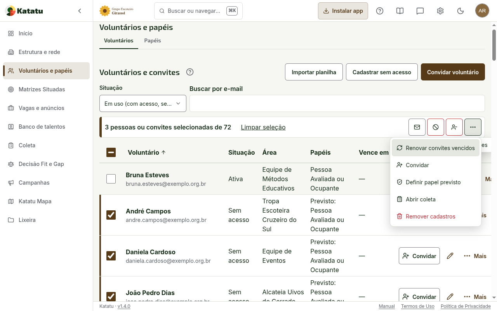
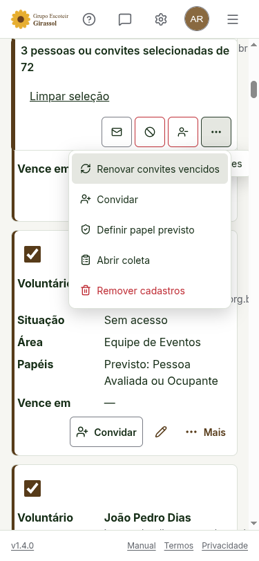

## Etapa 10: abrir os questionários de perfil

**Por que existe:** o questionário de perfil é a conversa em que o voluntário conta a trajetória e responde às perguntas sobre o dia a dia. Sem questionário aberto, a pessoa não tem nada para responder, e a Matriz não recebe perspectivas.

**Armadilha, a mais comum:** o questionário **não aparece sozinho**. Quando o voluntário entra e vê "Você não tem questionário de perfil para responder agora", não há defeito: ninguém o chamou ainda. Quem administra precisa chamar cada pessoa.

**Passo a passo, uma pessoa por vez**

1. Abra **Matrizes Situadas** e escolha a Matriz da função da pessoa.
2. Abra a seção **Avaliados**.
3. No campo **Designar avaliado**, busque o nome e escolha a pessoa.
4. Confirme. A pessoa passa a ver o questionário em **Questionários de perfil** e no Início.

**Passo a passo, todos os ocupantes de uma função**

1. Na Matriz, em **Avaliados**, toque em **Designar os ocupantes deste cargo**.
2. Confirme. A tela mostra quantas pessoas foram chamadas, quantas já estavam na lista e quantas foram recusadas, com o motivo.

**Passo a passo, em lote na lista de pessoas**

1. Em **Pessoas e papéis › Pessoas**, marque as pessoas.
2. Escolha **Mais ações em lote › Abrir questionário de perfil**. Cada pessoa é chamada na Matriz em uso da função que ela ocupa.

**Dica:** antes de chamar todo mundo, abra o questionário para você mesmo e para um voluntário de teste. Responda, veja o resultado e só então chame os demais.

**Dica:** quem ocupa duas funções é chamado na Matriz da função principal. Não crie dois questionários para a mesma pessoa.

**Armadilha:** chamar não envia e-mail. Quem não aceitou o convite ainda não tem acesso, e responde depois de entrar. Por isso, faça os convites da etapa 9 antes de abrir os questionários.

**Quando dá errado**

- **"Esta pessoa já tem outro questionário de perfil ativo nesta Matriz."** O questionário que está valendo continua. Use o existente.
- **Pessoa recusada na chamada em lote.** A tela diz o motivo. Em geral, falta de área ou de função no cadastro.

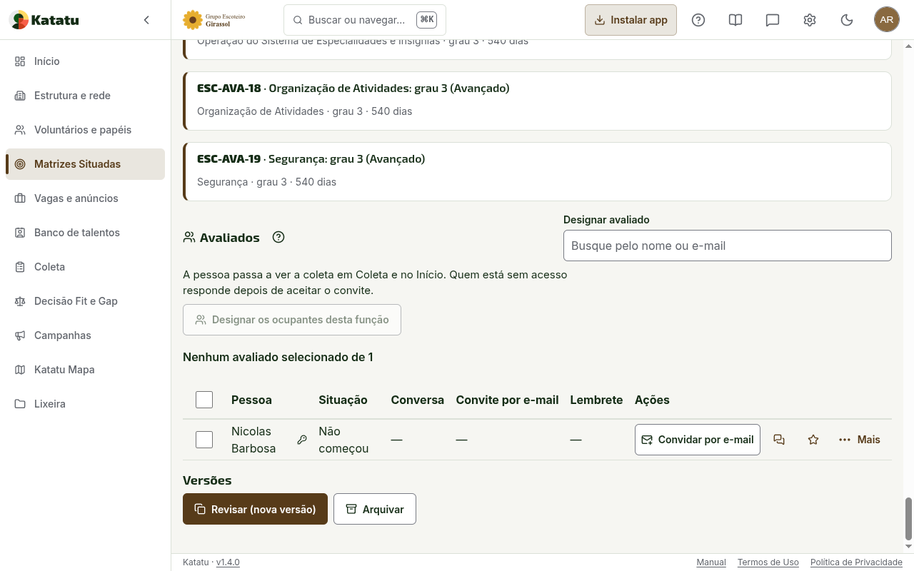
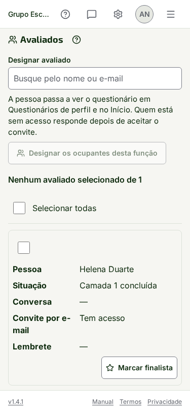

## Etapa 11: primeira leitura no Katatu Mapa

**Por que existe:** o Mapa mostra, por cargo e sem nomes, a cobertura de sucessão, as avaliações pendentes e as lacunas por competência. É o retrato do grupo, e ele muda conforme os questionários e as avaliações chegam.

**Onde fica:** **Mapa**, no menu.

**O que você vai ver logo no começo:** as cadeiras aparecem como **sem dados**. Isso é o esperado. Não é zero: é falta de registro. A cobertura, a sucessão e as lacunas aparecem depois das primeiras respostas e avaliações.

**Como ler:**

- **Cobertura:** sucessão imediata, programada ou ninguém.
- **Sobrecarga:** aparece quando um candidato capaz foi recusado por causa da carga de horas.
- **Última avaliação:** a data e o tipo da última campanha encerrada do ocupante.

**Dica:** o Mapa não é uma nota. Ele mostra quem está pronto e o que falta. A decisão continua sendo sua.

**Armadilha:** áreas pequenas somam na área de cima, para que ninguém seja identificado. Não se assuste se uma área não aparecer separada.

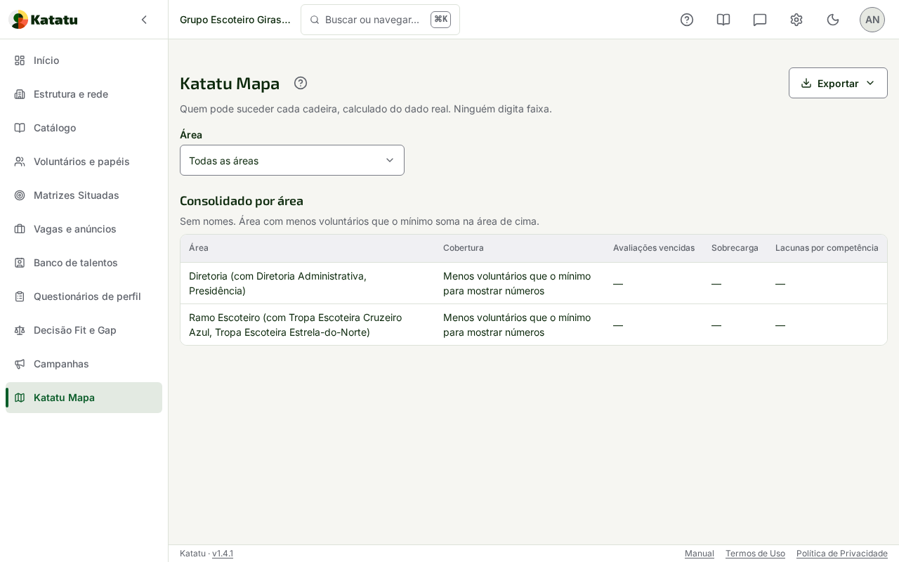
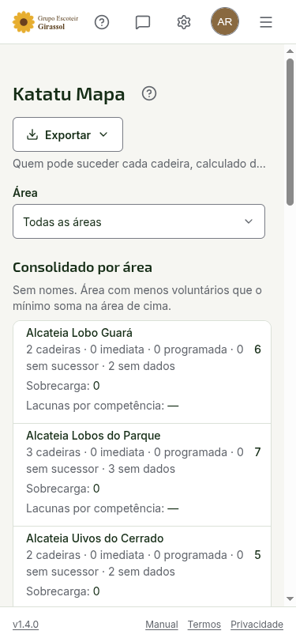

## O que vem depois

Quando os questionários de perfil estiverem respondidos, o ciclo segue assim:

1. **Avaliações.** Em **Campanhas**, crie a campanha dentro da janela do calendário e dispare. Veja [2. Gestor ou Recrutador](/2-gestor-recrutador/).
2. **Decisão e plano.** Quando houver candidato para uma função, use o **Katatu Fit** e o **Katatu Gap**. Veja [2. Gestor ou Recrutador](/2-gestor-recrutador/).
3. **Ajustes do catálogo.** Quando uma trilha ou um modelo mudar, a mudança vale para o que for criado depois. As Matrizes oficializadas não mudam sozinhas. Veja [5. Administrador da Organização](/5-admin-organizacao/).

## Onde mandar dúvidas

Cada tela tem o botão de **Feedback**, no alto. Diga em qual tela você estava, o que fez e o que esperava. Se for anexar uma imagem, prefira captura de tela a PDF: o PDF guarda o nome do autor e as datas. Veja [Enviar um relato ou sugestão](/8-feedback/).

## Termos usados neste guia

Veja o [Glossário do Katatu](/7-glossario/) para piso, pleno, âncora, trilha, Matriz e Mapa.
