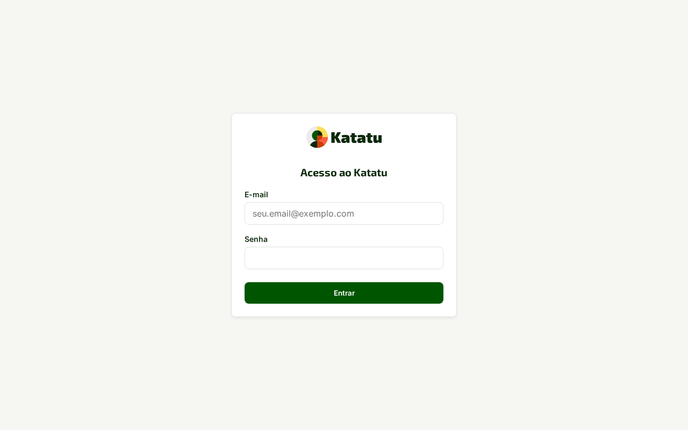
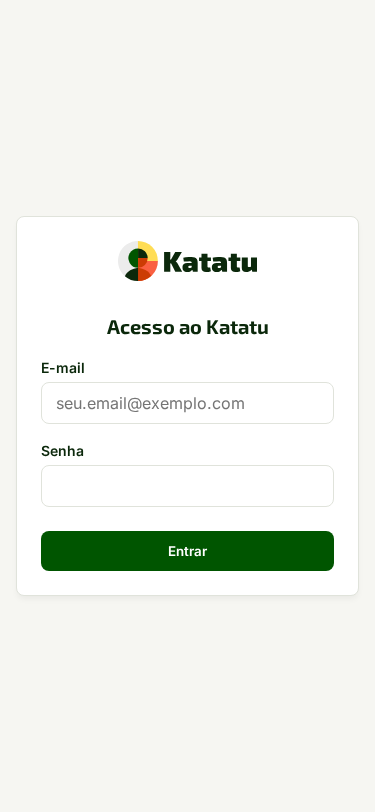

# Manual do Usuário — Katatu

Bem-vindo ao guia operacional oficial do **Katatu** (`https://app.katatu.com.br`), a plataforma da V3RTECH para desenho situado de funções, avaliação determinística de aderência (*Katatu Fit*), plano vivo de compensação dos primeiros 90 dias (*Katatu Gap*), governança de certidões legais (*Cofre de Conformidade*) e leitura de sucessão e riscos estruturais (*Katatu Mapa*).

> **Sobre os exemplos e as telas deste manual:** eles usam um grupo fictício, o "Grupo Escoteiro Girassol", para não mostrar dados de pessoas reais. No Katatu do seu grupo você vê o nome e as pessoas do seu próprio grupo, não as do exemplo.

---

## Comece por aqui

- [Começando: implantar o Katatu na sua organização](implantar-organizacao/): para quem administra.
- [Recebi um convite: guia do colaborador](primeiros-passos/): para quem é convidado.

## Como usar este manual (entrada rápida por dúvida)

- **Vou implantar o Katatu na minha organização (administração):** comece por [Começando: implantar o Katatu na sua organização](implantar-organizacao/), do convite de administração às primeiras coletas.
- **Recebi um convite por e-mail e nunca usei o Katatu:** comece por [Recebi um convite: guia do colaborador](primeiros-passos/), com as telas de cada etapa.
- **Acabei de receber um link de convite por e-mail ou WhatsApp:** veja [1. Entrar por convite e gerir sua Carteira Pessoal](1-avaliado-colaborador/).
- **Preciso desenhar uma vaga ou posição existente nos 4 eixos situados:** veja [2. Construir a Matriz Situada e coletar múltiplas perspectivas](2-gestor-recrutador/).
- **Preciso decidir uma alocação na Faixa 3 com amortecedores obrigatórios:** veja [2.3 Como aprovar posse na Faixa 3 com amortecedores](2-gestor-recrutador/#23-aprovar-posse-na-faixa-3-e-gerar-o-katatu-gap).
- **Minha organização exige certidão legal (ECA Art. 59-A ou TST):** veja [3. Operar o Cofre de Conformidade com base legal prévia](3-conformidade-diretoria/).
- **Sou consultoria de RH atendendo várias empresas-clientes:** veja [4. Modo Consultoria e Passagem de Bastão Assinada](4-consultoria-rh/).
- **Preciso configurar organograma, filiais, chaves de IA (BYOK) ou retenção LGPD:** veja [5. Administrador da Organização — Estrutura, IA e Governança LGPD](5-admin-organizacao/).
- **Preciso gerir licenças `V3RLicense`, cópias cifradas externas ou ensaio de restauração:** veja [6. Administrador do Serviço — Licenças, Cópias Cifradas e Manutenção](6-admin-servico/).
- **Quero enviar um relato, uma sugestão ou anexar um arquivo ao feedback:** veja [Enviar um relato ou sugestão, com anexos](8-feedback/).
- **Quero instalar o Katatu no computador ou no celular, ou apareceu a faixa "Nova versão disponível":** veja [Instalar o app e a faixa de nova versão](#instalar-o-app-e-a-faixa-de-nova-versão).
- **Não entendi um termo (Piso, Pleno, Amortecedor, Fit, Gap):** veja o [Glossário do Katatu](7-glossario/).
- **Tenho uma dúvida comum (Faixa 3, áudio da entrevista, chave de IA, licença):** veja as [Perguntas Frequentes](9-perguntas-frequentes/).

---

## Instalar o app e a faixa de nova versão

**Instalar o app.** O Katatu pode ser instalado como um aplicativo, com ícone próprio e janela própria, para abrir mais rápido. O botão **Instalar app** só aparece quando o seu navegador oferece a instalação, e some depois de instalado:

- **No computador e no Android:** no topo da tela, toque em **Instalar app** (em telas estreitas, abra o menu da sua foto e toque em **Instalar aplicativo**) e confirme na janela do navegador.
- **No iPhone e no iPad:** o navegador não oferece o botão. Abra o menu da sua foto, toque em **Instalar aplicativo** e siga a instrução: **Toque em Compartilhar e depois em Adicionar à Tela de Início**.
- Se nenhum dos dois botões aparece, o seu navegador não oferece a instalação (ou o app já está instalado). Nada está errado: o Katatu funciona normalmente no navegador.

**A faixa "Nova versão disponível".** Quando o Katatu é atualizado, uma faixa colorida aparece na parte de baixo da tela, com o botão **Atualizar**. Ela aparece poucos segundos depois da atualização, quando você volta para a aba ou quando a internet volta. Toque em **Atualizar** para carregar a versão nova. A faixa não some sozinha e não cobre os botões do fim da tela. **Antes de atualizar**, termine e salve o que estiver escrevendo: a página recarrega e o que não foi salvo se perde. Se você ignorar a faixa, o app continua funcionando na versão antiga até a próxima vez que a página for recarregada.

---

## Novidades da Versão 1.4.0

- **Trocar o e-mail de acesso:** em **Meu Perfil › Conta** você troca o e-mail que usa para entrar. O link chega ao e-mail de hoje e um código de 6 dígitos chega ao novo. Quem perdeu o e-mail antigo pede à administração da organização, que troca pela lista de Pessoas. Veja [1. Avaliado ou Colaborador](1-avaliado-colaborador/) e [5. Administrador da Organização](5-admin-organizacao/).
- **Aviso de nova versão:** uma faixa **Nova versão disponível**, com o botão **Atualizar**, avisa quando o Katatu foi atualizado.
- **Instalar o app:** o botão **Instalar app** aparece no topo e no menu da sua foto quando o navegador oferece a instalação. Veja [Instalar o app e a faixa de nova versão](#instalar-o-app-e-a-faixa-de-nova-versão).

## Novidades da Versão 1.3.9

- **Responder ao e-mail do feedback chega até quem enviou:** quando você autoriza o contato ao enviar um relato, a resposta da equipe de suporte vai direto para o seu e-mail. Sem a autorização, o suporte não tem como responder. Veja [Enviar um relato ou sugestão, com anexos](8-feedback/).
- **Anexo do Word aceito no feedback:** além de imagens e PDF, você pode anexar documentos do Word (.doc e .docx), e também planilhas e apresentações (Excel, PowerPoint e LibreOffice). Documentos com macro não são aceitos.
- **Coleta respondida sai do Início:** depois de concluir a coleta, ela deixa o cartão "Coletas para responder" do Início. Em Coleta, ela aparece como "Respondida · ver seu Retrato". Veja [Primeiros passos](primeiros-passos/).

## Novidades da Versão 1.3.8

- **Aba Trajetória em Meu Perfil:** o currículo, os cursos e certificados e a sua trajetória ficam numa aba própria, que você atualiza quando quiser. O currículo é lido inteiro, inclusive Lattes e LinkedIn em PDF e Word, até 10 MB, e o Katatu mostra só o que você ainda não tem. Veja [1. Avaliado e Colaborador](1-avaliado-colaborador/).
- **Coleta usa a sua trajetória:** a etapa "Sua trajetória" mostra o que você já tem no perfil, e "Continuar para as perguntas" guarda o que estiver escrito.
- **Chamar para a coleta:** na Matriz, "Designar os ocupantes desta função"; na lista de Pessoas, "Abrir coleta" em lote.
- **Correções:** nomes com hífen inteiros na trajetória, IA que tenta de novo quando está fora por um instante, botão principal legível no tema escuro e feedback com anexo que não se perde.

## Novidades da Versão 1.3.7

- **Pessoas e papéis num item só:** os antigos "Papéis e acessos" e "Pessoas e convites" viraram um item do menu com duas abas. Veja [5. Administrador da Organização](5-admin-organizacao/#pessoas-importar-uma-planilha).
- **Código a cada nova entrada:** quem tenta entrar várias vezes seguidas recebe o código por e-mail a cada entrada; voltar à verificação ou recarregar a tela nos 5 minutos seguintes não gasta outro código.
- **Feedback volta a chegar ao suporte:** o relato ou a sugestão enviado pelo botão de feedback chega por e-mail à equipe de suporte. Veja [Enviar um relato ou sugestão, com anexos](8-feedback/).

## Novidades da Versão 1.3.6

- **Código por e-mail já enviado:** na verificação em duas etapas, quando o código por e-mail é a única opção, ele sai ao abrir a tela; o botão passa a ser "Reenviar código".

## Novidades da Versão 1.3.5

- **Várias Matrizes de uma vez:** na lista de Matrizes Situadas, marque as Matrizes e escolha "Acrescentar requisito", "Tirar requisito" ou "Acrescentar etapa". Antes de aplicar, a tela mostra quantas e quais vão mudar; quem não pode receber a mudança fica de fora, com o motivo. Veja [2. Gestor e Recrutador](2-gestor-recrutador/).
- **Links de cursos, só de sites confiáveis:** a administração lista os sites confiáveis em Configurações da Organização › Privacidade, e requisitos e etapas da trilha ganham um link opcional que abre como "Abrir em <site>". Veja [5. Administrador da Organização](5-admin-organizacao/).
- **Papel previsto:** quem está cadastrado sem acesso pode ter o papel definido antes do convite; ao convidar, o papel já vem preenchido.
- **Seu currículo em Meus dados:** guarde o currículo uma vez e use o botão "Usar o meu currículo" na coleta. Nenhuma organização vê o arquivo. Para Lattes ou LinkedIn, salve como PDF pelo navegador. Veja [1. Avaliado e Colaborador](1-avaliado-colaborador/).
- **Cartões com borda:** nas listas que você edita (competências, requisitos, etapas, incidentes, vocabulário, dilemas, trajetória, horários e perspectiva), cada registro fica num cartão próprio.
- **Listas abrem no que está valendo:** Vagas em curso, Campanhas vigentes e Pessoas em uso; o resto fica no filtro, que é guardado no endereço da página.

## Novidades da Versão 1.3.4

- **Vocabulário da organização:** os números voltam a aparecer nos textos das telas, e o adjetivo concorda com o termo da organização ("Grupo inteiro").

## Novidades da Versão 1.3.3

- **Matrizes Situadas abre em "Em uso":** só as oficializadas que valem e os rascunhos abertos. As versões arquivadas ficam no filtro, e os cartões de contagem levam direto a cada lista.

## Novidades da Versão 1.3.2

- **Primeiros passos para quem recebe convite:** a página [Recebi um convite: primeiros passos](primeiros-passos/) mostra, com imagens, do e-mail ao Retrato. O e-mail do convite e a tela de entrada levam a ela.
- **Papel ao aceitar:** ao convidar quem foi cadastrado sem acesso, a administração escolhe o papel, e Gestor da Unidade vale na unidade do cadastro. Veja [5. Administrador da Organização](5-admin-organizacao/).
- **O que a organização passa a ver:** quem entra pela primeira vez pelo código vê o aviso e decide se mostra os seus cursos e certificados.
- **Cursos e certificados:** o arquivo do certificado vai na mesma janela de incluir, e a data de conclusão aceita dia e mês.
- **Configurações da Organização em abas:** Identidade, Dados e contato, Privacidade, Pessoas e coleta, Plano e IA e Suporte.
- **Matriz e catálogo em linhas:** elegibilidade, etapas, incidentes, modelos de cargo e trilhas mostram uma linha por item, com os campos lado a lado.

## Novidades da Versão 1.3.1

- **Dilemas da coleta por organização:** em Configurações da Organização, a administração escolhe de 2 a 6 dilemas, ou importa um modelo pronto (Empresa, Voluntariado e terceiro setor, Saúde e serviço público) e edita. Quem já abriu a coleta termina com os dilemas que viu. Veja [5. Administrador da Organização](5-admin-organizacao/).
- **Trajetória em texto corrido:** com a IA da organização configurada, a pessoa conta a trajetória como quiser e confirma cada item que a IA propõe.
- **Fim da coleta:** a tela avisa quando todas as perguntas foram respondidas, e "Concluir" pede confirmação. O gestor imediato recebe um e-mail dizendo que a coleta foi concluída, sem as respostas.
- **Cópias de segurança:** ficam as 7 últimas diárias, as 4 semanais e as 3 mensais, até o prazo escolhido (no máximo 90 dias).

## Novidades da Versão 1.3.0

- **Catálogo em JSON:** a importação de referenciais, modelos de cargo e trilhas mostra o formato e baixa um exemplo. Veja [5. Administrador da Organização](5-admin-organizacao/#importar-em-json).
- **Funções ligadas a modelos de cargo:** dá para ligar uma função a um modelo pela tela da Estrutura, uma a uma ou em lote. Veja [5. Administrador da Organização](5-admin-organizacao/).
- **Matriz:** a sugestão de trilha traz uma etapa por competência e grau, dá para tirar etapas em rascunho, e a oficialização mostra o que será congelado. Veja [2. Gestor ou Recrutador](2-gestor-recrutador/#21-construir-a-matriz-situada-nos-4-eixos-e-coletar-perspectivas).
- **Pessoas:** a prévia da importação mostra o cargo, aceita duas funções para a mesma pessoa e pode abrir as posições que faltam. Veja [5. Administrador da Organização](5-admin-organizacao/#pessoas-importar-uma-planilha).
- **Vocabulário da organização nas telas:** os nomes escolhidos em Identidade visual (por exemplo, Área no lugar de Unidade e Função no lugar de Cargo) passam a valer nos textos das telas da organização, não só no menu. A importação por planilha, os e-mails e as telas públicas seguem com os nomes padrão. Veja [5. Administrador da Organização](5-admin-organizacao/).
- **Matriz mais compacta:** cada competência fica numa linha, com Referencial, Piso do Dia 1 e Pleno esperado lado a lado, e a seção Avaliados cabe numa linha com a busca. Veja [2. Gestor ou Recrutador](2-gestor-recrutador/#21-construir-a-matriz-situada-nos-4-eixos-e-coletar-perspectivas).
- **Papéis numa janela:** as pessoas de um papel abrem numa janela sobre a lista, com as opções de "Onde o papel vale" lado a lado. Veja [5. Administrador da Organização](5-admin-organizacao/).
- **Minha coleta e Decisão Fit e Gap:** o item "Minha coleta" do menu lista as suas coletas, e no Fit a Matriz escolhida mostra os candidatos no lugar da lista.
- **Calendário de ciclos:** "Abranger todas" cobre a organização inteira, e o aviso informa a próxima janela. Veja [5. Administrador da Organização](5-admin-organizacao/).

## Novidades da Versão 1.0

- **Lançamento da versão 1.0 do Katatu:** fluxo completo da estrutura organizacional em níveis livres à Matriz Situada nos 4 eixos, coleta conversacional com transcrição volátil de voz, motor determinístico *Katatu Fit* (Faixas 1 a 4), plano vivo *Katatu Gap* com trava de amortecedores na Faixa 3, Cofre de Conformidade segregado, modo consultoria com Passagem de Bastão Assinada, *Katatu Mapa* de sucessão e painel completo de manutenção com cópias externas cifradas e ensaio de restauração na tela.

---

## Privacidade, Termos de Uso e LGPD

Os termos de uso versionados, a política de privacidade e os controles de portabilidade, revogação de consentimento e autodissolução da conta estão disponíveis diretamente no painel **Governança LGPD e Privacidade** dentro da aplicação (`https://app.katatu.com.br`) e no documento de arquitetura de privacidade do projeto.
