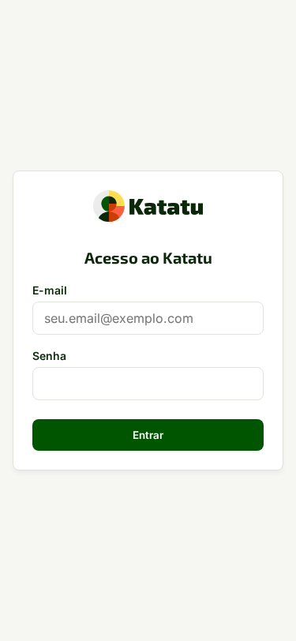

# Manual do Usuário — Katatu

Bem-vindo ao guia operacional oficial do **Katatu** (`https://app.katatu.com.br`), a plataforma da V3RTECH para desenho situado de funções, avaliação determinística de aderência (*Katatu Fit*), plano vivo de compensação dos primeiros 90 dias (*Katatu Gap*), governança de certidões legais (*Cofre de Conformidade*) e leitura de sucessão e riscos estruturais (*Katatu Mapa*).

---

## Como usar este manual (entrada rápida por dúvida)

- **Acabei de receber um link de convite por e-mail ou WhatsApp:** veja [1. Entrar por convite e gerir sua Carteira Pessoal](1-avaliado-colaborador/).
- **Preciso desenhar uma vaga ou posição existente nos 4 eixos situados:** veja [2. Construir a Matriz Situada e coletar múltiplas perspectivas](2-gestor-recrutador/).
- **Preciso decidir uma alocação na Faixa 3 com amortecedores obrigatórios:** veja [2.3 Como aprovar posse na Faixa 3 com amortecedores](2-gestor-recrutador/#23-aprovar-posse-na-faixa-3-e-gerar-o-katatu-gap).
- **Minha organização exige certidão legal (ECA Art. 59-A ou TST):** veja [3. Operar o Cofre de Conformidade com base legal prévia](3-conformidade-diretoria/).
- **Sou consultoria de RH atendendo várias empresas-clientes:** veja [4. Modo Consultoria e Passagem de Bastão Assinada](4-consultoria-rh/).
- **Preciso configurar organograma, filiais, chaves de IA (BYOK) ou retenção LGPD:** veja [5. Administrador da Organização — Estrutura, IA e Governança LGPD](5-admin-organizacao/).
- **Preciso gerir licenças `V3RLicense`, cópias cifradas externas ou ensaio de restauração:** veja [6. Administrador do Serviço — Licenças, Cópias Cifradas e Manutenção](6-admin-servico/).
- **Quero enviar um relato, uma sugestão ou anexar um arquivo ao feedback:** veja [Enviar um relato ou sugestão, com anexos](8-feedback/).
- **Não entendi um termo (Piso, Pleno, Amortecedor, Fit, Gap):** veja o [Glossário do Katatu](7-glossario/).
- **Tenho uma dúvida comum (Faixa 3, áudio da entrevista, chave de IA, licença):** veja as [Perguntas Frequentes](9-perguntas-frequentes/).

---

## Novidades da Versão 1.0

- **Lançamento da versão 1.0 do Katatu:** fluxo completo da estrutura organizacional em níveis livres à Matriz Situada nos 4 eixos, coleta conversacional com transcrição volátil de voz, motor determinístico *Katatu Fit* (Faixas 1 a 4), plano vivo *Katatu Gap* com trava de amortecedores na Faixa 3, Cofre de Conformidade segregado, modo consultoria com Passagem de Bastão Assinada, *Katatu Mapa* de sucessão e painel completo de manutenção com cópias externas cifradas e ensaio de restauração na tela.

---

## Privacidade, Termos de Uso e LGPD

Os termos de uso versionados, a política de privacidade e os controles de portabilidade, revogação de consentimento e autodissolução da conta estão disponíveis diretamente no painel **Governança LGPD e Privacidade** dentro da aplicação (`https://app.katatu.com.br`) e no documento de arquitetura de privacidade do projeto.
