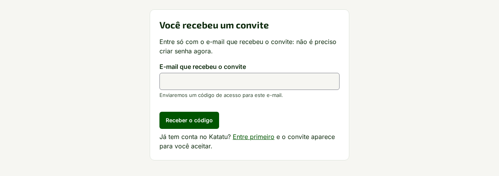
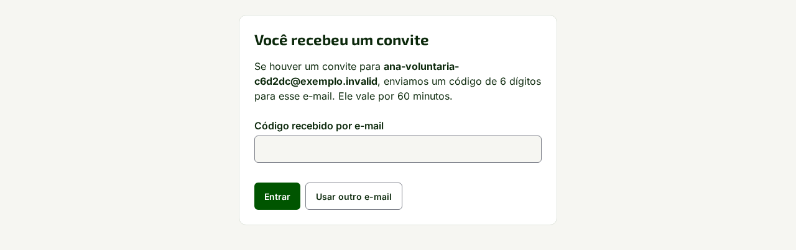
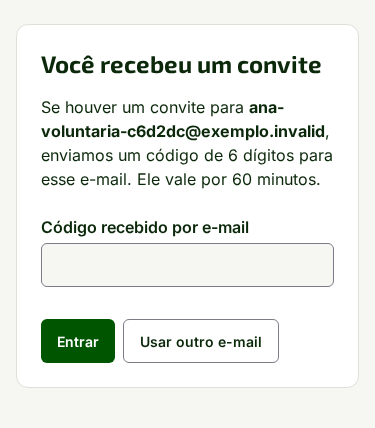
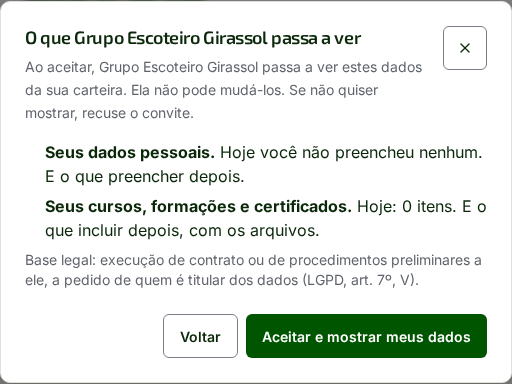
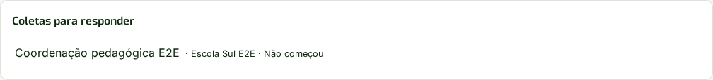
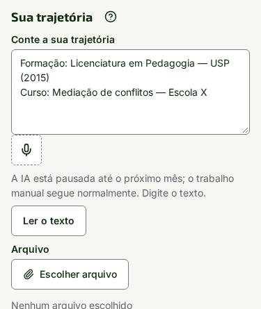
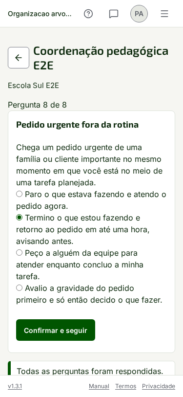
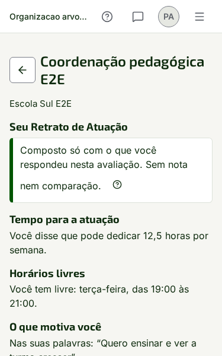

# Recebi um convite: primeiros passos

Esta página é para quem recebeu um convite do Katatu e nunca usou o sistema. Ela segue a ordem da tela: do e-mail do convite até o retrato que fica só com você.

## Por que isto importa

Você não precisa criar senha agora. Entra com o seu e-mail e um código de 6 dígitos, responde a coleta no seu ritmo e, ao final, recebe o seu Retrato de Atuação, que só você lê. Quando você aceita o convite de uma organização pela lista de convites, o app mostra antes o que ela passa a ver da sua carteira. Ler esse aviso com calma evita a surpresa de ter mostrado um dado que você não queria mostrar.

## 1. O convite

**De quem vem.** O convite é da organização que quer conhecer você. O nome dela aparece no assunto do e-mail ("Convite para entrar na organização ... no Katatu") e no texto. O e-mail sai do Katatu em nome dela.

**O que é o Katatu.** É um espaço em que você conta, em uma conversa curta, sua trajetória, o que gosta de fazer, quanto tempo pode dedicar e como costuma agir em situações do dia a dia. A organização usa essas informações para encaixar cada pessoa na função certa.

**Até quando vale.** O e-mail diz até quando o convite vale ("O convite vale até ..."). Depois desse prazo, a entrada não funciona mais: peça à organização um convite novo. O código de 6 dígitos vale 60 minutos.

## 2. Entrar com o e-mail e o código

1. No e-mail do convite, toque no botão **Aceitar o convite**. Ele abre a página **Você recebeu um convite**.
2. Digite o **e-mail que recebeu o convite**. Use exatamente o endereço que a organização cadastrou para você.
3. Toque em **Receber o código**. A tela responde com a mesma frase para qualquer e-mail: "Se houver um convite para ..., enviamos um código de 6 dígitos para esse e-mail."
4. Abra a sua caixa de entrada, copie os 6 dígitos do e-mail com o código e digite-os no campo **Código recebido por e-mail**.
5. Toque em **Entrar**. Se os dados estiverem certos, o app abre na tela **Início**.

**Exemplo.** Ana recebe o convite do Grupo Escoteiro Girassol na caixa de entrada. Toca em **Aceitar o convite**, digita o e-mail onde recebeu a mensagem, toca em **Receber o código**, copia o código 482915 que chegou em seguida e toca em **Entrar**. Pronto: está dentro do app.

### Se o código não chegar

- Procure o e-mail na pasta de **spam** ou **lixo eletrônico**. Os provedores costumam separar esse tipo de mensagem.
- Aguarde alguns minutos. O envio pode demorar.
- Para pedir outro código, toque em **Usar outro e-mail**, digite o mesmo e-mail e toque em **Receber o código** de novo.
- Se a tela avisar que você pediu códigos demais, use o último código que chegou ou espere alguns minutos antes de pedir outro.
- Se nada chegar mesmo assim, peça à organização que **reenvie o convite** para o seu e-mail.

### Se o código não funcionar

A tela mostra esta mensagem: "Código incorreto, convite vencido ou já utilizado. Confira o e-mail e o código mais recente, ou peça um convite novo a quem convidou você."

Confira, nessa ordem: se você está usando o código mais recente (o último e-mail que chegou); se o código tem 6 dígitos e nenhum espaço; se ele ainda está dentro dos 60 minutos. Se nada disso resolver, o convite pode ter vencido ou já ter sido usado. Peça um convite novo à organização.

**Dica:** digite o código logo depois de receber, sem sair da página. Se você sair, é só voltar a **Usar outro e-mail** e pedir de novo.

**Armadilha:** se você digitar um e-mail diferente do que recebeu o convite, o código não chega, e a tela não explica o motivo. Isso é proposital: a mensagem é a mesma para qualquer e-mail, para ninguém descobrir quem foi convidado. Confira o endereço antes de tocar em **Receber o código**.

## 3. Aceitar os termos e o aviso do que a organização vê

### Termos de Uso e Política de Privacidade

Quando há textos novos para aceitar, o app mostra a tela de aceite antes de qualquer outra coisa. Você marca:

- **Li e aceito os Termos de Uso**;
- **Li e aceito a Política de Privacidade**;
- os termos da organização, quando ela tiver os seus.

O botão **Aceitar e continuar** só fica ativo depois que cada documento foi marcado. Se não concordar, toque em **Recusar e sair**: a recusa encerra a entrada, e você só usa o app depois de aceitar. A regra geral, com mais detalhes, está no [capítulo 1](/1-avaliado-colaborador/).

### O que a organização passa a ver

Esse aviso aparece quando você aceita, pela lista de convites, o convite de uma organização que já tem a sua conta. Para isso, abra o link **Entre primeiro** na tela de entrada, entre com a sua conta e veja a lista **Estes são os convites que esperam por esta conta**.

Toque em **Aceitar o convite de ...**. Antes de confirmar, o app abre a janela **O que ... passa a ver**, com:

- os seus **dados pessoais**, com o que já está preenchido e o que ainda pode ser preenchido depois;
- os seus **cursos, formações e certificados**, com a quantidade de itens e os arquivos;
- a base legal que a organização informa para ter esses dados.

Você escolhe entre **Voltar** e **Aceitar e mostrar meus dados**. Depois de aceitar, a organização vê a sua carteira, com o CPF mascarado, e não pode mudar os seus dados. Se não quiser mostrar, toque em **Voltar** e depois em **Recusar** na lista de convites.

**Armadilha:** aceitar não é só concordar com um texto: é liberar a organização a ver a sua carteira. Leia a lista do que será visto antes de tocar em **Aceitar e mostrar meus dados**.

**Quando dá errado:** se a janela não mostrar a lista do que será visto e aparecer "Não foi possível mostrar o aviso agora", feche a janela e tente de novo mais tarde. Não aceite às cegas.

**Não reconheço** é outra opção da lista. Use quando você não sabe quem é a organização: o convite é apagado e ela fica **30 dias** sem poder convidar esse mesmo e-mail. Se você conhece a organização e só não quer entrar, use **Recusar**.

## 4. Achar o que responder

Depois de entrar, veja o **Início**. Há dois jeitos de chegar à coleta:

- **Cartão "Coletas para responder".** Aparece no Início quando alguém indicou você para responder uma coleta. Cada linha mostra o nome da coleta, a unidade e a situação ("Não começou"). Toque no nome para abrir. Se você foi lembrado, aparece "lembrete: falta concluir".
- **Cartão "Minha participação".** Se ainda não há coleta para você, o cartão diz "Você ainda não respondeu nenhuma etapa da coleta" e traz o botão **Iniciar minha coleta**. Ele leva à página **Minha coleta**.

Você também pode abrir **Minha coleta** pelo menu. No computador, ele fica na barra lateral à esquerda. No celular, toque no ícone de menu (☰), no canto superior direito.

**Dica:** se você tem mais de uma coleta, todas aparecem na página **Minha coleta**, cada uma com o nome e a unidade. Abra a que você reconhece.

## 5. Responder a coleta

A coleta tem três partes: a trajetória, as perguntas e a revisão. Você pode parar a qualquer momento e voltar depois; o que já respondeu fica salvo.

### Antes de começar

Em algumas organizações, a primeira tela da coleta é um aviso: "Nesta organização, a chefia direta no organograma pode ver o seu nome junto das suas respostas. As demais pessoas veem só dados consolidados." Leia com calma e toque em **Li o aviso e quero começar**.

### Sua trajetória

Conte a sua trajetória no campo **Conte a sua trajetória**. Você pode:

- **escrever um texto corrido**, como uma apresentação: formação, cursos, o que já fez e onde;
- **escolher um arquivo**, com o botão **Escolher arquivo**;
- **colar um link** do seu perfil público e tocar em **Usar o link**.

Depois, toque em **Ler o texto**. O app transforma o que você escreveu em itens, como formação e curso. Cada item traz dois botões: **Confirmar** (o item entra na sua trajetória) e **Descartar** (o item sai). Só o que você confirma vale.

Quando a inteligência artificial da organização não está disponível, a tela avisa "A IA está pausada até o próximo mês; o trabalho manual segue normalmente." Nesse caso, escreva **uma informação por linha**, começando pelo tipo, por exemplo:

- `Formação: Licenciatura em Pedagogia — USP (2015)`
- `Curso: Mediação de conflitos — Escola X`

Depois toque em **Ler o texto** e confirme os itens reconhecidos. Se nada for reconhecido, a tela pede o formato das linhas.

**Exemplo.** Ana escreve duas linhas: "Formação: Licenciatura em Pedagogia — USP (2015)" e "Curso: Mediação de conflitos — Escola X". Toca em **Ler o texto**, confirma a formação e descarta o curso, porque ele já está no certificado que ela tem. A trajetória fica só com o que ela confirmou.

**Dica:** quando for dar o link de um perfil público, use o endereço da página pública, sem senha nem dados que você não quer compartilhar.

**Armadilha:** não confirme um item só porque ele apareceu. Se a leitura trouxe uma data ou um nome errado, descarte e escreva a linha de novo.

Quando terminar, toque em **Continuar para as perguntas**.

### As perguntas

As perguntas são cartões, um de cada vez. Cada cartão tem o contador "Pergunta X de 8" e o botão **Confirmar e seguir** para salvar a resposta.

1. **Horas por semana.** No campo **Horas por semana que você pode dedicar**, escreva o número com vírgula para decimais, por exemplo `12,5`. O campo não aceita vazio: a tela pede o valor.
2. **Horários livres.** Escolha o **Dia**, o **Início** e o **Fim**. Use essa pergunta para um horário em que você realmente pode estar. Se tiver mais de um, acrescente outros.
3. **O que motiva você.** Escreva em poucas palavras, até 500 caracteres.
4. **O que você gosta de fazer.** Para cada grupo de atividades, escolha um grau: **Não é comigo**, **Um pouco**, **Bastante** ou **Muito**. A tela só segue quando todos os grupos têm uma escolha.
5. **Situações do dia a dia (4 perguntas).** Cada uma descreve um momento difícil e pede a sua reação mais próxima do que você faria de verdade. Por exemplo, em **Pedido urgente fora da rotina**: "Chega um pedido urgente de uma família ou cliente importante no mesmo momento em que você está no meio de uma tarefa planejada." As opções incluem "Termino o que estou fazendo e retorno ao pedido em até uma hora, avisando antes." Escolha uma só.

Antes da pergunta de interesses, a coleta mostra o aviso **Antes de continuar**: "Quem decide sobre este cargo verá os seus interesses e as suas escolhas nos dilemas desta etapa, para entender em que contexto você atua melhor. As demais respostas continuam só suas." Toque em **Entendi, continuar** para seguir.

**Dica:** responda as situações como você age, não como acha que deveria agir. A resposta sincera é a única que ajuda a organização a encaixar você.

**Armadilha:** o campo de horas não aceita vazio: se você tocar em **Confirmar e seguir** sem preencher, a tela mostra o erro na própria pergunta. Confira cada cartão antes de seguir.

**Quando dá errado:** a tela aponta o problema no próprio cartão. Os mais comuns são: "horas" vazio, janela de horário sem dia ou sem início e fim, e grupo de interesse sem escolha. Corrija o campo indicado e toque em **Confirmar e seguir** de novo.

### Revisar e concluir

Depois da oitava pergunta, a tela diz "Todas as perguntas foram respondidas. Se estiver tudo certo, use Concluir; para mudar uma resposta, volte pelas perguntas anteriores." Os botões são:

- **Pergunta anterior**: volta uma pergunta, para você rever a resposta;
- **Rever a trajetória**: volta à trajetória, para confirmar ou descartar itens;
- **Concluir**: encerra a coleta. Ele só fica ativo quando as 8 perguntas estão respondidas. Se faltar alguma, a tela mostra "Responda todas as perguntas para concluir."

Ao tocar em **Concluir**, o app pergunta **Concluir a coleta?**. A tela avisa que, depois de concluir, as suas respostas **não podem mais ser mudadas**. Confirme só quando estiver tudo certo.

**Armadilha:** essa confirmação é o último momento em que você muda uma resposta. Depois de concluir, as respostas não podem mais ser mudadas.

### Depois de concluir

O app mostra **Camada 1 concluída** e o seu **Seu Retrato de Atuação**. O Retrato é montado só com as suas respostas, sem nota e sem comparação com outras pessoas. Você pode baixá-lo em PDF pelo botão **Baixar PDF**.

Quem vê o quê:

- **O Retrato é só seu.** Nem a gestão nem quem conduziu a conversa têm acesso. Ele não vai para a sua carteira pessoal.
- **O gestor imediato** recebe só o aviso de que você concluiu a coleta, sem as respostas.
- **Quem decide sobre o cargo** vê os seus interesses e as suas escolhas nas situações, como o aviso antes das perguntas mostrou.

## 6. Ajuda

Depois de entrar, o topo da tela tem três ícones:

- **?** (Ajuda sobre esta tela): abre a ajuda da tela em que você está.
- **Livro** (Manual do Usuário): abre este manual numa janela sobre a tela, sem perder o que você digitou. No celular, o manual também está no rodapé, no link **Manual**.
- **Balão** (Enviar feedback): envia um relato, uma sugestão ou uma dúvida. Diga em qual tela você estava e o que aconteceu. Se for anexar arquivo, veja antes o que ele contém.

## Perguntas frequentes

**O código não chegou. O que faço?**
Veja primeiro a pasta de spam ou lixo eletrônico e aguarde alguns minutos. Depois, toque em **Usar outro e-mail**, digite o mesmo endereço e toque em **Receber o código** de novo. Se a tela disser que você pediu códigos demais, espere alguns minutos. Se nada chegar, peça à organização que reenvie o convite.

**Entrei com outro e-mail. Como corrijo?**
O convite vale só para o e-mail que a organização cadastrou. Saia da conta pelo menu do seu nome, no canto superior direito, e entre de novo com o endereço certo. Se você não sabe qual e-mail ela cadastrou, pergunte a ela.

**Errei uma resposta antes de concluir. Consigo mudar?**
Consegue, enquanto não tocar em **Concluir**. Use **Pergunta anterior** ou **Rever a trajetória**, mude a resposta e toque em **Confirmar e seguir** no cartão. Depois de concluir, não há como mudar.

## Glossário

- **Coleta**: o conjunto de perguntas que você responde no app para a organização.
- **Trajetória**: o que você já fez em formação, cursos e experiências, do jeito que você conta.
- **Retrato de Atuação**: o texto que o app monta com as suas respostas. Só você lê.
- **Código de acesso**: os 6 dígitos que chegam por e-mail. Valem por 60 minutos.
- **Carteira pessoal**: o seu conjunto de dados pessoais e certificados, na página **Meus dados**.
