# Recebi um convite: guia do colaborador

Este guia é para quem recebeu um convite do Katatu e nunca usou o sistema. Ele segue a ordem da tela: do e-mail do convite até o retrato que fica só com você.

> **Você administra a organização?** Comece por [Começando: implantar o Katatu na sua organização](/implantar-organizacao/).

## Por que isto importa

Você não precisa criar senha agora. Entra com o seu e-mail e um código de 6 dígitos, responde ao questionário de perfil no seu ritmo e, ao final, recebe o seu Retrato de Atuação, que só você lê. Na primeira entrada, o app mostra o que a organização passa a ver dos seus dados e da sua formação, e você decide se mostra. Ler esse aviso com calma evita a surpresa de ter mostrado um dado que você não queria mostrar.

## Quem vê o quê

| O que existe | Quem vê |
| :--- | :--- |
| Suas respostas do questionário de perfil e o seu Retrato de Atuação | Só você |
| Seus dados e a sua formação (dados pessoais, cursos e certificados) | Você, e a organização só depois que você aceita mostrar |
| Quem conduziu o questionário e a chefia direta | Conforme a organização configurou, com aviso antes das perguntas |
| O resultado de uma avaliação | Só depois que o gestor ou o mentor conversa com você |

**Dica:** o que você vê está sempre atualizado. Se algo não bate com o que você espera, use o botão de **Feedback** no alto da tela.

## 1. O convite

**De quem vem.** O convite é da organização que quer conhecer você. O nome dela aparece no assunto do e-mail ("Convite para entrar na organização ... no Katatu") e no texto. O e-mail sai do Katatu em nome dela.

**O que é o Katatu.** É um espaço em que você conta, em uma conversa curta, a sua trajetória, o que gosta de fazer, quanto tempo pode dedicar e como costuma agir em situações do dia a dia. A organização usa essas informações para encaixar cada pessoa na função certa.

**Até quando vale.** O e-mail diz até quando o convite vale ("O convite vale até ..."). Depois desse prazo, a entrada não funciona mais: peça à organização um convite novo. O código de 6 dígitos vale 60 minutos.

## 2. Entrar com o e-mail e o código

1. No e-mail do convite, toque no botão **Aceitar o convite**. Ele abre a página **Você recebeu um convite**.
2. Digite o **e-mail que recebeu o convite**. Use exatamente o endereço que a organização cadastrou para você.
3. Toque em **Receber o código**. A tela responde com a mesma frase para qualquer e-mail: "Se houver um convite para ..., enviamos um código de 6 dígitos para esse e-mail."
4. Abra a sua caixa de entrada, copie os 6 dígitos do e-mail com o código e digite-os no campo **Código recebido por e-mail**.
5. Toque em **Entrar**. Se os dados estiverem certos, o app abre na tela **Início**.

**Exemplo.** Ana Ribeiro, voluntária do Grupo Escoteiro Girassol (nome fictício), recebe o convite na caixa de entrada. Toca em **Aceitar o convite**, digita o e-mail onde recebeu a mensagem, toca em **Receber o código**, copia o código que chegou em seguida e toca em **Entrar**. Pronto: está dentro do app.

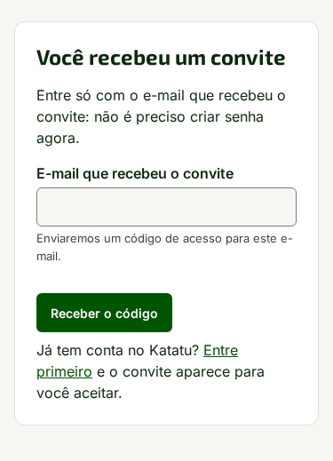

### Se o código não chegar

- Procure o e-mail na pasta de **spam** ou **lixo eletrônico**. Os provedores costumam separar esse tipo de mensagem.
- Aguarde alguns minutos. O envio pode demorar.
- Para pedir outro código, toque em **Usar outro e-mail**, digite o mesmo e-mail e toque em **Receber o código** de novo.
- Se a tela avisar que você pediu códigos demais, use o último código que chegou ou espere alguns minutos antes de pedir outro.
- Se nada chegar mesmo assim, peça à organização que **reenvie o convite** para o seu e-mail.

### Se o código não funcionar

A tela mostra esta mensagem: "Código incorreto, convite vencido ou já utilizado. Confira o e-mail e o código mais recente, ou peça um convite novo a quem convidou você."

Confira, nessa ordem: se você está usando o código mais recente (o último e-mail que chegou); se o código tem 6 dígitos e nenhum espaço; se ele ainda está dentro dos 60 minutos. Se nada disso resolver, o convite pode ter vencido ou já ter sido usado. Peça um convite novo à organização.

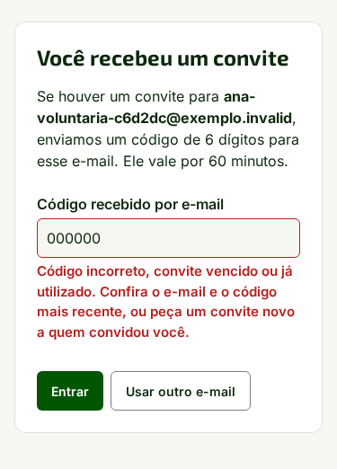

**Dica:** digite o código logo depois de receber, sem sair da página. Se você sair, é só voltar a **Usar outro e-mail** e pedir de novo.

**Armadilha:** se você digitar um e-mail diferente do que recebeu o convite, o código não chega, e a tela não explica o motivo. Isso é proposital: a mensagem é a mesma para qualquer e-mail, para ninguém descobrir quem foi convidado. Confira o endereço antes de tocar em **Receber o código**.

## 3. Aceitar os termos e o aviso do que a organização vê

**Por que isto importa:** aceitar não é só concordar com um texto. Ao aceitar o vínculo, você libera a organização a ver os seus dados e a sua formação.

### Termos de Uso e Política de Privacidade

Quando há textos novos para aceitar, o app mostra a tela de aceite antes de qualquer outra coisa. Você marca:

- **Li e aceito os Termos de Uso**;
- **Li e aceito a Política de Privacidade**;
- os termos da organização, quando ela tiver os seus.

O botão **Aceitar e continuar** só fica ativo depois que cada documento foi marcado. Se não concordar, toque em **Recusar e sair**: a recusa encerra a entrada, e você só usa o app depois de aceitar. A regra geral, com mais detalhes, está no [capítulo 1](/1-avaliado-colaborador/).

### O que a organização passa a ver

Logo depois do código, na primeira entrada, o app abre a janela **O que ... passa a ver**. Ela também aparece quando você já tem conta e aceita o convite pela lista **Estes são os convites que esperam por esta conta** (link **Entre primeiro** na tela de entrada, depois **Aceitar o convite de ...**). A janela mostra:

- os seus **dados pessoais**, com o que já está preenchido e o que ainda pode ser preenchido depois;
- os seus **cursos, formações e certificados**, com a quantidade de itens e os arquivos;
- o que fica só com você: o seu Retrato de Atuação e as suas respostas individuais do questionário de perfil;
- em **Saiba mais**, a base legal que a organização informa para ter esses dados (o seu vínculo com ela, como um contrato de trabalho ou o Acordo de Trabalho Voluntário).

As opções da janela:

- **Confirmar e continuar**: confirma o vínculo, e você segue para o Início. Depois disso, a organização vê os seus dados e a sua formação, com o CPF mascarado, e não pode mudar os seus dados.
- **Decidir depois** (na primeira entrada): fecha a janela, e ela volta na próxima vez que você abrir o Katatu. Enquanto você não decidir, a organização não vê os seus dados e a sua formação.
- **Recusar o convite** (na primeira entrada): encerra o vínculo com a organização, e ela não vê nenhum dado seu. O cadastro que ela já tinha de você (nome e e-mail) continua com ela, e o que você preencheu continua com você. Se mudar de ideia, peça um novo convite a quem convidou você. Na lista de convites, o equivalente é **Recusar**.
- **Não reconheço**: use quando você não sabe quem é a organização. O convite é apagado, e a organização fica **30 dias** sem poder convidar esse mesmo e-mail. Se você conhece a organização e só não quer entrar, use **Recusar**.

**Dica:** leia a lista do que será visto antes de tocar em **Confirmar e continuar**. Se quiser mudar depois, dá para ajustar em **Meu Perfil**, na aba **Meus dados e formação**.

**Quando dá errado:** se a janela não mostrar a lista e aparecer "Não foi possível mostrar o aviso agora", feche a janela e tente de novo mais tarde. Não aceite às cegas.

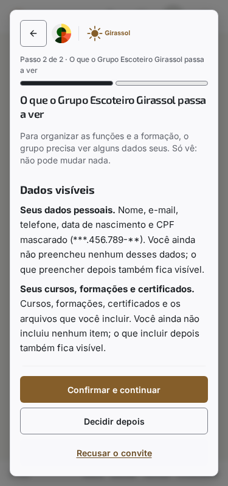

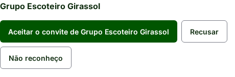
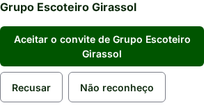

## 4. Achar o que responder

Depois de entrar, veja o **Início**. Há dois jeitos de chegar ao questionário de perfil:

- **Cartão "Questionários de perfil para responder".** Aparece no Início quando alguém indicou você para responder um questionário de perfil. Cada linha mostra o nome do questionário, a área e a situação ("Não começou" ou "Em andamento"). Toque no nome para abrir. Se você foi lembrado, aparece "lembrete: falta concluir". Quando você conclui o questionário, ele sai do cartão; se não sobrar nenhum para responder, o cartão some do Início. O questionário concluído continua em **Meu questionário de perfil**, no menu, marcada como "Respondida · ver seu Retrato", e abre o seu Retrato de Atuação.
- **Cartão "Minha participação".** Se você ainda não respondeu nenhuma etapa, o cartão diz "Você ainda não respondeu nenhuma etapa do questionário de perfil." e traz o botão **Começar meu questionário de perfil**. Ele leva à página **Questionários de perfil**.

Você também pode abrir **Meu questionário de perfil** pelo menu. No computador, ele fica na barra lateral à esquerda. No celular, toque no ícone de menu (☰), no canto superior direito.

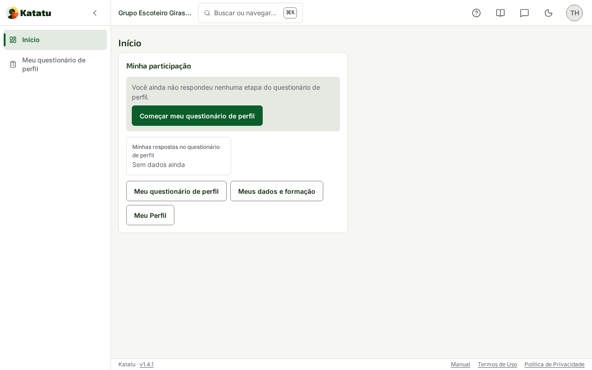
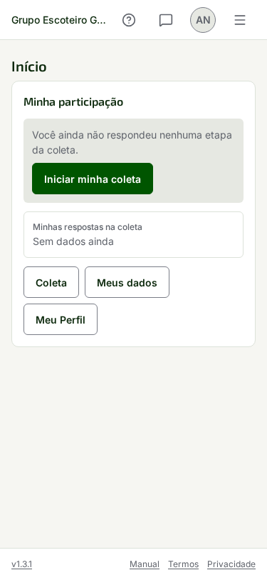

**Dica:** se você tem mais de um questionário, todos aparecem na página **Questionários de perfil**, cada um com o nome e a área. Abra o que você reconhece.

**Armadilha:** se você não vê nenhum questionário, não é defeito. A organização precisa chamar você. Se ela ainda não aceitou o seu convite, o questionário aparece depois que você entrar.

## 5. Responder ao questionário de perfil

**Por que isto importa:** o questionário é o que a organização conhece de você além do nome. Você pode parar a qualquer momento e voltar depois: o que já respondeu fica salvo. Responder com sinceridade é o que deixa o retrato útil para você e para quem decide.

O questionário tem três partes: a **trajetória**, as **perguntas** e a **revisão**.

### Antes de começar

Em algumas organizações, a primeira tela do questionário é um aviso: "Nesta organização, a chefia direta no organograma pode ver o seu nome junto das suas respostas. As demais pessoas veem só dados consolidados." Leia com calma e toque em **Li o aviso e quero começar**.

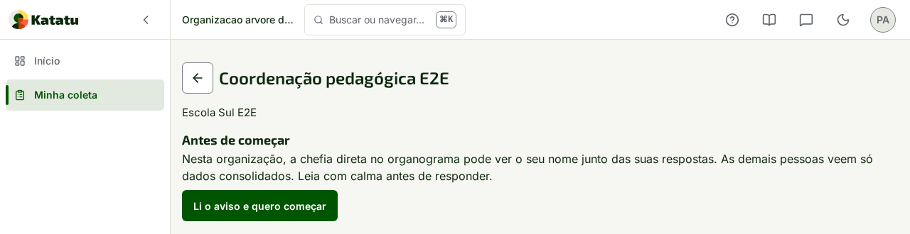
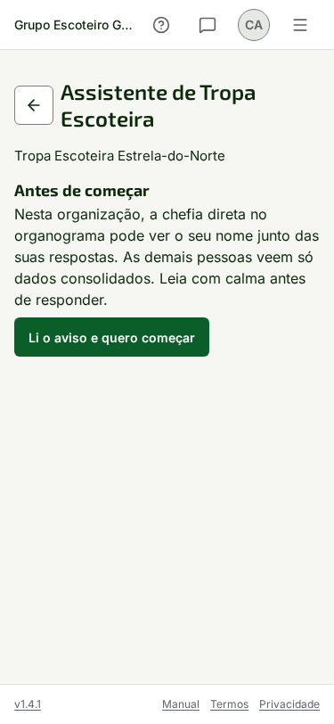

### Sua trajetória

Conte a sua trajetória no campo **Conte a sua trajetória**. Você pode:

- **escrever um texto corrido**, como uma apresentação: formação, cursos, o que já fez e onde;
- **escolher um arquivo**, com o botão **Escolher arquivo**: currículo em PDF com texto, Word (.docx), .txt ou .md, de até 10 MB;
- **colar um link** do seu perfil público e tocar em **Usar o link**.

Se você já tem a trajetória em **Meu Perfil › Trajetória**, ela aparece em **No seu perfil**, e você ajusta ali mesmo.

Depois, toque em **Ler o texto**. O app transforma o que você escreveu em itens, como formação e curso. Cada item traz dois botões: **Confirmar** (o item entra na sua trajetória) e **Descartar** (o item sai). Só o que você confirma vale.

Quando a inteligência artificial da organização não está disponível, a tela avisa que o trabalho manual segue normalmente. Nesse caso, escreva **uma informação por linha**, começando pelo tipo, por exemplo:

- `Formação: Licenciatura em Pedagogia — USP (2015)`
- `Curso: Mediação de conflitos — Escola X`

Depois toque em **Ler o texto** e confirme os itens reconhecidos. Se nada for reconhecido, a tela pede o formato das linhas.

**Exemplo.** Ana escreve duas linhas: "Formação: Licenciatura em Pedagogia — USP (2015)" e "Curso: Mediação de conflitos — Escola X". Toca em **Ler o texto**, confirma a formação e descarta o curso, porque ele já está no certificado que ela tem. A trajetória fica só com o que ela confirmou.

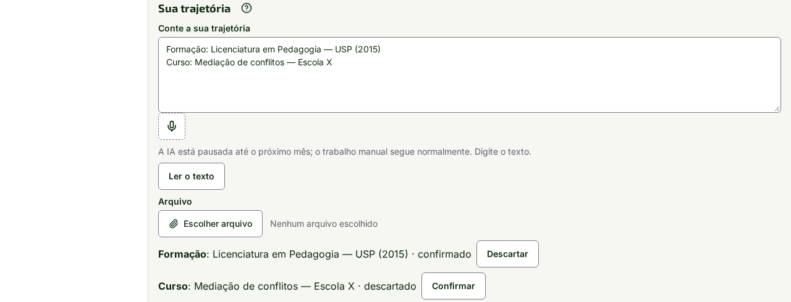

**Dica:** o currículo do Lattes ou do LinkedIn não é lido a partir do endereço da página. Abra o currículo no navegador, use **Imprimir › Salvar como PDF** e envie o arquivo.

**Armadilha:** não confirme um item só porque ele apareceu. Se a leitura trouxe uma data ou um nome errado, descarte e escreva a linha de novo.

**Armadilha:** um PDF escaneado, que é só imagem, não tem texto para ler, e é recusado. Gere o PDF pelo navegador, ou envie Word, .txt ou .md.

Quando terminar, toque em **Continuar para as perguntas**. Esse botão guarda o que estiver escrito.

### As perguntas

As perguntas são cartões, um de cada vez. Cada cartão tem o contador "Pergunta X de 8" e o botão **Confirmar e seguir** para salvar a resposta.

1. **Horas por semana.** No campo **Horas por semana que você pode dedicar**, escreva o número com vírgula para decimais, por exemplo `12,5`. O campo não aceita vazio: a tela pede o valor.
2. **Horários livres.** Escolha o **Dia**, o **Início** e o **Fim**. Use essa pergunta para um horário em que você realmente pode estar. Se tiver mais de um, acrescente outros.
3. **O que motiva você.** Escreva em poucas palavras, até 500 caracteres.
4. **O que você gosta de fazer.** Para cada grupo de atividades, escolha um grau: **Não é comigo**, **Um pouco**, **Bastante** ou **Muito**. A tela só segue quando todos os grupos têm uma escolha.
5. **Situações do dia a dia (4 perguntas).** Cada uma descreve um momento difícil e pede a sua reação mais próxima do que você faria de verdade. Escolha uma só.

Antes da pergunta de interesses, o questionário mostra o aviso **Antes de continuar**, explicando quem vê os seus interesses e as suas escolhas nas situações. Toque em **Entendi, continuar** para seguir.

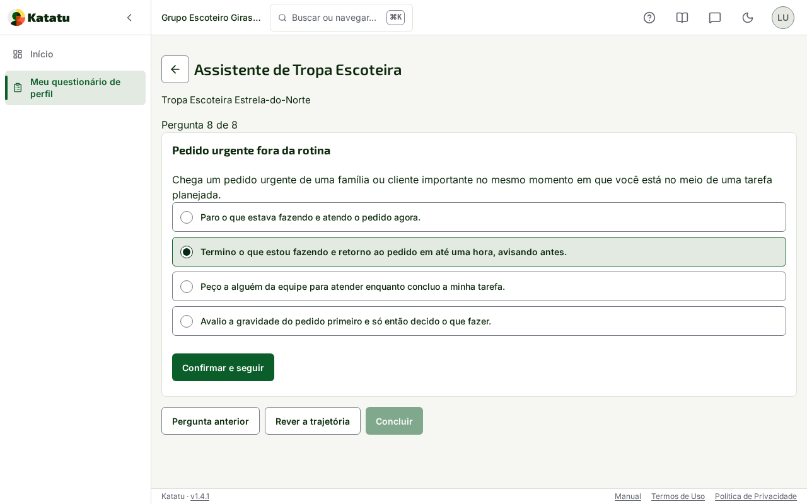

**Dica:** responda as situações como você age, não como acha que deveria agir. A resposta sincera é a única que ajuda a organização a encaixar você.

**Armadilha:** o campo de horas não aceita vazio. Se você tocar em **Confirmar e seguir** sem preencher, a tela mostra o erro na própria pergunta.

**Quando dá errado:** a tela aponta o problema no próprio cartão. Os mais comuns são: "horas" vazio, janela de horário sem dia ou sem início e fim, e grupo de interesse sem escolha. Corrija o campo indicado e toque em **Confirmar e seguir** de novo.

### Revisar e concluir

Depois da oitava pergunta, a tela diz "Todas as perguntas foram respondidas." Os botões são:

- **Pergunta anterior**: volta uma pergunta, para você rever a resposta;
- **Rever a trajetória**: volta à trajetória, para confirmar ou descartar itens;
- **Concluir**: encerra o questionário. Ele só fica ativo quando as 8 perguntas estão respondidas.

Ao tocar em **Concluir**, o app pergunta **Concluir o questionário de perfil?**. Depois de concluir, as suas respostas **não podem mais ser mudadas**. Confirme só quando estiver tudo certo.

**Armadilha:** essa confirmação é o último momento em que você muda uma resposta.

### Depois de concluir

O app mostra **Camada 1 concluída** e o seu **Seu Retrato de Atuação**. O Retrato é montado só com as suas respostas, sem nota e sem comparação com outras pessoas. Você pode baixá-lo em PDF pelo botão **Baixar PDF**.

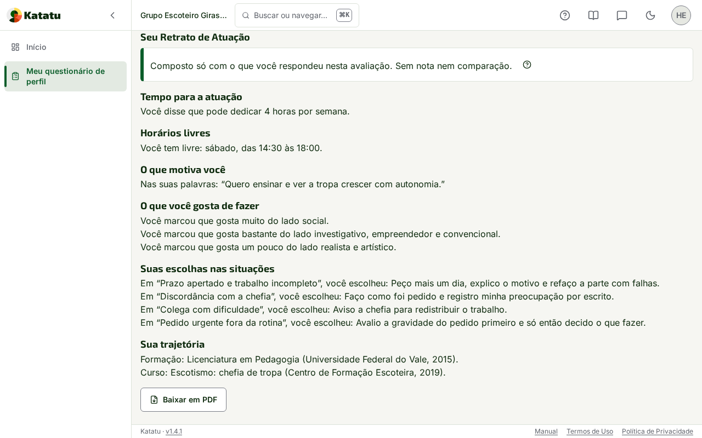
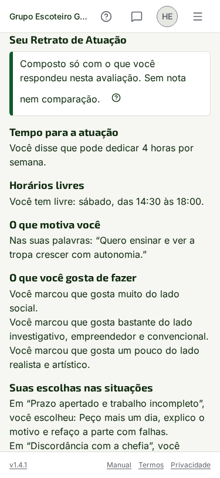

Quem vê o quê:

- **O Retrato é só seu.** Nem a gestão nem quem conduziu a conversa têm acesso. Ele não vai para os seus dados e a sua formação.
- **O gestor imediato** recebe só o aviso de que você concluiu o questionário, sem as respostas.
- **Quem decide sobre o cargo** vê os seus interesses e as suas escolhas nas situações, como o aviso antes das perguntas mostrou.

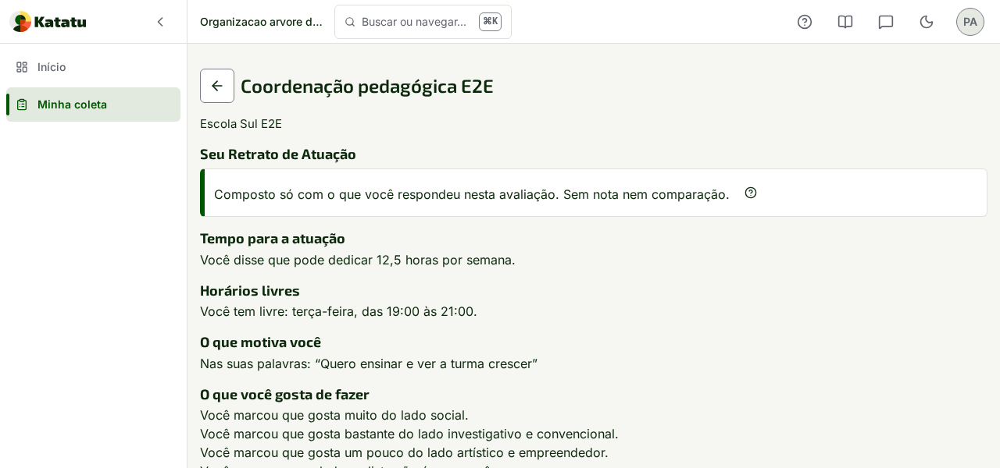

## 6. Meu Perfil: sua trajetória e seus dados

**Por que isto importa:** a sua trajetória é sua, não do questionário. Ela fica em **Meu Perfil**, e você atualiza quando quiser: as pessoas fazem cursos, mudam de trabalho e aprendem. O questionário usa o que está ali. Cada questionário concluído guarda uma foto do que estava na trajetória naquele dia, e mudar depois não altera o que já foi concluído.

**Onde fica:** no menu, **Meu Perfil**. As abas são **Meus dados e formação**, **Trajetória**, **Conta** e **Outras posições**.

### 6.1 A aba Trajetória

- **Minha trajetória:** formação, experiência, cursos e certificados, que você acrescenta, corrige e apaga a qualquer momento.
- **Currículo:** guarde o seu currículo uma vez (PDF com texto, Word .docx, .txt ou .md, até 10 MB) e troque, baixe ou apague quando quiser. O Katatu lê o arquivo inteiro e mostra o que você ainda não tem na trajetória, para confirmar ou descartar. O que já está lá não se repete.
- **Certificados:** em cada certificado você guarda o tipo, o título, a instituição, a carga horária, a data de conclusão e o arquivo, em PDF ou imagem de até 5 MB.

**Privacidade:** o seu currículo é só seu. Nenhuma organização vê o arquivo, nem com o vínculo ativo.

**Dica:** revise sempre os itens marcados como **A confirmar** logo depois do envio do currículo. Datas e cargas horárias precisam estar certas.

**Armadilha:** arquivos `.doc` (Word antigo) não são lidos. No Word, use **Salvar como** › `.docx` ou PDF.

**Apagar:** apagar um item também apaga o arquivo do certificado, na hora. Não existe lixeira para isso.

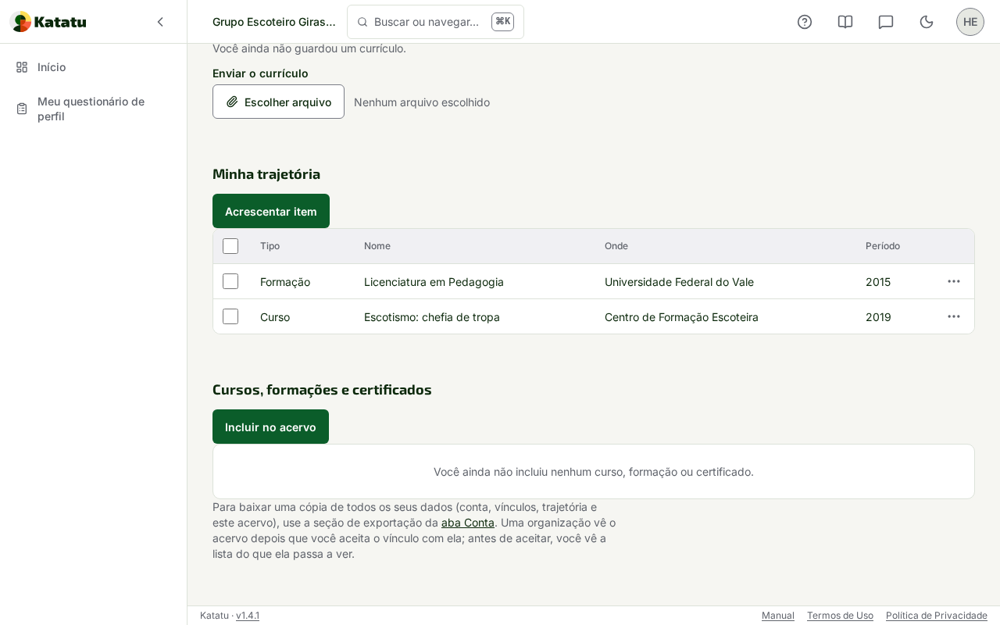
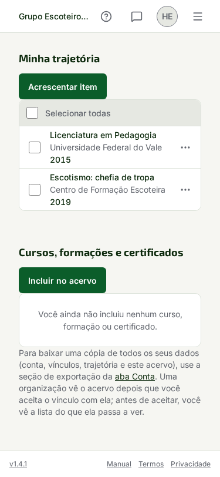

### 6.2 Trocar o e-mail de acesso

Se o seu e-mail mudou, troque o endereço de entrada em **Meu Perfil › Conta**, na seção **E-mail de acesso**. A troca só vale quando você prova que tem acesso ao e-mail de hoje e ao novo. Por isso, são dois passos:

1. **Peça a troca.** Digite o e-mail novo e toque em **Enviar link ao e-mail atual**. O app pede a confirmação do segundo passo (o código do aplicativo autenticador, a passkey ou o código por e-mail). Um e-mail com um link chega ao seu e-mail **de hoje**, nunca ao novo.
2. **Abra o link e digite o código.** Na página do link, toque em **Enviar código ao novo e-mail**. Um código de 6 dígitos chega ao novo e-mail. Digite o código e toque em **Confirmar a troca**.

**Quando vale:** a partir da confirmação, você entra com o e-mail novo, e o antigo deixa de entrar. As suas organizações, os seus papéis e os seus dados e a sua formação ficam como estavam. Os outros aparelhos em que você estava entrando são desconectados.

**Se não foi você quem pediu:** ignore o e-mail com o link. O pedido vence sozinho em 48 horas e nada muda.

**Armadilha:** o código vale 15 minutos. Cinco códigos errados cancelam o pedido, e você precisa pedir a troca outra vez.

**Se você perdeu o acesso ao e-mail antigo:** sem ele, não há como abrir o link. Peça à administração da organização para trocar o seu e-mail de acesso. Se você participa de mais de uma organização, a administração orienta a procurar o suporte da plataforma.

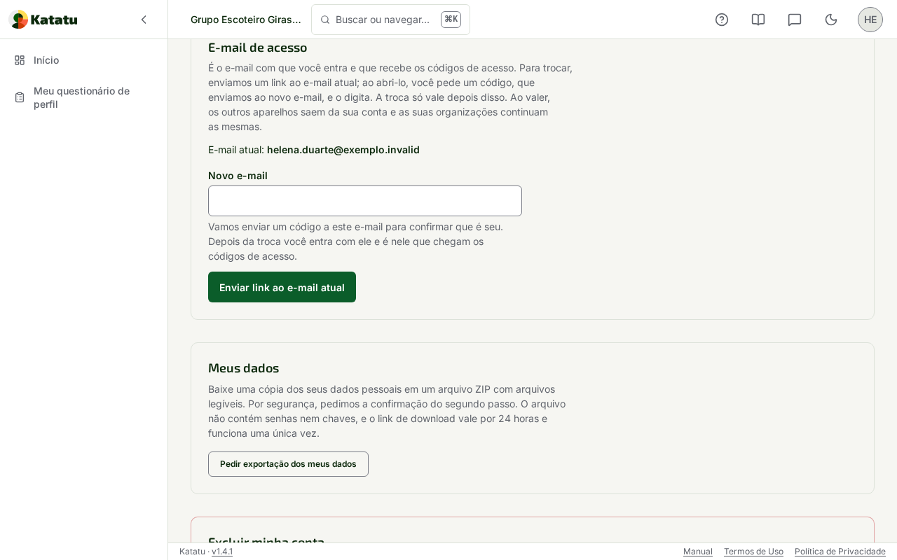
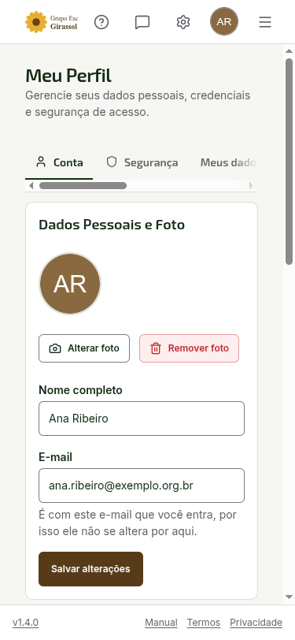

## 7. Instalar o app e a faixa de nova versão

**Instalar o app.** O Katatu pode ser instalado como um aplicativo, com ícone próprio e janela própria, para abrir mais rápido. O botão **Instalar app** só aparece quando o seu navegador oferece a instalação, e some depois de instalado:

- **No computador e no Android:** no topo da tela, toque em **Instalar app** (em telas estreitas, abra o menu da sua foto e toque em **Instalar aplicativo**) e confirme na janela do navegador.
- **No iPhone e no iPad:** o navegador não oferece o botão. Abra o menu da sua foto, toque em **Instalar aplicativo** e siga a instrução: **Toque em Compartilhar e depois em Adicionar à Tela de Início**.
- Se nenhum dos dois botões aparece, o seu navegador não oferece a instalação, ou o app já está instalado. O Katatu funciona normalmente no navegador.

**A faixa "Nova versão disponível".** Quando o Katatu é atualizado, uma faixa colorida aparece na parte de baixo da tela, com o botão **Atualizar**. Toque em **Atualizar** para carregar a versão nova.

**Antes de atualizar**, termine e salve o que estiver escrevendo: a página recarrega, e o que não foi salvo se perde.

**Dica:** se você ignorar a faixa, o app continua funcionando na versão antiga até a próxima vez que a página for recarregada.

## 8. Enviar um relato ou sugestão

Toque em **Feedback**, no topo da tela. Se você não consegue passar da tela de entrada, use **Problemas para entrar? Envie um feedback**, no canto inferior esquerdo.

1. Escolha a categoria: **Sugestão**, **Problema**, **Elogio**, **Depoimento** ou **Outro**.
2. Escreva o relato: em qual tela você estava, o que fez e o que esperava que acontecesse.
3. Se quiser anexar arquivos, escolha até 3, com no máximo 10 MB cada.
4. Se estiver fora do sistema, informe o seu e-mail, para receber a resposta.
5. Toque em **Enviar feedback**.

**Dica:** prefira captura de tela a PDF. O PDF guarda o nome do autor e as datas, e você não consegue recolher esses dados depois do envio.

**Armadilha:** anexe só o trecho que mostra o problema. Um documento com CPF ou dados de outras pessoas vai para a equipe de suporte.

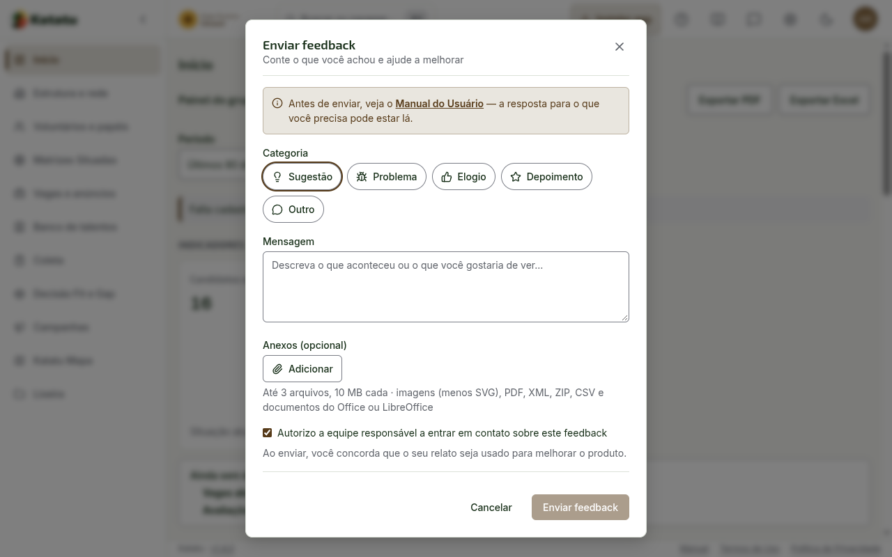
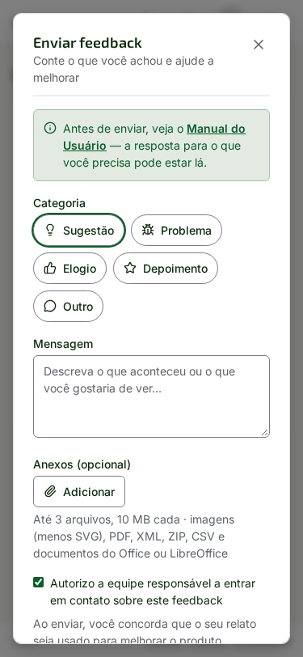

## Perguntas frequentes

**O código não chegou. O que faço?**
Veja primeiro a pasta de spam ou lixo eletrônico e aguarde alguns minutos. Depois, toque em **Usar outro e-mail**, digite o mesmo endereço e toque em **Receber o código** de novo. Se a tela disser que você pediu códigos demais, espere alguns minutos. Se nada chegar, peça à organização que reenvie o convite.

**Entrei com outro e-mail. Como corrijo?**
O convite vale só para o e-mail que a organização cadastrou. Saia da conta pelo menu do seu nome, no canto superior direito, e entre de novo com o endereço certo. Se você não sabe qual e-mail ela cadastrou, pergunte a ela.

**Errei uma resposta antes de concluir. Consigo mudar?**
Consegue, enquanto não tocar em **Concluir**. Use **Pergunta anterior** ou **Rever a trajetória**, mude a resposta e toque em **Confirmar e seguir** no cartão. Depois de concluir, não há como mudar.

**Não vejo nenhum questionário de perfil. É problema?**
Não necessariamente. O questionário aparece quando a organização chama você. Se ela ainda não aceitou o seu convite, ou não chamou você, a lista fica vazia.

Mais respostas estão nas [Perguntas Frequentes](/9-perguntas-frequentes/) e na [página de Avaliado ou Colaborador](/1-avaliado-colaborador/).

## Glossário

- **Questionário de perfil**: o conjunto de perguntas que você responde no app para a organização.
- **Trajetória**: o que você já fez em formação, cursos e experiências, do jeito que você conta.
- **Retrato de Atuação**: o texto que o app monta com as suas respostas. Só você lê.
- **Código de acesso**: os 6 dígitos que chegam por e-mail. O código do convite vale por 60 minutos.
- **Meus dados e formação**: a aba do **Meu Perfil** com os seus dados pessoais e os seus certificados. A aba **Trajetória** fica ao lado dela.
