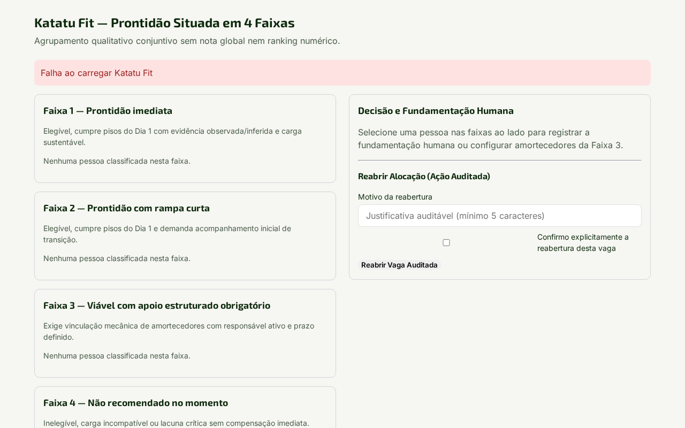
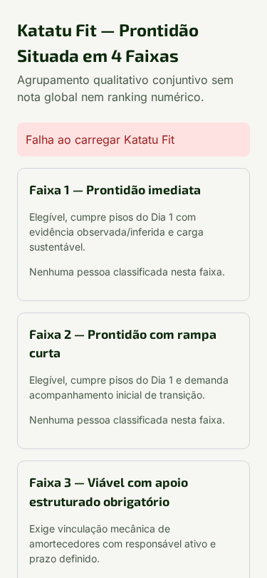
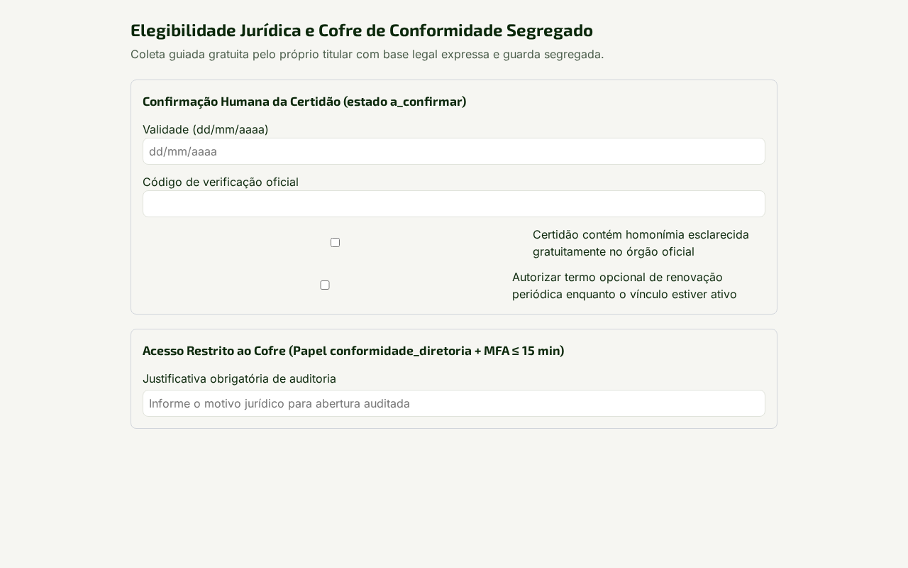
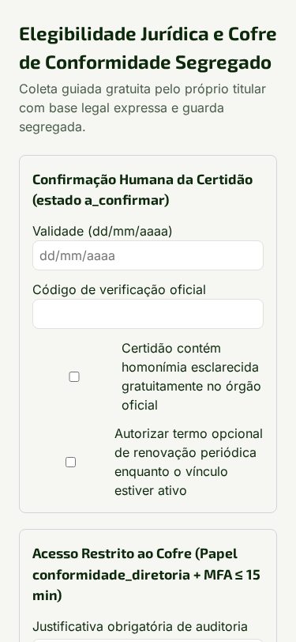
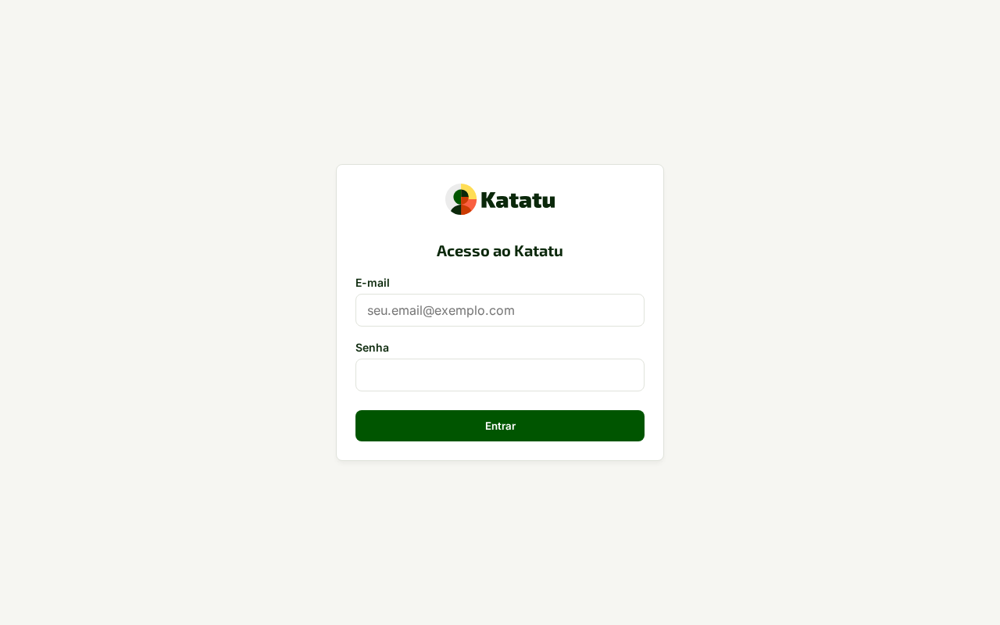
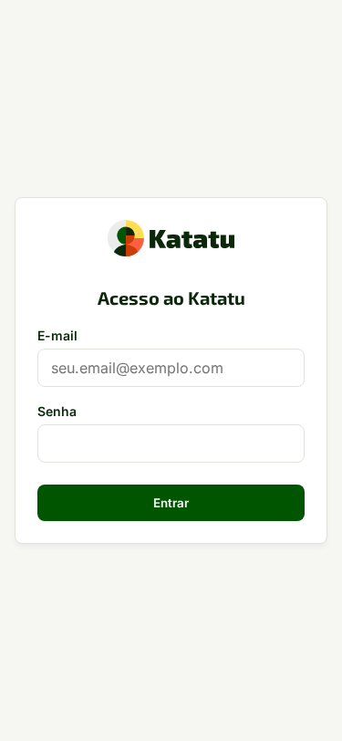

# Manual do Usuário — Katatu

Bem-vindo ao guia operacional oficial do **Katatu** (`https://app.katatu.com.br`), a plataforma da V3RTECH para desenho situado de funções, avaliação determinística de aderência (*Katatu Fit*), plano vivo de compensação dos primeiros 90 dias (*Katatu Gap*), governança de certidões legais (*Cofre de Conformidade*) e leitura de sucessão e riscos estruturais (*Katatu Mapa*).

---

## Como usar este manual (entrada rápida por dúvida)

- **Acabei de receber um link de convite por e-mail ou WhatsApp:** veja [1. Entrar por convite e gerir sua Carteira Pessoal](#1-avaliado-ou-colaborador--entrar-por-convite-coleta-e-carteira-pessoal).
- **Preciso desenhar uma vaga ou posição existente nos 4 eixos situados:** veja [2. Construir a Matriz Situada e coletar múltiplas perspectivas](#2-gestor-ou-recrutador--matriz-situada-coleta-e-decisão-katatu-fit-e-gap).
- **Preciso decidir uma alocação na Faixa 3 com amortecedores obrigatórios:** veja [2.3 Como aprovar posse na Faixa 3 com amortecedores](#23-aprovar-posse-na-faixa-3-e-gerar-o-katatu-gap).
- **Minha organização exige certidão legal (ECA Art. 59-A ou TST):** veja [3. Operar o Cofre de Conformidade com base legal prévia](#3-conformidade-e-diretoria--cofre-de-conformidade-segregado).
- **Sou consultoria de RH atendendo várias empresas-clientes:** veja [4. Modo Consultoria e Passagem de Bastão Assinada](#4-consultoria-de-rh--carteiras-de-clientes-e-passagem-de-bastão).
- **Preciso configurar organograma, filiais, chaves de IA (BYOK) ou retenção LGPD:** veja [5. Administrador da Organização — Estrutura, IA e Governança LGPD](#5-administrador-da-organização--estrutura-ia-e-governança-lgpd).
- **Preciso gerir licenças `V3RLicense`, cópias cifradas externas ou ensaio de restauração:** veja [6. Administrador do Serviço — Licenças, Cópias Cifradas e Manutenção](#6-administrador-do-serviço--licenças-cópias-cifradas-e-manutenção).
- **Quero enviar um relato, uma sugestão ou anexar um arquivo ao feedback:** veja [Enviar um relato ou sugestão, com anexos](#enviar-um-relato-ou-sugestão-com-anexos).

---

## 1. Avaliado ou Colaborador — Entrar por convite, Coleta e Carteira Pessoal

### Por que isto importa

No Katatu, você não perde tempo criando login e senha antes de participar de um mapeamento ou processo seletivo: o link do convite abre sua sessão imediatamente. Mais importante: **os certificados e cursos da sua Carteira Pessoal pertencem a você**. Quando você participa de processos em duas organizações diferentes (por exemplo, Organização A e Organização B), nenhuma delas enxerga o que você enviou para a outra até que você autorize explicitamente item por item.

### Passo a passo

1. Abra o link recebido no formato `/c/<token>` no celular ou computador. A sessão inicia automaticamente sem exigir cadastro prévio de senha.
2. Na etapa **Camada 0 (Qualificação e Currículo)**, envie seu currículo (`PDF`, `DOCX` ou imagem) ou informe o link público do seu perfil.
   - Tudo o que o assistente extrair do seu arquivo aparece destacado com o selo **A confirmar**. Revise cada linha antes de tocar em **Confirmar dados**.
3. Na etapa de **Conversa Situacional e Entrevista (Camadas 1 e 2)**, responda digitando ou usando o botão **Gravar resposta por voz**.
   - Ao usar voz, o áudio é transcrito na hora em memória temporária e **descartado imediatamente**: você sempre revisa e edita o texto transcrito na tela antes de tocar em **Salvar resposta**.
4. Ao concluir a coleta, acesse **Meu Retrato de Atuação** para consultar e exportar em `PDF` sua devolutiva construtiva (pontos de força observados e recomendações práticas de desenvolvimento, sem rótulos de "aprovado/reprovado" nem comparação com terceiros).
5. Para guardar sua conta para usos futuros, acesse **Carteira Pessoal > Promover conta**, defina seu e-mail/senha ou vincule sua conta Google.

### Exemplo concreto

**Marina Alves** recebe o convite para a posição de *Coordenadora Pedagógica* na **Rede Educacional Horizonte**. Ela abre o link no celular (`375px`), envia seu certificado de pós-graduação em Gestão Escolar (`PDF`) e grava por voz o relato de como conduziu uma mediação com famílias num conselho de classe crítico. O texto transcrito aparece na caixa de revisão; ela corrige a sigla de um projeto e toca em **Salvar resposta**. Mais tarde, convidada pela **Consultoria Prisma**, seu certificado aparece em **Quarentena de compartilhamento**: ela decide com 1 clique se deseja ou não compartilhá-lo com a segunda organização.

### Dicas e armadilhas

- **O que funciona bem:** revisar sempre os itens marcados como **A confirmar** logo após o upload do currículo — isso garante que datas no formato brasileiro (`dd/mm/aaaa`) e cargas horárias entrem exatas no abatimento do seu plano de 90 dias.
- **O que evitar (e a consequência):** não cole link de perfil fechado (como página do LinkedIn que exige login) esperando importação automática. O Katatu não usa robôs furtivos nem credenciais alheias; quando o link é fechado, o sistema exibe o aviso amigável para que você envie o PDF exportado do perfil ou preencha os campos manualmente.
- **Proteção contra convite indevido:** recebeu um e-mail de convite que não reconhece? Toque em **Não reconheço este convite**. A organização remetente fica bloqueada por **30 dias** de enviar novos convites para o seu endereço.

### Quando dá errado

| Mensagem na tela | O que significa | O que fazer |
| :--- | :--- | :--- |
| `link_fechado_requer_arquivo` | O endereço informado exige login ou bloqueia leitura pública. | Exporte o perfil em PDF (no LinkedIn: *Mais > Salvar como PDF*) e envie o arquivo, ou preencha manualmente. |
| `Serviço de transcrição temporariamente indisponível (503)` | A franquia ou provedor externo de IA não respondeu no tempo limite. | O campo de texto permanece aberto: digite sua resposta diretamente sem perder o rascunho. |
| `Convite expirado ou já utilizado` | O token do link atingiu a data de validade ou foi revogado pelo gestor. | Solicite um novo link de convite ao recrutador ou gestor da unidade. |

### Limites do papel

O avaliado/colaborador enxerga exclusivamente seus próprios dados, sua Carteira Pessoal, seu *Retrato de Atuação* e seu próprio plano *Katatu Gap*. Ele nunca vê outros candidatos, notas de corte internas nem o painel comparativo *Katatu Fit*.

---

## 2. Gestor ou Recrutador — Matriz Situada, Coleta e Decisão (*Katatu Fit* e *Gap*)

### Por que isto importa

Avaliações tradicionais falham porque usam descrições genéricas de cargo ("boa comunicação", "proatividade") e tiram uma média que esconde lacunas graves. No Katatu, você desenha a **Matriz Situada da Função** nos **4 eixos reais de trabalho** e define dois marcos separados para cada competência (`0` a `3`): o **Piso (Dia 1)** — abaixo do qual a pessoa não consegue operar com segurança no primeiro dia — e o **Pleno (Dia 90)** — o patamar esperado após três meses com suporte. O motor *Katatu Fit* é **100% determinístico**: nenhum desvio abaixo do piso é mascarado por nota alta em outra competência.

### 2.1 Construir a Matriz Situada nos 4 eixos e coletar perspectivas

1. No menu da organização, abra **Matrizes Situadas** e clique em **Nova Matriz Situada**.
2. Escolha o modo de operação:
   - **Modo A (Vaga aberta / Seleção):** para contratação externa ou mobilidade interna.
   - **Modo B (Posição ocupada / Exercício):** para mapear quem já atua na função.
3. Preencha os **4 eixos situados obrigatórios**:
   - **Eixo 1 — Autonomia imediata no Dia 1 vs. o que aguarda até 90 dias;**
   - **Eixo 2 — Incidentes críticos reais da função;**
   - **Eixo 3 — Densidade relacional e ambiguidade do ambiente;**
   - **Eixo 4 — Carga semanal realista, picos sazonais e janelas fixas.**
4. Para calibrar a matriz sem viés de uma única pessoa, clique em **Convidar perspectiva** (`/p/<token>`) e envie o link para pares, ocupantes atuais ou especialistas responderem em até 10 minutos no celular ou desktop.
5. Defina para cada competência o **Piso (`0..3`)**, o **Pleno (`0..3`)**, os critérios de **Elegibilidade** (`atendido`, `compensavel` ou `impedido`) e os **Amortecedores disponíveis** na equipe (dupla titularidade nos primeiros 30 dias, mentoria semanal, alçada assistida).

### 2.2 Analisar o *Katatu Fit* (4 Faixas Conjuntivas)

Abra **Decisão > Katatu Fit** na vaga desejada. O motor classifica cada pessoa de forma determinística em uma das quatro faixas:

- **Faixa 1 — Prontidão Plena:** zero competências abaixo do Piso (`delta_piso < 0`), maioria das competências já no nível Pleno (`delta_pleno >= 0`), estilo convergente e viabilidade de carga sustentável.
- **Faixa 2 — Prontidão de Piso com Trilha de 90 Dias:** zero competências abaixo do Piso (`delta_piso < 0`), mas com competências ainda entre o Piso e o Pleno (`delta_pleno < 0`), que viram itens de desenvolvimento no *Katatu Gap*.
- **Faixa 3 — Alocação Condicionada a Amortecedores:** possui desvio abaixo do Piso (`delta_piso < 0`) ou carga limítrofe, **exigindo amortecedor formal, responsável nominal e prazo** para cada lacuna antes da posse.
- **Faixa 4 — Impedimento Objetivo no Momento:** requisito inegociável de elegibilidade no estado `impedido` ou carga `incompativel`.

### 2.3 Aprovar posse na Faixa 3 e gerar o *Katatu Gap*

1. Na mesa de decisão do *Katatu Fit*, selecione o avaliado e clique em **Converter em Posse e Gerar Katatu Gap**.
2. **Trava mecânica da Faixa 3:** se o avaliado estiver na **Faixa 3**, o botão exige que, para **cada** competência com `delta_piso < 0`, você vincule:
   - O **amortecedor organizacional** (ex.: *Revisão em par das entregas críticas nas primeiras 4 semanas*);
   - O **responsável nominal** pelo acompanhamento;
   - O **prazo de verificação** dentro da janela de 90 dias.
3. Caso o avaliado possua cursos na **Carteira Pessoal** que cubram itens da trilha sugerida, marque ou aceite as equivalências individualmente ou em lote pela `ListaComAcoes`.
4. Confirmada a posse, o registro transita imediatamente do **Modo A (Seleção)** para o **Modo B (Acompanhamento de 90 Dias)** e habilita o registro de notas semanais de evolução (`declarado -> observado`) e o **Balanço de 90 Dias**.

### Quando dá errado

| Mensagem na tela | O que significa | O que fazer |
| :--- | :--- | :--- |
| `422 amortecedor_obrigatorio_pendente` | Tentativa de dar posse a uma pessoa na Faixa 3 sem preencher amortecedor, responsável e prazo para cada item abaixo do Piso. | Preencha os três campos obrigatórios em todas as lacunas listadas antes de confirmar a posse. |
| `402 licenca_expirada_novos_ciclos_bloqueados` | A licença da instalação venceu após os 14 dias de carência. | Vagas abertas, *Katatu Gap*, *Mapa* e exportações continuam funcionando; peça ao `admin_servico` para renovar a chave `V3RLicense`. |

---

## 3. Conformidade e Diretoria — Cofre de Conformidade Segregado

### Por que isto importa

Certidões de antecedentes ou certidões judiciais nunca podem ser pedidas de forma indiscriminada nem misturadas ao perfil comportamental do candidato. No Katatu, o **Cofre de Conformidade** vive num schema físico segregado (`cofre_conformidade`), acessível exclusivamente por conexão própria do banco e restrito ao papel `conformidade_diretoria` com **MFA TOTP obrigatório**. Toda leitura exige justificativa e grava rastro imutável em `auditoria.acessos_cofre`.

### Passo a passo

1. Antes de habilitar a exigência na vaga, selecione a **Base Legal Prévia** aplicável:
   - `ECA_ART_59A` — funções com contato habitual com crianças e adolescentes (Estatuto da Criança e do Adolescente, Art. 59-A);
   - `TST_JURISPRUDENCIA_ATIVIDADE_SENSIVEL` — funções com fidúcia especial ou guarda de valores/armas amparadas pela jurisprudência do TST.
2. Defina o regime de guarda:
   - **Apenas verificação (`apenas_verificacao`):** registra somente o status de conferência, validade e hash, descartando o PDF imediatamente após a validação;
   - **Guarda de PDF (`exige_guarda_pdf`):** retém o documento cifrado no Cofre durante a vigência legal.
3. Na etapa de pré-posse ou renovação periódica, o candidato segue o guia passo a passo de emissão (Polícia Federal e Justiças Estaduais). A leitura assistida extrai validade e código de autenticação sempre como **A confirmar** e dispara **Alerta de Homonímia** quando o nome exige conferência de filiação/CPF antes de qualquer conclusão.
4. No desligamento do colaborador, o termo opcional de lembrete de renovação é revogado imediatamente e certidões vencidas são eliminadas pela rotina diária.

### Limites do papel

Recrutadores, gestores de unidade e `apoiadores_delegados` recebem **`403 Acesso negado`** se tentarem ler qualquer rota do Cofre de Conformidade: eles visualizam apenas o indicador binário de prontidão documental para posse, sem jamais ver o teor da certidão.

---

## 4. Consultoria de RH — Carteiras de Clientes e Passagem de Bastão

### Por que isto importa

Consultorias de RH operam dezenas de processos simultâneos para empresas-clientes distintas, muitas vezes com vagas confidenciais. O Katatu isola cada carteira por `empresa_cliente_id`, permite que o gestor da empresa contratante (`cliente_aprovador`) aprove o briefing e veja apenas a *shortlist* liberada (`liberado_shortlist = true`), e entrega ao final uma **Passagem de Bastão Assinada** (`HMAC-SHA256`) que transfere a Matriz Situada e o *Katatu Gap* direto para a conta da empresa contratante começar os 90 dias sem perder histórico.

### Passo a passo

1. Em **Estrutura > Empresas-Clientes**, cadastre a empresa contratante ou marque a vaga como **Confidencial** (ocultando o nome real da contratante nos anúncios públicos).
2. Convide o gestor da empresa contratante com o papel **`cliente_aprovador`**: ele acessa apenas a validação do briefing, os candidatos marcados com **Liberado na shortlist** no *Katatu Fit* e o plano *Katatu Gap* do contratado.
3. Para incluir um candidato no **Banco de Talentos da Consultoria**, colete o consentimento específico e separado do candidato (distinto da inscrição na vaga única).
4. Concluída a contratação, clique em **Emitir Passagem de Bastão Assinada** e entregue ou aplique o pacote na organização contratante: a Matriz Situada e o *Katatu Gap* chegam íntegros e prontos para o acompanhamento dos primeiros 90 dias.

---

## 5. Administrador da Organização — Estrutura, IA e Governança LGPD

### Por que isto importa

Cada organização tem sua própria topologia (diretorias, regionais, filiais, escolas ou unidades operacionais), sua política de uso de inteligência artificial e seus prazos de retenção de dados pessoais. O Katatu permite desenhar níveis livres sem limite de profundidade, proteger equipes pequenas contra identificação indireta e operar 100% funcional mesmo sem IA ativada.

### Passo a passo

1. **Desenhar unidades e organograma (`Estrutura`):**
   - Crie unidades em qualquer profundidade (`unidades_fecho`) ou importe planilhas `CSV/XLSX` e imagens/PDFs de organograma pela **Ingestão Assistida** (tudo entra como **A confirmar**).
   - Configure o **Piso mínimo de agregação** (padrão: `3` ocupantes, mínimo irredutível: `2`): abaixo desse número, painéis agregados e campanhas 90º/180º/360º ocultam quebras nominais, incidentes críticos, amortecedores e nomes em Faixa 3.
2. **Configurar Assistência de IA e chaves próprias (`Assistência > Configuração e Consumo`):**
   - Escolha entre a franquia da assinatura V3RTECH, chaves próprias cifradas (**BYOK**: Google Gemini, OpenAI ou Anthropic Claude) ou modo **100% manual sem IA**.
   - Acompanhe o painel transparente de consumo filtrado por unidade, empresa-cliente, usuário e operação.
3. **Publicar vagas e integrar canais (`Divulgação`):**
   - Gere versões do *Perfil da Vaga* adaptadas aos 5 estilos e 5 canais (sempre sobre a projeção pública fechada que nunca vaza campos internos da Matriz Situada).
   - Ative o mural incorporável ou publique direto no **WordPress** via REST API nativa (`wp/v2`) com *Application Password*, sem instalar plugin no site.
4. **Governança LGPD e Retenção (`Governança LGPD`):**
   - Configure os prazos de retenção de candidaturas não selecionadas (padrão: 365 dias) e logs de auditoria.
   - Antes de ativar um novo prazo, clique em **Simular Retenção (Modo de Ensaio)** para visualizar exatamente quantos registros seriam avisados (30 e 7 dias antes) ou eliminados, sem apagar nenhum dado real.

---

## 6. Administrador do Serviço — Licenças, Cópias Cifradas e Manutenção

### Por que isto importa

Toda a operação crítica da plataforma — ativação do primeiro administrador, gestão de licenças `V3RLicense`, rotação do chaveiro criptográfico, envio de cópias de segurança cifradas para nuvem externa e ensaio de restauração — acontece **pela interface web**, sem nunca exigir SSH ou comandos de terminal no servidor.

### Passo a passo

1. **Inicialização única (`/inicializar`):** no primeiro acesso ao banco limpo, cadastre o primeiro `admin_servico`, escaneie o QR Code de pareamento **MFA TOTP (`RFC 6238`)**, confirme o código de 6 dígitos enviado por e-mail e guarde os 8 códigos de recuperação de uso único.
2. **Licenciamento (`Sistema > Licença V3RLicense`):** insira a chave assinada (`ed25519`). Em caso de falha de rede com o servidor de licenças, a instalação opera por 14 dias em carência; após o vencimento, apenas a criação de novas vagas e campanhas é bloqueada (`402`), mantendo leitura e exportações 100% liberadas.
3. **Cópias de segurança cifradas e Kit de Recuperação (`Sistema > Manutenção`):**
   - Antes de habilitar um destino externo (S3/R2, WebDAV, SFTP ou Google Drive), clique em **Baixar Kit de Recuperação Independente**, informe seu código MFA atual (*step-up*) e digite a frase de confirmação. O kit inclui o script autônomo de decifragem `AES-256-GCM + HMAC-SHA256`.
   - Para testar a integridade de uma cópia sem afetar os dados em produção, clique em **Executar Ensaio de Restauração**: o sistema valida a assinatura HMAC, decifra o snapshot em transação isolada de teste e exibe o certificado de integridade.
4. **Envios de feedback que não chegaram ao GitHub (`Início do serviço`):** a tela mostra quantos envios ficaram retidos. Toque em **Reenviar agora** para tentar na hora; o servidor também tenta sozinho. A tela não mostra o texto dos relatos: quem os lê é a issue no GitHub.

---

## Glossário do Katatu

- **Matriz Situada da Função:** especificação viva de uma vaga (Modo A) ou posição ocupada (Modo B) estruturada em 4 eixos de realidade operacional, substituindo descrições genéricas de cargo.
- **Piso (Dia 1) e Pleno (Dia 90):** os dois níveis separados de exigência (`0` a `3`) de cada competência. O Piso é o mínimo para operar com segurança no primeiro dia; o Pleno é o nível esperado ao final dos primeiros 90 dias.
- **Amortecedor Organizacional:** suporte concreto disponibilizado pela equipe (mentoria, dupla titularidade, revisão em par, alçada assistida) para compensar uma lacuna abaixo do Piso na Faixa 3.
- **Katatu Fit:** motor determinístico e auditável que avalia elegibilidade, desvios frente ao Piso e ao Pleno, sintonia de estilo e viabilidade de carga, classificando nas Faixas 1 a 4 sem média compensatória.
- **Katatu Gap:** plano vivo dos primeiros 90 dias gerado na posse, combinando amortecedores obrigatórios, trilha formativa e abatimento de cursos equivalentes da Carteira Pessoal.
- **Katatu Mapa:** visão organizacional contínua de cobertura de competências, prontidão de sucessão imediata, sucessão programada e alertas de sobrecarga estrutural.
- **Retrato de Atuação:** devolutiva individual privativa entregue a toda pessoa avaliada, focada em pontos de força e desenvolvimento, sem rótulos de aprovação/reprovação.

---

## Enviar um relato ou sugestão, com anexos

### Por que isto importa

Um relato que diz em qual tela você estava, o que fez e o que aconteceu permite à equipe achar o problema sem perguntar de novo. Antes de enviar, veja se o Manual já responde à sua dúvida: a caixa de envio tem um link para ele. O cuidado que mais importa aqui é com o anexo, porque arquivos carregam dados que você não vê, e tudo o que é enviado passa a ser da equipe de suporte.

### Passo a passo

1. Toque em **Feedback**, no topo da tela. Se você não consegue passar da tela de entrada, use **Problemas para entrar? Envie um feedback**, no canto inferior esquerdo.
2. Em **Categoria**, escolha **Sugestão**, **Problema**, **Elogio**, **Depoimento** ou **Dúvida**.
3. Escreva o relato no campo de descrição: em qual tela você estava, o que fez e o que esperava que acontecesse.
4. Se quiser anexar arquivos, toque em **Selecionar arquivos...** e escolha até 3, com no máximo 10 MB cada. São aceitos PNG, JPEG, WebP e PDF.
   - **Imagens (PNG, JPEG, WebP):** o Katatu remove sozinho a localização onde a foto foi tirada e outros dados escondidos antes de enviar. Você não precisa fazer nada.
   - **PDF:** o Katatu não consegue limpar os dados escondidos de um PDF. Ao anexá-lo, aparece uma caixa de confirmação de risco com este texto: "Este PDF pode conter dados pessoais escondidos (como nome do autor e datas) e será enviado à equipe de suporte. Se possível, envie uma captura de tela no lugar. Assumo a responsabilidade pelo envio." Leia e marque a caixa.
5. Se você estiver fora do sistema, informe o seu **e-mail**, para receber a resposta.
6. Toque em **Enviar Feedback**. Enquanto houver um PDF sem a caixa marcada, o botão fica desabilitado e nada é enviado.

### Exemplo concreto

**Marina Alves** não consegue passar da tela de entrada do convite pelo celular. Ela toca em **Problemas para entrar? Envie um feedback**, escolhe a categoria **Problema** e escreve: "Ao abrir o link pelo celular, a tela de entrada fica em branco." Anexa uma captura de tela dessa tela (PNG). A imagem sai sem a localização do celular. Como está fora do sistema, informa o e-mail e toca em **Enviar Feedback**. Se, em vez da captura, tivesse anexado o PDF do convite, teria de marcar a caixa de risco antes de o botão liberar.

### Dicas e armadilhas

- **Prefira captura de tela a PDF.** O PDF guarda o nome do autor, o programa usado e as datas, e nada disso aparece na tela. Uma captura mostra o mesmo conteúdo sem esses dados. Consequência de anexar o PDF inteiro: a equipe recebe esses dados junto com o seu relato, e não há como recolhê-los depois do envio.
- **Anexe só o trecho que mostra o problema.** Um documento com CPF, salário ou dados de outras pessoas vai para a equipe de suporte. Recorte a parte que importa.
- **Escreva o relato antes de anexar.** Um anexo sem texto não diz à equipe o que procurar.

### Quando dá errado

| Mensagem na tela | O que significa | O que fazer |
| :--- | :--- | :--- |
| `Máximo de 3 anexos permitidos.` | Você tentou anexar mais de três arquivos de uma vez. | Remova um arquivo e envie de novo. |
| `O arquivo "…" excede o tamanho máximo de 10 MB.` | O arquivo é grande demais. | Envie uma captura de tela, que costuma ser menor, ou recorte a parte que importa. |
| `Tipo de anexo não permitido` | O arquivo não é PNG, JPEG, WebP nem PDF. Arquivos de programa e de página da web não são aceitos. | Salve a imagem como PNG ou JPEG, ou envie só o texto. |
| `Anexos desabilitados em repositório público sem e-mail configurado` | Esta instalação do Katatu não aceita anexos no feedback. | Envie o relato só com texto. |
| Botão **Enviar Feedback** desabilitado | Há um PDF anexado e a caixa de confirmação de risco não está marcada. | Marque a caixa ou remova o PDF. |

### Limites do papel

Qualquer pessoa pode enviar feedback, dentro ou fora do sistema. O relato vai para a equipe de suporte. Quem administra o serviço vê apenas quantos envios não chegaram ao GitHub, sem o texto deles. Se você informou um e-mail, a resposta chega nele.

---

## Perguntas Frequentes (FAQ)

### 1. Por que uma pessoa com várias competências nível 3 ficou na Faixa 3 do *Katatu Fit*?
Porque o Katatu **não usa média compensatória**. Se uma competência essencial da função exige Piso `2` no Dia 1 e a evidência observada foi `1` (`delta_piso = -1`), uma nota máxima em outra competência não esconde essa lacuna. A pessoa entra na **Faixa 3**, indicando que ela pode assumir a função **desde que** a organização cadastre o amortecedor, o responsável e o prazo para cobrir aquela competência nos primeiros 90 dias.

### 2. O áudio que gravei na entrevista fica salvo no servidor da empresa?
**Não.** O Katatu segue a regra de **zero banco de voz**: o áudio existe apenas na memória volátil (RAM) durante os segundos necessários para gerar o rascunho de texto e é descartado imediatamente no bloco `finally`. Apenas o texto que você revisou e salvou na tela é armazenado.

### 3. Outra empresa que usa o Katatu consegue ver os certificados que subi na minha Carteira Pessoal?
**Não.** Todo certificado da sua Carteira Pessoal fica em quarentena por organização: a Organização B jamais toma conhecimento de documentos enviados na Organização A a menos que você autorize explicitamente o compartilhamento.

### 4. O que acontece se a chave de IA (BYOK) expirar ou a franquia acabar no meio de uma entrevista?
Nenhum fluxo trava. Todas as telas de estrutura, matriz situada, coleta e equivalência possuem modo manual imediato: se o provedor de IA retornar indisponibilidade (`503`), você preenche ou revisa os campos diretamente na tela sem perder dados.

### 5. O que acontece quando a licença `V3RLicense` da instalação expira?
Após os 14 dias de carência, a plataforma bloqueia **apenas** a abertura de novas vagas e novas campanhas (`402`). Todas as vagas já em andamento, planos *Katatu Gap* de 90 dias, *Katatu Mapa*, leituras e exportações (`PDF`, `XLSX`, `CSV` e portabilidade LGPD) continuam funcionando normalmente.

---

## Novidades da Versão 1.0

- **Lançamento da versão 1.0 do Katatu:** fluxo completo da estrutura organizacional em níveis livres à Matriz Situada nos 4 eixos, coleta conversacional com transcrição volátil de voz, motor determinístico *Katatu Fit* (Faixas 1 a 4), plano vivo *Katatu Gap* com trava de amortecedores na Faixa 3, Cofre de Conformidade segregado, modo consultoria com Passagem de Bastão Assinada, *Katatu Mapa* de sucessão e painel completo de manutenção com cópias externas cifradas e ensaio de restauração na tela.

---

## Privacidade, Termos de Uso e LGPD

Os termos de uso versionados, a política de privacidade e os controles de portabilidade, revogação de consentimento e autodissolução da conta estão disponíveis diretamente no painel **Governança LGPD e Privacidade** dentro da aplicação (`https://app.katatu.com.br`) e no documento de arquitetura de privacidade do projeto.
